# Exam 2 Preparation Materials

Based on the expierce gained from the first exam we know that exam 2 is likely a combination of problems from the previous exam as well as problems from Professor Lamp’s lecture notes.

Me must prepare for all questions that are either on the previous test (“exam 2” in the previous exams directory.) According to the professor our exam 2 will cover:

Chapters 6,7, 9, 10, 11.

The professor has provided the lecture notes and a previous exam. We should be able to solve any combination of problems from lecture notes as well as the previous exam in 15 question quantities in around 30-40 mintues, but must be under 50 minutes.

------------------------------------------------------------------------

# Conservation of Energy

Energy is the ability to do work. We measure energy in Joules (Which is Kg m^(2/s)2)

Work is the scalar result of the dot product of the force vector and displacement vector. It is a means of measuring energy transferred in a system.

The common way to see it is \\W = Fd\\ or \\W = \overrightarrow{F} \cdot \overrightarrow{d}\\

The common varibles tossed around for energy include Energy \\E\\, Potential Energy \\U\\, and Kinetic energy \\K\\.

Under the idea of conservation of energy:

\\E_i = E_f\\

Where \\E = U + K\\

Or

\\U_i + K_i = U_f + K_f\\

------------------------------------------------------------------------

## Kinetic Energy

Kinetic Energy is given from \\K=\frac{1}{2}mv^2\\

And *gravitational* potential energy is given as \\U = mgh\\

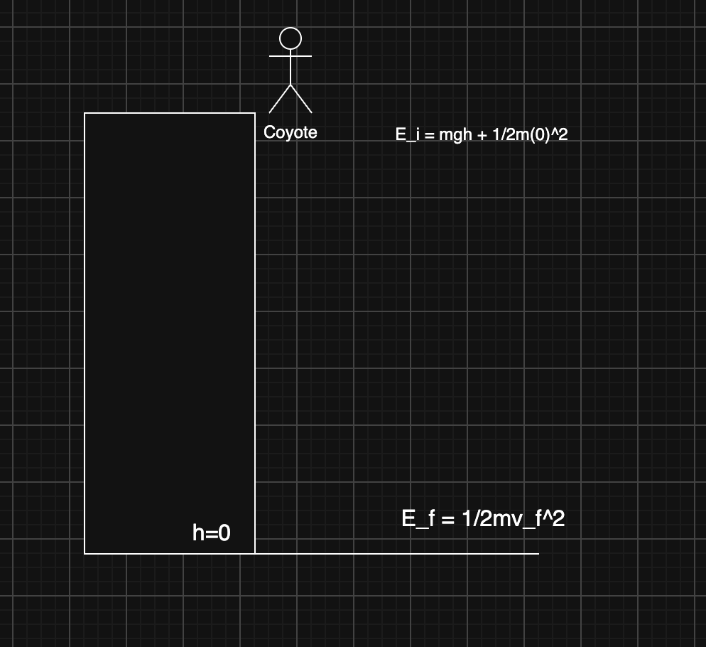

Example of Wile E. Coyote falling from a cliff

Consider again the example of Wile E. Coyote falling from a cliff.

His initial energy is only his gravitational potential energy since his initial velocity is 0.

\\E_i = mgh\\

\\E_f = \frac{1}{2}mv_f^2\\ is his final energy as all of his gravitational potential energy has been converted to kinetic energy throughout the fall.

Since there is no means of energy being lost \\E_i = E_f\\

\\v_f\\ therefore can be found by solving for it through:

\\ \newline mgh = \frac{1}{2}mv^2 \newline v_f = \sqrt{2gh} \\

------------------------------------------------------------------------

# Atwood’s Machine

Consider a pulley with two masses of varying weight on either side. Assuming the pulley is perfectly frictionless we can use the law of conservation of energy to determine the final velocity of either mass after some change in displacement.

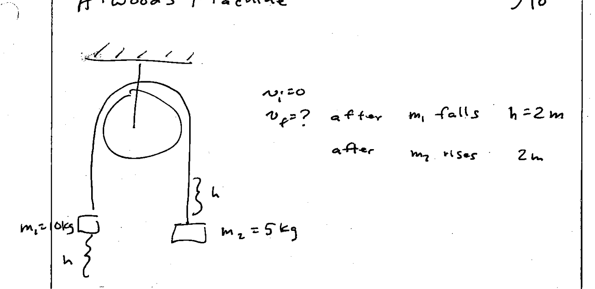

Example problem from lecture notes

In this problem we measure the height for \\m_1\\ and \\m_2\\ inversely. Meaning m_1 start from a position where it’s height is considered 2m. \\m_2\\ however starts from a height of 0m and finishes with a height of 2m.

This allows us to cancel out most terms in the initial energy equation.

\\ m_1gh = \frac{1}{2}m_1v_f^2 + \frac{1}{2}m_2v_f^2 + m_2gh \\

> **NOTE:**
>
> With the Atwood’s machine problem there is no difference between \\v_1f\\ and \\v_2f\\ as the two have are connected and therefore will exhibit inverse final velocities (One falls while on rises at the same velocity). Therefore it’s important only to distinguish the sign between the two objects.

Now based on the problem description we want to take the equation for energy conservation and we want to find our final velocity:

\\ \newline m_1gh = \frac{1}{2}m_1v_f^2 + \frac{1}{2}m_2v_f^2 + m_2gh \newline m_1gh = \frac{1}{2}(m_1+m_2)+m_2gh \newline (m_1-m_2)gh=\frac{1}{2}(m_1+m_2)v_f^2 \newline v_f = \sqrt{\frac{2gh(m_1-m_2)}{m_1+m_2}} \\

Plugging in our relevant variables:

\\ v_f = \sqrt{\frac{(2)(9.8)(2)(10-5)}{10+5}} \approx \pm 3.61 m/s \\

Recall that \\m_1\\ moves down so we should say that for \\m_1\\ our \\v_f\\ value is \\-3.61 \space m/s\\ and for \\m_2\\ who moves up our \\v_f\\ should be positive therefore \\3.61 \space m/s\\.

# Rollercoaster Problem

Using Conservation of Energy to Find Out The velocity of a rollercoaster at specific heights

Recall in the previous problem we determined that we can calculate an objects final velocity when gravity is the sole force acting upon it to create velocity.

In such a case we solved the Conservation of energy equation to find that

\\v_f = \sqrt{2gh}\\

This works when the object is simple and sliding (not rolling as that’s going to be a problem related to angular momentum).

But in the case of our roller coaster above we are sliding down the track and therefore we can calculate our speed at the given heights simply by considering gravitational potential energy:

\\ \newline mgh_1=\frac{1}{2}mv_f^2+mgh_2 \newline mg(h_1-h_2)=\frac{1}{2}mv_f^2 \newline 2g(h_1-h_2)=v_f^2 \newline v_f = \sqrt{2g(h_1-h_2)} \newline \\

Since energy is conserved in the system perfectly we know the velocity at any point on the track considering the roller coasters initial position.

Consider the velocity at point \\h_2\\ as \\v_2\\ and so on:

\\ v_2 = \sqrt{(2)(9.8)(100-20)} \approx 39.6 \space \text{m/s} \\

Likewise each other part of the track such as \\h_3\\ and \\h_4\\ can be calculated as such:

\\ \newline v_3 = \sqrt{(2)(9.8)(100-50)} \approx 31.3 \space \text{m/s} \newline v_4 = \sqrt{(2)(9.8(100-0))} \approx 44.3 \space \text{m/s} \newline \\

# Halfpipe

## Frictionless

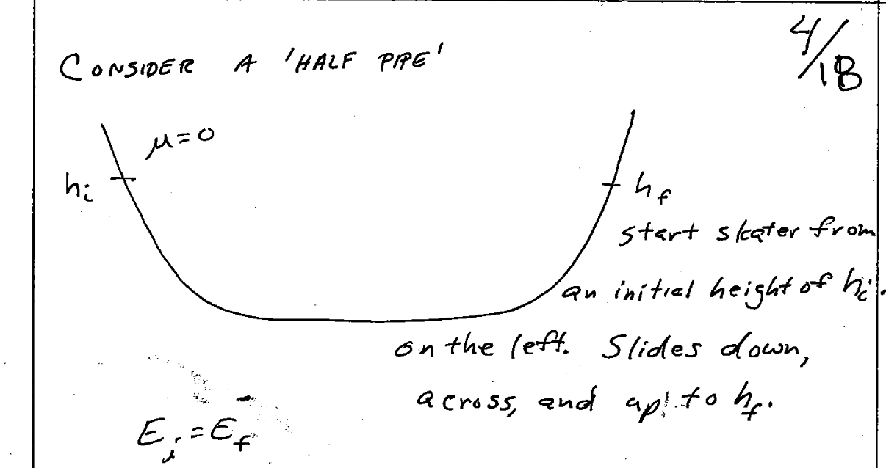

A problem related to a frictionless half-pipe

Much like the roller coaster and other problems we have imagined, in a half pipe our skater *slides* from one side of the half pipe to the other on a perfectly frictionless surface.

In such a case the \\E_i = E_f\\ as there is no mechanism for energy to be lost.

That means that at his initial height \\h_i\\ and with no initial velocity he exhibits the maximum potential energy via gravity.

\\U_i = mgh\\

Likewise, at the opposite side of the halfpipe his climb stops once all of his energy kinetically is equal to his initial potential energy.

That is to say, as the skater reaches the bottom of the halfpipe his height is 0, therefore all of his gravitational potential energy has been converted to kinetic energy.

Likewise, once the skater begins rising on the other side of the half pipe, his kinetic energy once again start becoming gravitational potential energy and eventually \\U_i = K_f\\ at \\h_f\\.

Since there is no mechanism for energy to be lost \\h_i = h_f\\ as the same gravitational potential energy is reconverted from kinetic energy on the opposite side of the half pipe:

\\U_i + K_i = U_f + K_f\\

Where \\K_i\\ and \\K_f\\ both equal zero therefore:

\\U_i = U_f\\ which if you’ll recall \\U_i=mgh_i\\ therefore, since mass and gravity are both constants, the height must be the same on both sides for \\U_i = U_f\\ to be true. So \\h_i = h_f\\

## With Friction

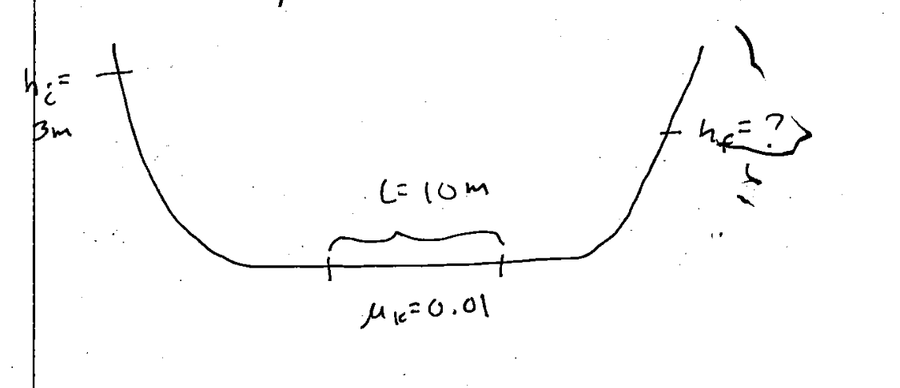

Same Halfpipe problem but with friction

Consider the same half-pipe but with a catch, in the middle there is a length \\L\\ of 10 meters in which we apply a kinetic friction of \\\mu_k = 0.01\\

### Work-Energy Theorem

This is similar to the conservation of energy which is \\E_i = E_f\\ except here we consider energy lost in the system:

\\E_i = E_f + E\_{lost}\\

With the frictionless halfpipe we learned that U_i = U_f, but when there is friction we know that:

\\ U_i = U_f + \mu_kmgL \\

Therefore \\h_i \ne h_f\\

We can solve for \\h_f\\ as such:

\\ \newline mgh_i = mgh_f + \mu_kmgL \newline \text{Divide both sides by mg to cancel them out} \newline h_i = h_f + \mu_kL \newline h_f = h_i - \mu_kL \newline h_f = 3-(0.01\*10)= 2.9 \space \text{m} \newline \\

In general Work-Energy theorem is \\E_i + E\_{added} = E_f + E\_{lost}\\

------------------------------------------------------------------------

# Mass Sliding Up An Incline

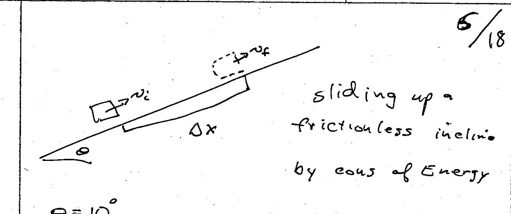

Mass sliding up frictionless incline

Consider a mass sliding up a frictionless incline with \\\theta=10^\circ\\, after a change in position of \\\Delta{x} = 3m\\ we want to know it’s final velocity \\v_f\\. We are assuming that it’s initial velocity is \\v_0 = 4\\ m/s

Again, we want to use the *Work Energy Theorem* here to determine it’s final velocity.

Remember that it’s \\E_i + E\_{added} = E_f + E\_{lost}\\

In our case we are not adding any energy to the system so therefore:

\\E_i = E_f + E\_{lost}\\

Our initial energy is our kinetic energy:

\\\frac{1}{2}mv_0^2\\

And our final energy is

\\\frac{1}{2}mv_f^2\\

And we lose energy to friction which is the force of gravity applied to our x component:

\\mg\Delta{x}\sin{\theta}\\

Therefore considering the work energy theorem we can actually find our final velocity by arranging that equation:

\\ \newline \frac{1}{2}mv_0^2=\frac{1}{2}mv_f^2+mg\Delta{s}\sin{\theta} \newline v_f = \sqrt{v_o^2-2g\Delta{x}\sin{\theta}} \newline v_f = \sqrt{4^2-(2)(9.8)(3)(0.174)} \approx 2.41 \space \text {m/s} \\

And recall that our object is moving to the right (which is our positive x-direction) therefore it’s \\v_f\\ is continuning to moving to the right (positive x-direction).

------------------------------------------------------------------------

# Mass Sliding Up An Incline With Friction

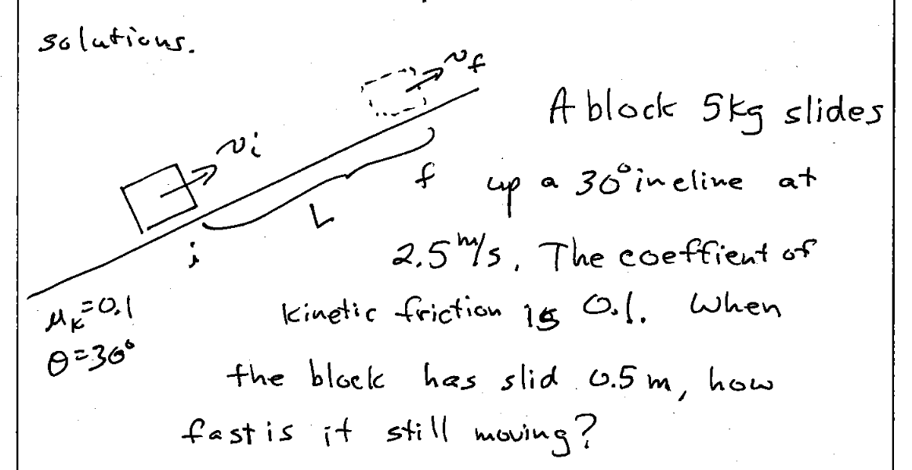

Problem description

In this problem we are effectively going to use conservation of energy as a means to determine where the block will end up as well as it’s speed.

Given \\\theta = 30^\circ\\, \\\mu_k = 0.1\\ and our \\\Delta{x}\\ or \\L\\ is 0.5 meters, and our initial velocity \\\v_0 = 2.5\\ m/s.

We know that \\E_i = E_f + E_lost\\ in this case because we lose energy to friction while no energy is added into the system.

We know that our starting height is considered zero on the plane, therefore on the initial energy side we do not repersent gravitational potential energy.

\\ \frac{1}{2}mv_0^2 = mgh + \frac{1}{2}mv_f^2+E\_{lost} \\

Our energy is lost is due to friction on an inclined plane which we can represent as \\\mu_k mg \cos{\theta}\\

Plugging that term in for \\E\_{lost}\\ gives us:

\\ \newline \frac{1}{2}mv_0^2 = mgh + \frac{1}{2}mv_f^2+ \mu_kmg\cos{\theta} \newline \\

Solving for \\V_f\\ yields:

\\ v_f = \sqrt{v_0^2-2gL(\sin{\theta}+\mu_k\cos{\theta})} \\

Plugging in our respective values from the above problem statement yields:

\\ \newline v_f \approx 0.708 m/s \newline \\

An important distinction to make during this problem is that when evaluating terms under the square root, if our terms combine to yield a negative number, that means the mass did not slide the required distance \\L\\ or \\\Delta{x}\\ and instead came to rest somewhere short of it.

## Determining \\\Delta{x}\\ When \\V_f = 0\\

To determine the distance the block slid before coming to rest consider the following problem:

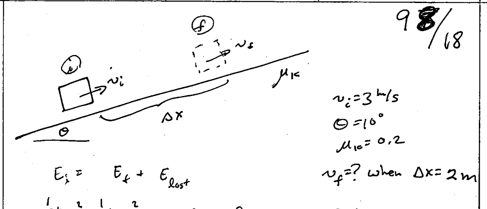

Problem description

Here we can use the same approach as above to solve for \\v_f\\ when \\\Delta{x} =\\ 2m.

Recall that, \\v_f = \sqrt{v_0^2-2g\Delta{x}(\mu_k\cos{\theta}+\sin{\theta})}\\

Plugging in the numbers from the problem description where \\v_0 = 3\\m/s, \\\theta = 10^\circ\\, \\\mu_k=0.2\\ and \\\Delta{x}=2\\m

We find that:

\\ v_f = \sqrt{9-14.54} \\

The result of that square root would result in an imaginary number. This means that the block did not slide a distance \\\Delta{x}\\ before coming to rest.

Therefore, instead we will solve for \\\Delta{x}\\ when \\v_f = 0\\

To do this you can plug in our terms into a kinematic equation:

\\ v_f^2 = v_0^2 +2a(X_f - X_i) \\

Pluggin in our terms yields:

\\ 0 = v_0^2-2g\Delta{x}(\mu_kcos{\theta}+\sin{\theta}) \\

Solving for \\\Delta{x}\\ yields:

\\ \Delta{x} = \frac{v_0^2}{2g(\mu_k\cos{\theta}+\sin{\theta})} \\

Pluggin in our values:

\\ \Delta{x} = \frac{9}{(2)(9.8)(0.371)} = 1.24 \space \text{m} \\

The mass therefore will slide 1.24 meters up before stopping.

## Mass Sliding Down

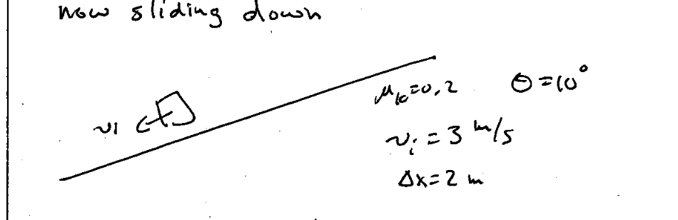

Mass sliding down problem description

In this problem our mass is sliding down the incline rather than up. Firstly, we will solve for \\v_f\\ after 2 meters, this will let us know if our mass is speeding up or slowing down.

We can arrange our conservation of energy problem as such:

\\ mgh_i + \frac{1}{2}mv_0^2 = \frac{1}{2}mv_f^2+\mu_kg\Delta{x}\cos{\theta} \\

And recall that our \\h_i\\ can be determined using a triginometric function.

\\ g\Delta{x}\sin{\theta} + \frac{1}{2}v_0^2 = \frac{1}{2}v_f^2 + \mu_kg\Delta{x}\cos{\theta} \\

From there solving for \\v_f\\ yields:

\\ v_f = \sqrt{v_0^2+2g\Delta{x}(\sin(\theta)- \mu_k\cos{\theta}} \\

Pluggin in our values we find that

\\ \newline v_f = \sqrt{8.0984} \approx 2.85 \space \text{m/s} \\

That means that our mass is slowing down after 2 meters of displacement. Next we can solve for how far it travels before stopping:

Recall that, \\ \Delta{x} = \frac{-v_0^2}{2g(\sin{\theta}-\mu_k\cos{\theta})} \\

Since our velocity is in the negative direction and therefore our velocity value is negative we can drop the sign from the \\\v_0^2\\ term to yield:

\\ \Delta{x} = \frac{v_0^2}{2g(\sin{\theta}-\mu_k\cos{\theta})} \newline \Delta{x} = \frac{9}{(2)(9.8)(0.2\*0.988-0.174)} = 19.96 \space \text{meters} \newline \\

Therefore, our mass will slide 19.96 meters before coming to rest.

------------------------------------------------------------------------

# Hooke’s Law Springs

A Hooke’s law spring is a spring that attempts to retract when stretched and attempts to expand when compressed.

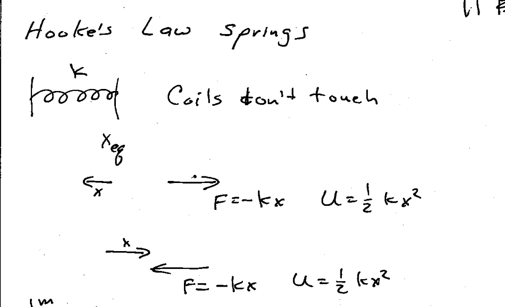

Exmaple depicting Hooke’s Law Spring

The spring constant \\k\\ represents the force a spring will attempt to apply when compressed or retracted.

Assume the spring is at rest when \\x=0\\. Assume then a force applies pressure to the spring in a negative \\x\\ direction. The further that force presses the spring in the more force the spring will push back with wanting to return to a \\x=0\\ position.

This can be represented as \\F\_{spring} = -kx\\. And the potential energy of the spring \\U\_{spring} = \frac{1}{2}kx^2\\

Likewise, if the spring is stretched (\\x\>0\\) then the spring will want to impart a force that tends towards it’s origin.

## Mass Sliding Into A Spring

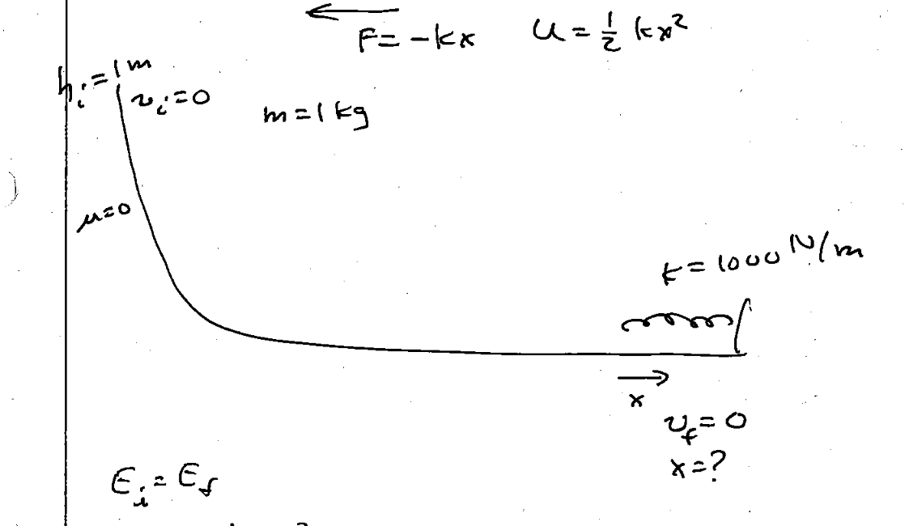

Mass Sliding Into A Spring Problem

Here a mass slides down an incline before colliding with our spring and compressing it. We want to first solve for \\x\\ or how far the spring will compress before our mass comes to a rest.

Recall conservation of energy

\\ E_i = E_f \\

And also recall that in the given problem at the top of the incline we have gravitational potential energy and no initial velocity.

At the bottom of the ramp, once we collide with the spring our kinetic energy will have been converted to potential energy within the spring from compressing it.

Therefore we can arrange the conservation of energy equation as such:

\\ mgh = \frac{1}{2}kx^2 \\

From there we can solve for \\x\\ by arranging as such:

\\ x = \sqrt{\frac{2mgh}{k}} \newline \\

Plugging in our respective values:

\\ \sqrt{\frac{(2)(1)(9.8)(1)}{1000}} \approx 0.14 \space \text{m} \newline \\

So we know that the spring then compresses 0.14 meters before our mass comes to rest.

------------------------------------------------------------------------

# Power, Work, and Force

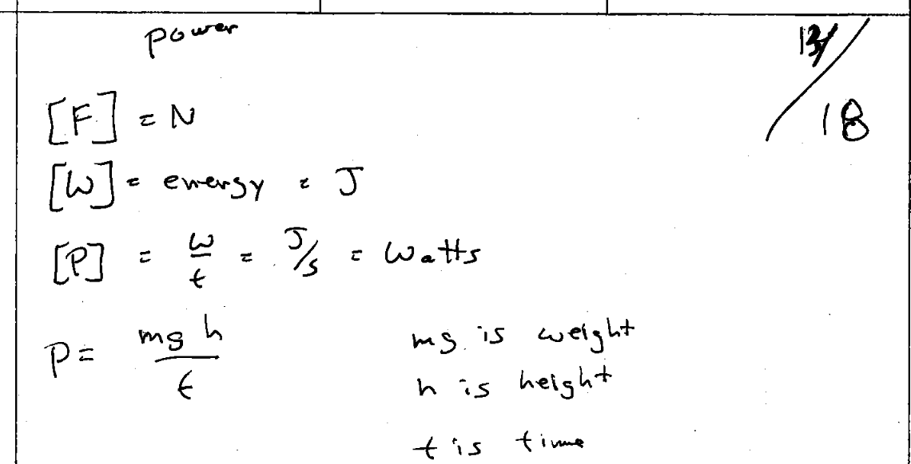

Lecture Notes Brief Description

## Work

Work is a measurement of energy transfer. It is measured in Newton meters (\\\frac{N}{m}\\) which is also referred to as a Joule (J).

To find work you can use:

\\ W = \overrightarrow{F} \cdot \overrightarrow{\Delta{r}} = F\Delta{r}\cos{\theta} \\

Therefore a force of 2N applied to an object that results in no displacement has done no work.

A force of \\2N\\ that moves an object through a displacement of 1 meter does more work than a similar force of \\2N\\ that moves and object through a displacement of only 10 cm.

A force of \\1N\\ that moves an object 1m does less work than a force of \\2N\\ that moves an object that same 1m.

A force that is perpendicular to displacement does no work (does not transfer energy into the system) as \\\cos(90^\circ)=0\\

Work carries a sign, and that sign depends on the direction of force and displacement.

A force that is opposite in direction to displacement provides negative work, whereas when force and displacement occur in the same direction work’s sign is positive.

Work done by a spring can be measured as such:

\\ W\_{spring} = \frac{1}{2}kx_i^2 - \frac{1}{2}kx_f^2 \\

The total energy of a system is defined as that systems kinetic energy \\K\\ plus it’s potential energy \\U\\.

\\ E + K + U \\

Work is done on a system by external forces and the only change is in the speed of it’s members. Therefore work can be found via:

\\ W = K_f - K_i = \frac{1}{2}mv_f^2-\frac{1}{2}mv_0^2 \\

If the only change is the configuration of the system then work can be measured from the change in potential energy:

\\ W = U_f - U_i \\

------------------------------------------------------------------------

## Power

Work is a measurement of force relative to displacement. Power expands on work as it measures work done over the course of time.

\\ P = \frac{W}{\Delta{t}} \\

Power’s SI unit is the Watt in which 1 Watt = 1 Joule/s = \\\frac{1 kg m^2}{s^3}\\

# Man Climbing Stairs

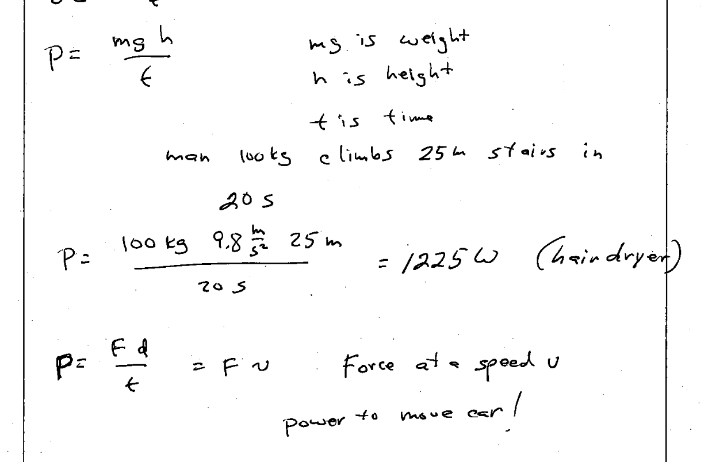

Man Climbs Stairs Problem

In this problem a man climbs 25 meters of stairs in 20 seconds.

We can find the mans work from his his potential energy where we know:

\\m=100\\ kg, and his displacement is \\\Delta{h}=25\\ meters.

Therefore \\W = mgh\\, and the time it took for him to to do this work was 20 seconds, therefore we know his power output was:

\\ P = \frac{(100)(9.8)(25)}{20} = 1225 \space \text{Watts} \\

------------------------------------------------------------------------
