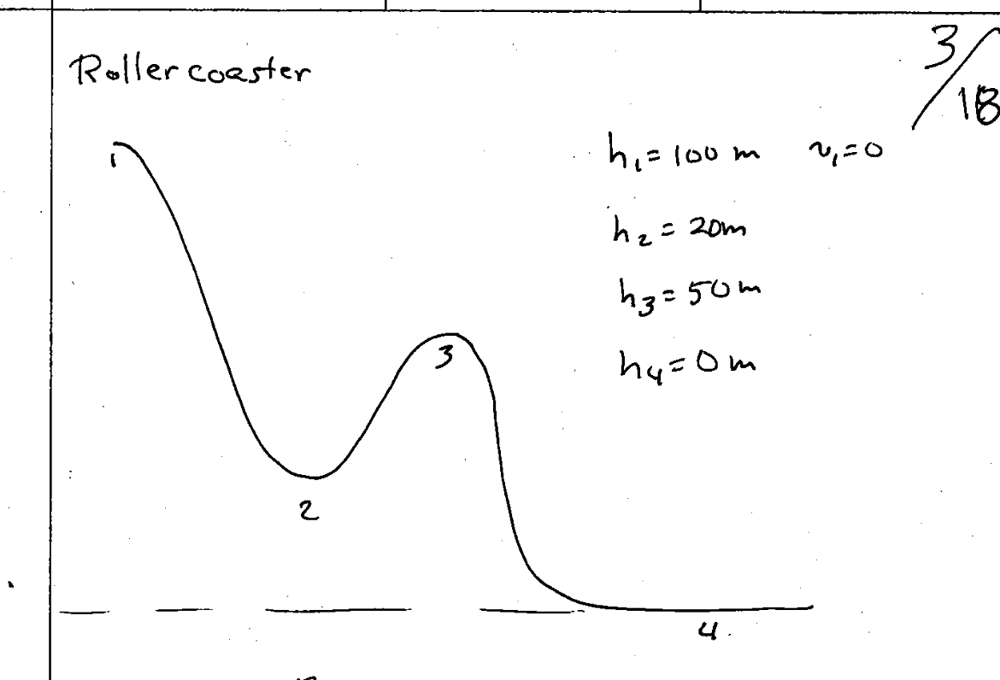

Based on the expierce gained from the first exam we know that exam 2 is likely a combination of problems from the previous exam as well as problems from Professor Lamp's lecture notes. 

Me must prepare for all questions that are either on the previous test ("exam 2" in the previous exams directory.) According to the professor our exam 2 will cover:

Chapters 6,7, 9, 10, 11.

The professor has provided the lecture notes and a previous exam. We should be able to solve any combination of problems from lecture notes as well as the previous exam in 15 question quantities in around 30-40 mintues, but must be under 50 minutes. 

---

# Conservation of Energy 

Energy is the ability to do work. We measure energy in Joules (Which is Kg m^2/s^2)

Work is the scalar result of the dot product of the force vector and displacement vector. It is a means of measuring energy transferred in a system.

The common way to see it is $W = Fd$ or $W = \overrightarrow{F} \cdot \overrightarrow{d}$

The common varibles tossed around for energy include Energy $E$, Potential Energy $U$, and Kinetic energy $K$.

Under the idea of conservation of energy:

$E_i = E_f$ 

Where $E = U + K$

Or 

$U_i + K_i = U_f + K_f$

---

## Kinetic Energy

Kinetic Energy is given from $K=\frac{1}{2}mv^2$

And *gravitational* potential energy is given as $U = mgh$

Consider again the example of Wile E. Coyote falling from a cliff. 

His initial energy is only his gravitational potential energy since his initial velocity is 0.

$E_i = mgh$ 

$E_f = \frac{1}{2}mv_f^2$ is his final energy as all of his gravitational potential energy has been converted to kinetic energy throughout the fall. 

Since there is no means of energy being lost $E_i = E_f$

$v_f$ therefore can be found by solving for it through:

$$
\newline
mgh = \frac{1}{2}mv^2
\newline
v_f = \sqrt{2gh}
$$

---

# Atwood's Machine 

Consider a pulley with two masses of varying weight on either side. Assuming the pulley is perfectly frictionless we can use the law of conservation of energy to determine the final velocity of either mass after some change in displacement.

In this problem we measure the height for $m_1$ and $m_2$ inversely. Meaning m_1 start from a position where it's height is considered 2m. $m_2$ however starts from a height of 0m and finishes with a height of 2m. 

This allows us to cancel out most terms in the initial energy equation.

$$
m_1gh = \frac{1}{2}m_1v_f^2 + \frac{1}{2}m_2v_f^2 + m_2gh
$$

::: {.callout-note}
With the Atwood's machine problem there is no difference between $v_1f$ and $v_2f$ as the two have are connected and therefore will exhibit inverse final velocities (One falls while on rises at the same velocity). Therefore it's important only to distinguish the sign between the two objects. 
:::

Now based on the problem description we want to take the equation for energy conservation and we want to find our final velocity:

$$
\newline
m_1gh = \frac{1}{2}m_1v_f^2 + \frac{1}{2}m_2v_f^2 + m_2gh
\newline
m_1gh = \frac{1}{2}(m_1+m_2)+m_2gh
\newline
(m_1-m_2)gh=\frac{1}{2}(m_1+m_2)v_f^2
\newline
v_f = \sqrt{\frac{2gh(m_1-m_2)}{m_1+m_2}}
$$

Plugging in our relevant variables:

$$
v_f = \sqrt{\frac{(2)(9.8)(2)(10-5)}{10+5}}
\approx \pm 3.61 m/s
$$

Recall that $m_1$ moves down so we should say that for $m_1$ our $v_f$ value is $-3.61 \space m/s$ and for $m_2$ who moves up our $v_f$ should be positive therefore $3.61 \space m/s$.

# Rollercoaster Problem

Recall in the previous problem we determined that we can calculate an objects final velocity when gravity is the sole force acting upon it to create velocity. 

In such a case we solved the Conservation of energy equation to find that 

$v_f = \sqrt{2gh}$

This works when the object is simple and sliding (not rolling as that's going to be a problem related to angular momentum).

But in the case of our roller coaster above we are sliding down the track and therefore we can calculate our speed at the given heights simply by considering gravitational potential energy:

$$
\newline
mgh_1=\frac{1}{2}mv_f^2+mgh_2
\newline
mg(h_1-h_2)=\frac{1}{2}mv_f^2
\newline
2g(h_1-h_2)=v_f^2
\newline
v_f = \sqrt{2g(h_1-h_2)}
\newline
$$

Since energy is conserved in the system perfectly we know the velocity at any point on the track considering the roller coasters initial position.

Consider the velocity at point $h_2$ as $v_2$ and so on:

$$
v_2 = \sqrt{(2)(9.8)(100-20)} \approx 39.6 \space \text{m/s}
$$

Likewise each other part of the track such as $h_3$ and $h_4$ can be calculated as such:

$$
\newline
v_3 = \sqrt{(2)(9.8)(100-50)} \approx 31.3 \space \text{m/s}
\newline
v_4 = \sqrt{(2)(9.8(100-0))} \approx 44.3 \space \text{m/s}
\newline
$$

# Halfpipe

## Frictionless 

Much like the roller coaster and other problems we have imagined, in a half pipe our skater *slides* from one side of the half pipe to the other on a perfectly frictionless surface. 

In such a case the $E_i = E_f$ as there is no mechanism for energy to be lost. 

That means that at his initial height $h_i$ and with no initial velocity he exhibits the maximum potential energy via gravity.

$U_i = mgh$ 

Likewise, at the opposite side of the halfpipe his climb stops once all of his energy kinetically is equal to his initial potential energy. 

That is to say, as the skater reaches the bottom of the halfpipe his height is 0, therefore all of his gravitational potential energy has been converted to kinetic energy. 

Likewise, once the skater begins rising on the other side of the half pipe, his kinetic energy once again start becoming gravitational potential energy and eventually $U_i = K_f$ at $h_f$.

Since there is no mechanism for energy to be lost $h_i = h_f$ as the same gravitational potential energy is reconverted from kinetic energy on the opposite side of the half pipe:

$U_i + K_i = U_f + K_f$

Where $K_i$ and $K_f$ both equal zero therefore: 

$U_i = U_f$ which if you'll recall $U_i=mgh_i$ therefore, since mass and gravity are both constants, the height must be the same on both sides for $U_i = U_f$ to be true. So $h_i = h_f$

## With Friction 

Consider the same half-pipe but with a catch, in the middle there is a length $L$ of 10 meters in which we apply a kinetic friction of $\mu_k = 0.01$

### Work-Energy Theorem

This is similar to the conservation of energy which is $E_i = E_f$ except here we consider energy lost in the system:

$E_i = E_f + E_{lost}$

With the frictionless halfpipe we learned that U_i = U_f, but when there is friction we know that:

$$
U_i = U_f + \mu_kmgL
$$

Therefore $h_i \ne h_f$

We can solve for $h_f$ as such:

$$
\newline
mgh_i = mgh_f + \mu_kmgL
\newline
\text{Divide both sides by mg to cancel them out}
\newline
h_i = h_f + \mu_kL
\newline
h_f = h_i - \mu_kL
\newline
h_f = 3-(0.01*10)= 2.9 \space \text{m}
\newline
$$

In general Work-Energy theorem is $E_i + E_{added} = E_f + E_{lost}$

---

# Mass Sliding Up An Incline

Consider a mass sliding up a frictionless incline with $\theta=10^\circ$, after a change in position of $\Delta{x} = 3m$ we want to know it's final velocity $v_f$. We are assuming that it's initial velocity is $v_0 = 4$ m/s

Again, we want to use the *Work Energy Theorem* here to determine it's final velocity. 

Remember that it's $E_i + E_{added} = E_f + E_{lost}$

In our case we are not adding any energy to the system so therefore:

$E_i = E_f + E_{lost}$ 

Our initial energy is our kinetic energy:

$\frac{1}{2}mv_0^2$ 

And our final energy is 

$\frac{1}{2}mv_f^2$ 

And we lose energy to friction which is the force of gravity applied to our x component:

$mg\Delta{x}\sin{\theta}$

Therefore considering the work energy theorem we can actually find our final velocity by arranging that equation:

$$
\newline
\frac{1}{2}mv_0^2=\frac{1}{2}mv_f^2+mg\Delta{s}\sin{\theta}
\newline
v_f = \sqrt{v_o^2-2g\Delta{x}\sin{\theta}}
\newline
v_f = \sqrt{4^2-(2)(9.8)(3)(0.174)} \approx 2.41 \space \text {m/s}
$$

And recall that our object is moving to the right (which is our positive x-direction) therefore it's $v_f$ is continuning to moving to the right (positive x-direction).

