Use $g = 9.8\ \text{m/s}^2$. Choose the single best answer. Answers are rounded to the precision shown.

::: {layout="[58,42]" layout-valign="top"}
::: {}
**1.** A skateboarder starts from rest at a height of 6.0 m on one wall of a halfpipe. The halfpipe is frictionless except for an 8.0 m long section of the flat bottom that has a coefficient of kinetic friction $\mu = 0.15$. How high up the far wall does she rise before she momentarily comes to rest?\
a)\ 4.8\ m $\quad$ b)\ 5.1\ m $\quad$ c)\ 5.6\ m $\quad$ d)\ 6.0\ m $\quad$ e)\ 6.2\ m
:::

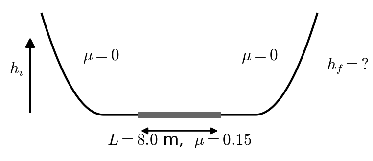
:::

::: {layout="[58,42]" layout-valign="top"}
::: {}
**2.** A mass is launched from the edge of a ledge 5.0 m above the flat ground below at 25 m/s, 30° above the horizontal. How high above the ground below is the mass at the highest point of its trajectory?\
a)\ 5.0\ m $\quad$ b)\ 8.0\ m $\quad$ c)\ 13.0\ m $\quad$ d)\ 21.0\ m $\quad$ e)\ 36.9\ m
:::

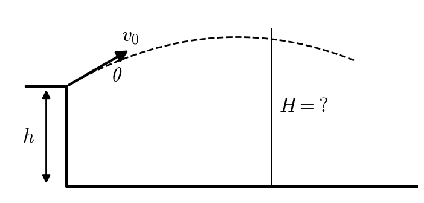
:::

::: {layout="[58,42]" layout-valign="top"}
::: {}
**3.** A mass slides along a frictionless floor and enters the bottom of a frictionless vertical circular loop of radius $R = 6.0$ m. What is the minimum speed it must have as it enters the bottom of the loop to make it all the way around?\
a)\ 7.7\ m/s $\quad$ b)\ 10.8\ m/s $\quad$ c)\ 15.3\ m/s $\quad$ d)\ 17.1\ m/s $\quad$ e)\ 24.2\ m/s
:::

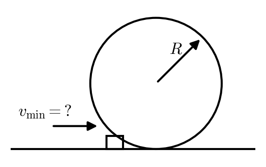
:::

::: {layout="[58,42]" layout-valign="top"}
::: {}
**4.** A 3.0 kg block is sliding up a ramp ($\theta = 20^\circ$, $\mu_k = 0.30$) with an initial speed of 6.0 m/s. How long does it continue to slide up the ramp before it comes to rest?\
a)\ 0.61\ s $\quad$ b)\ 0.98\ s $\quad$ c)\ 1.4\ s $\quad$ d)\ 1.8\ s $\quad$ e)\ 2.9\ s
:::

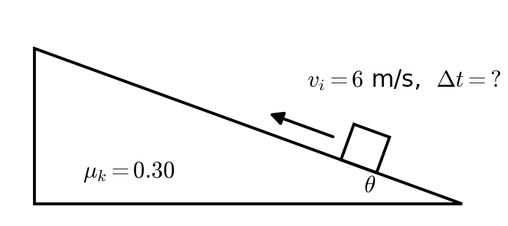
:::

::: {layout="[58,42]" layout-valign="top"}
::: {}
**5.** A highway curve of radius 80 m is banked at $\theta = 15^\circ$. The coefficient of static friction between the tires and the road is $\mu_s = 0.25$. What is the maximum speed at which a car can take the curve without sliding up the bank?\
a)\ 14.0\ m/s $\quad$ b)\ 14.5\ m/s $\quad$ c)\ 17.6\ m/s $\quad$ d)\ 20.9\ m/s $\quad$ e)\ 28.0\ m/s
:::

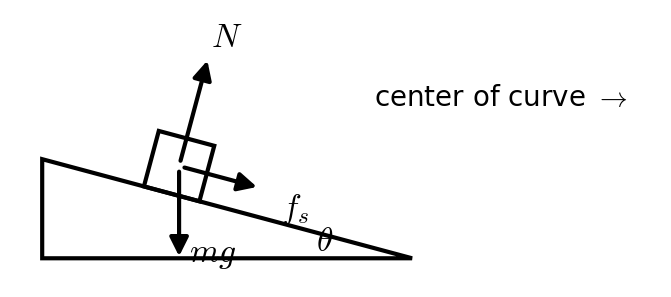
:::

::: {layout="[58,42]" layout-valign="top"}
::: {}
**6.** A 0.10 kg mass is placed on a vertical spring of spring constant $k = 1500$ N/m that has been compressed 0.040 m from its equilibrium length. When released, the spring shoots the mass straight up. How far above the release point does the mass fly?\
a)\ 0.12\ m $\quad$ b)\ 0.49\ m $\quad$ c)\ 1.2\ m $\quad$ d)\ 2.4\ m $\quad$ e)\ 12\ m
:::

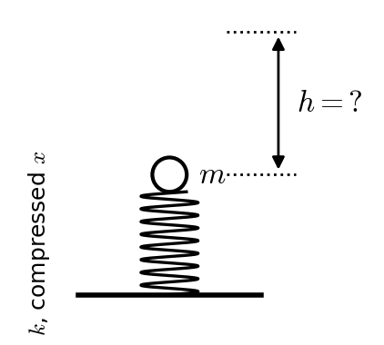
:::

::: {layout="[58,42]" layout-valign="top"}
::: {}
**7.** A 3.0 kg ball moving to the right at 4.0 m/s collides **elastically** head on with a 1.0 kg ball moving to the left at 6.0 m/s. What is the velocity of the 3.0 kg ball after the collision? Positive to the right / negative to the left.\
a)\ +9.0\ m/s $\quad$ b)\ +2.5\ m/s $\quad$ c)\ +1.0\ m/s $\quad$ d)\ −1.0\ m/s $\quad$ e)\ −2.5\ m/s
:::

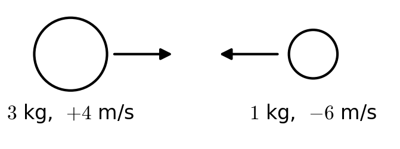
:::

::: {layout="[58,42]" layout-valign="top"}
::: {}
**8.** A cart of mass $m$ moving with velocity $3v$ collides completely **inelastically** with a cart of mass $2m$ that is at rest. The two carts couple together. What fraction of the initial kinetic energy is still retained by the carts after the collision?\
a)\ <\ 10% $\quad$ b)\ 10–20% $\quad$ c)\ 30–40% $\quad$ d)\ 50–60% $\quad$ e)\ >\ 90%
:::

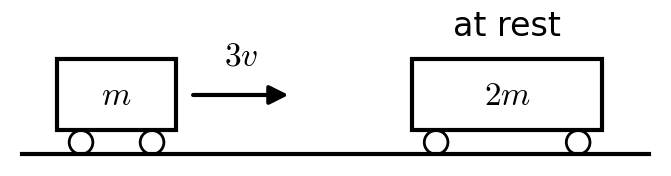
:::

::: {layout="[58,42]" layout-valign="top"}
::: {}
**9.** A bullet of mass 0.0080 kg is fired horizontally into a 2.0 kg block of wood hanging at rest from light strings. The bullet lodges in the block, and the block swings upward, rising 0.080 m. What was the speed of the bullet just before it hit the block?\
a)\ 1.25\ m/s $\quad$ b)\ 63\ m/s $\quad$ c)\ 157\ m/s $\quad$ d)\ 251\ m/s $\quad$ e)\ 314\ m/s
:::

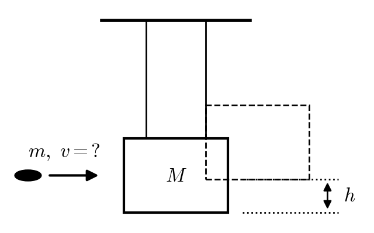
:::

::: {layout="[58,42]" layout-valign="top"}
::: {}
**10.** A 2.0 kg mass hangs from a light string wrapped around a pulley that is a uniform disk ($I = \tfrac{1}{2}MR^2$, $M = 6.0$ kg, $R = 0.25$ m) on a frictionless axle. The mass is released from rest. How fast is it moving after it has fallen 1.5 m?\
a)\ 2.0\ m/s $\quad$ b)\ 3.4\ m/s $\quad$ c)\ 4.4\ m/s $\quad$ d)\ 5.4\ m/s $\quad$ e)\ 7.7\ m/s
:::

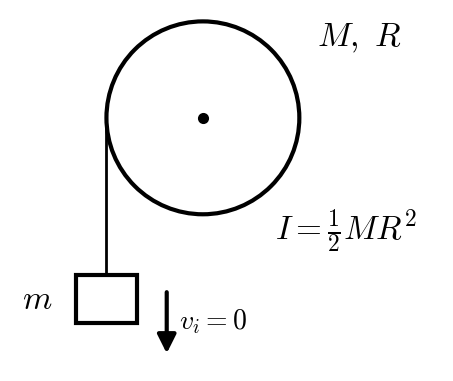
:::

::: {layout="[58,42]" layout-valign="top"}
::: {}
**11.** A solid cylinder ($M = 3.0$ kg, $R = 0.050$ m, $I = \tfrac{1}{2}MR^2$) starts from rest and rolls without slipping down an incline from a height of 2.0 m. At the bottom of the incline, what is the cylinder's rotational velocity $\omega$?\
a)\ 5.1\ rad/s $\quad$ b)\ 89\ rad/s $\quad$ c)\ 102\ rad/s $\quad$ d)\ 125\ rad/s $\quad$ e)\ 280\ rad/s
:::

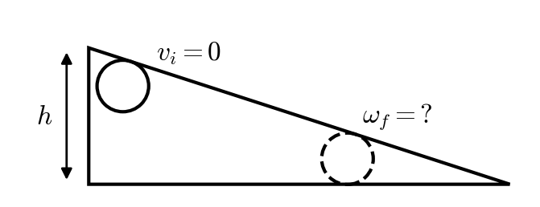
:::

::: {layout="[58,42]" layout-valign="top"}
::: {}
**12.** A disk ($I = \tfrac{1}{2}MR^2$, $M = 300$ kg, $R = 2.0$ m) rotates at +3.0 rad/s. A ring ($I = MR^2$, mass 100 kg, radius 1.5 m) rotating in the opposite direction at −4.0 rad/s is dropped centered onto the disk. Their collision is completely inelastic. After they stop slipping, what is the angular velocity of the two-object stack?\
a)\ +1.09\ rad/s $\quad$ b)\ +1.64\ rad/s $\quad$ c)\ +2.18\ rad/s $\quad$ d)\ +2.40\ rad/s $\quad$ e)\ +3.27\ rad/s
:::

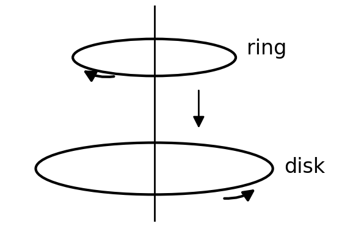
:::

::: {layout="[58,42]" layout-valign="top"}
::: {}
**13.** A merry-go-round (a disk, $I = \tfrac{1}{2}MR^2$, $M = 400$ kg, $R = 2.5$ m) rotates at 0.50 rad/s. A 40 kg child running at 6.0 m/s tangent to the rim, in the same direction the rim is moving, jumps on at the rim. What is the new rotation rate of the merry-go-round WITH the child?\
a)\ 0.42\ rad/s $\quad$ b)\ 0.82\ rad/s $\quad$ c)\ 0.98\ rad/s $\quad$ d)\ 1.30\ rad/s $\quad$ e)\ 2.4\ rad/s
:::

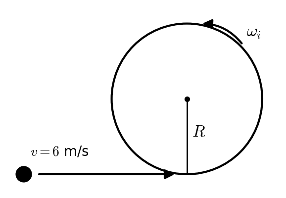
:::

::: {layout="[58,42]" layout-valign="top"}
::: {}
**14.** An 80 kg person stands at the rim of a merry-go-round (a disk, $I = \tfrac{1}{2}MR^2$, $M = 400$ kg, $R = 3.0$ m) that rotates at 1.5 rad/s. The person walks to the center. What is the angular velocity when the person reaches the center? (Treat the person as a point mass.)\
a)\ 1.07\ rad/s $\quad$ b)\ 1.25\ rad/s $\quad$ c)\ 1.5\ rad/s $\quad$ d)\ 1.8\ rad/s $\quad$ e)\ 2.1\ rad/s
:::

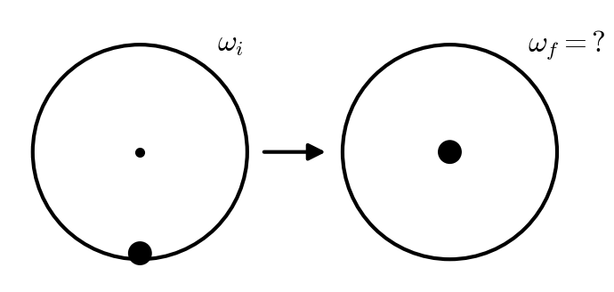
:::

::: {layout="[58,42]" layout-valign="top"}
::: {}
**15.** A 4.0 kg block slides down a $25^\circ$ incline ($\mu_k = 0.15$) at 0.50 m/s. It is connected by a light string to a pulley at the top of the incline (as shown). The pulley is a disk of mass 3.0 kg, radius 0.10 m, and moment of inertia $\tfrac{1}{2}MR^2$. How fast is the block sliding when it has slid 1.0 m down along the incline?\
a)\ 2.08\ m/s $\quad$ b)\ 2.42\ m/s $\quad$ c)\ 2.50\ m/s $\quad$ d)\ 2.92\ m/s $\quad$ e) it stops before it slides the whole 1.0 m
:::

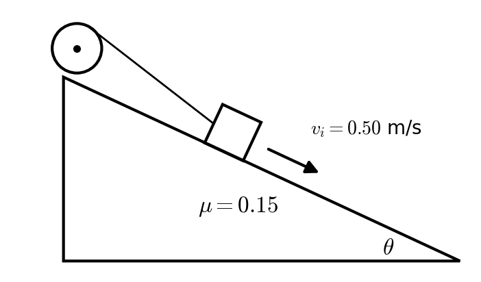
:::
