Use $g = 9.8\ \text{m/s}^2$. Choose the single best answer. Answers are rounded to the precision shown. For a minimum or maximum, choose the answer choice that actually works.

::: {layout="[58,42]" layout-valign="top"}
::: {}
**1.** A car goes around a flat (unbanked) curve of radius 35 m. The coefficient of static friction between the tires and the road is $\mu_s = 0.40$. What is the maximum speed at which the car can take the curve without sliding?\
a)\ 3.7\ m/s $\quad$ b)\ 11.7\ m/s $\quad$ c)\ 16.6\ m/s $\quad$ d)\ 18.5\ m/s $\quad$ e)\ 137\ m/s
:::

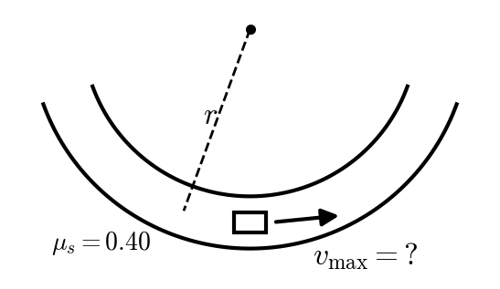
:::

::: {layout="[58,42]" layout-valign="top"}
::: {}
**2.** A highway curve of radius 90 m is banked at $\theta = 30^\circ$. The coefficient of static friction between the tires and the road is $\mu_s = 0.15$. What is the minimum speed at which a car can take the curve without sliding down the bank?\
a)\ 12\ m/s $\quad$ b)\ 18\ m/s $\quad$ c)\ 20\ m/s $\quad$ d)\ 23\ m/s $\quad$ e)\ 27\ m/s
:::

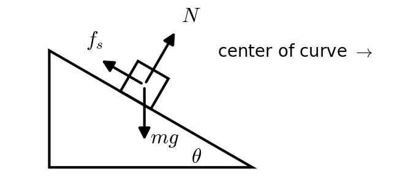
:::

::: {layout="[58,42]" layout-valign="top"}
::: {}
**3.** Two masses, $m_1 = 8.0$ kg and $m_2 = 6.0$ kg, hang from opposite ends of a light string over a massless, frictionless pulley (Atwood's machine). They are released from rest. How fast is $m_1$ moving after it has fallen 1.5 m?\
a)\ 1.45\ m/s $\quad$ b)\ 2.05\ m/s $\quad$ c)\ 2.71\ m/s $\quad$ d)\ 3.13\ m/s $\quad$ e)\ 5.42\ m/s
:::

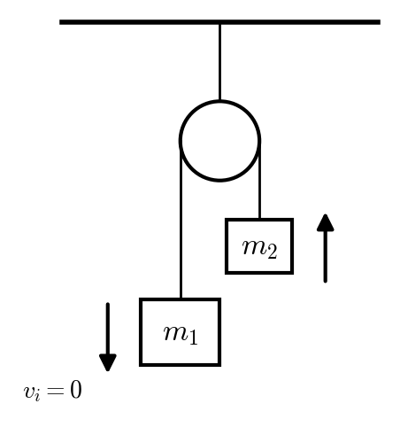
:::

::: {layout="[58,42]" layout-valign="top"}
::: {}
**4.** A roller coaster car starts from rest at the top of a 65 m hill. It goes over a 45 m hump and then down to a section of track 10 m above the ground. The track is frictionless. How fast is the car moving on the 10 m section?\
a)\ 14.0\ m/s $\quad$ b)\ 19.8\ m/s $\quad$ c)\ 23.2\ m/s $\quad$ d)\ 32.8\ m/s $\quad$ e)\ 35.7\ m/s
:::

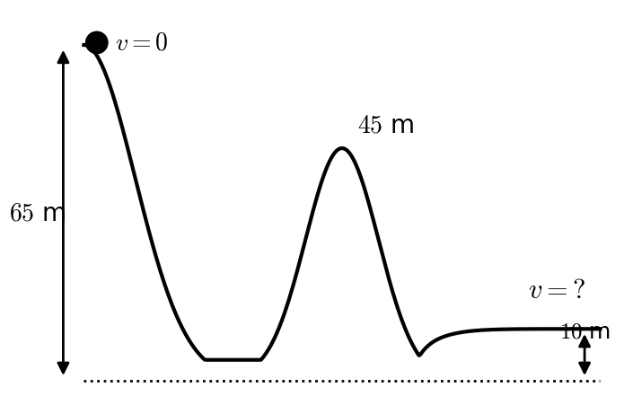
:::

::: {layout="[58,42]" layout-valign="top"}
::: {}
**5.** A block slides up a frictionless incline ($\theta = 15^\circ$) with an initial speed of 5.0 m/s. How fast is it moving after it has slid 2.5 m along the incline?\
a)\ 3.5\ m/s $\quad$ b)\ 4.3\ m/s $\quad$ c)\ 6.1\ m/s $\quad$ d)\ 12.3\ m/s $\quad$ e) it stops before it slides the whole 2.5 m
:::

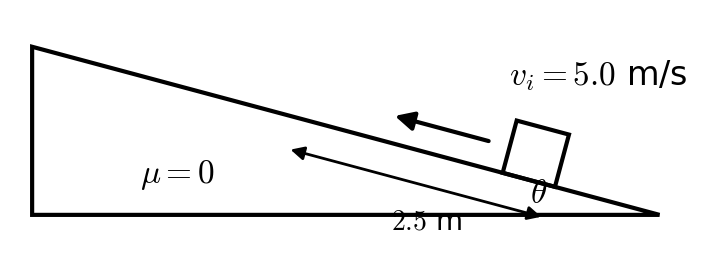
:::

::: {layout="[58,42]" layout-valign="top"}
::: {}
**6.** A block is sliding **down** a rough incline ($\theta = 12^\circ$, $\mu_k = 0.35$) at 4.0 m/s. How far does it slide along the incline before it comes to rest?\
a)\ 1.5\ m $\quad$ b)\ 2.4\ m $\quad$ c)\ 6.1\ m $\quad$ d)\ 12.1\ m $\quad$ e) it never stops; it speeds up
:::

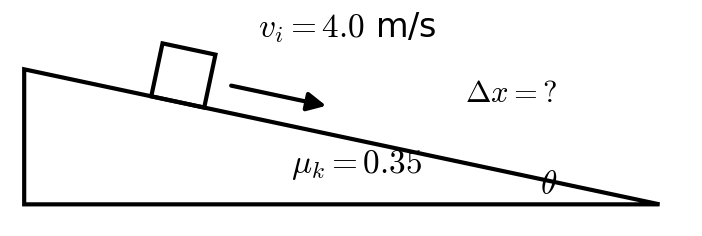
:::

::: {layout="[58,42]" layout-valign="top"}
::: {}
**7.** A 15 kg block on a $25^\circ$ incline ($\mu_k = 0.30$) is tied by a light string over a massless pulley to a 4.0 kg hanging mass. The block is moving **up** the incline at 3.0 m/s (and the hanging mass is moving down). How fast is the block moving after it has slid 1.5 m up the incline?\
a)\ 2.32\ m/s $\quad$ b)\ 2.51\ m/s $\quad$ c)\ 2.98\ m/s $\quad$ d)\ 4.35\ m/s $\quad$ e) it stops before it slides the whole 1.5 m
:::

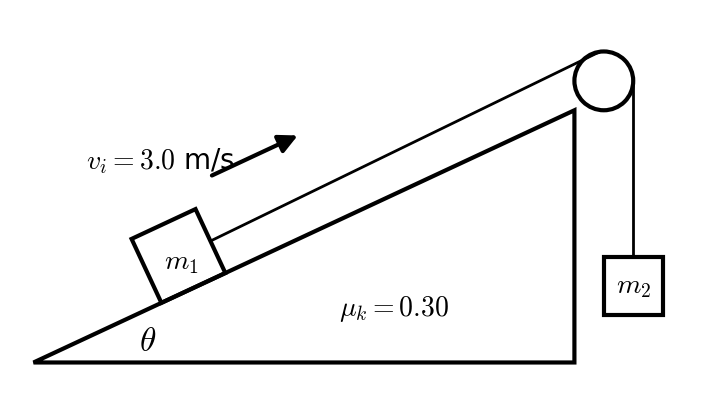
:::

::: {layout="[58,42]" layout-valign="top"}
::: {}
**8.** A 2.5 kg mass starts from rest at a height of 0.80 m on a frictionless ramp. It slides down, across a frictionless floor, and into a spring with spring constant $k = 1800$ N/m. How far is the spring compressed when the mass comes to rest?\
a)\ 0.011\ m $\quad$ b)\ 0.022\ m $\quad$ c)\ 0.10\ m $\quad$ d)\ 0.15\ m $\quad$ e)\ 0.21\ m
:::

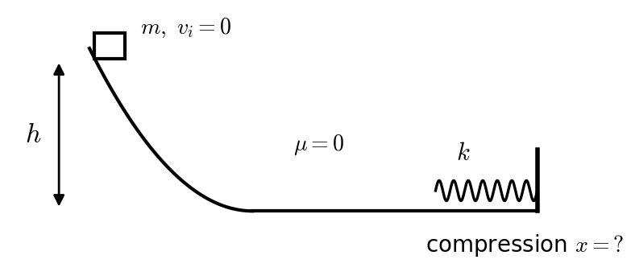
:::

::: {layout="[58,42]" layout-valign="top"}
::: {}
**9.** A 70 kg person climbs a staircase 12 m high in 8.0 s. What is the person's average power output?\
a)\ 105\ W $\quad$ b)\ 457\ W $\quad$ c)\ 1030\ W $\quad$ d)\ 8230\ W $\quad$ e)\ 65,900\ W
:::

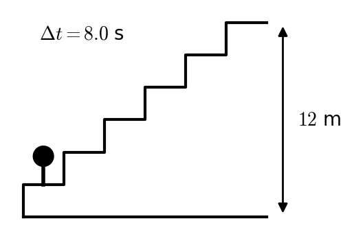
:::

::: {layout="[58,42]" layout-valign="top"}
::: {}
**10.** A 0.15 kg ball hits a wall head-on at 30 m/s and bounces straight back at 30 m/s. The ball is in contact with the wall for 0.010 s. What is the magnitude of the average force the wall exerts on the ball?\
a)\ 0\ N $\quad$ b)\ 4.5\ N $\quad$ c)\ 9.0\ N $\quad$ d)\ 450\ N $\quad$ e)\ 900\ N
:::

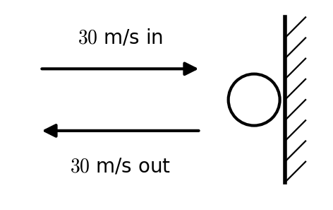
:::

::: {layout="[58,42]" layout-valign="top"}
::: {}
**11.** A wheel speeds up uniformly from 10 rad/s to 50 rad/s while turning through 90 rad. How long does this take?\
a)\ 1.5\ s $\quad$ b)\ 1.8\ s $\quad$ c)\ 2.25\ s $\quad$ d)\ 3.0\ s $\quad$ e)\ 9.0\ s
:::

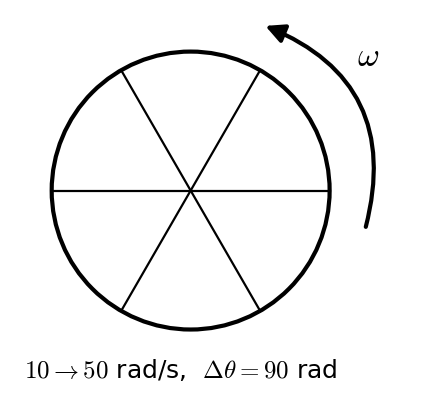
:::

::: {layout="[58,42]" layout-valign="top"}
::: {}
**12.** A thin uniform rod has mass 3.0 kg and length 1.2 m ($I_{cm} = \tfrac{1}{12}m\ell^2$). It rotates about an axis perpendicular to the rod, located 0.30 m from one end. What is the rod's moment of inertia about this axis?\
a)\ 0.09\ kg·m² $\quad$ b)\ 0.27\ kg·m² $\quad$ c)\ 0.36\ kg·m² $\quad$ d)\ 0.50\ kg·m² $\quad$ e)\ 0.63\ kg·m²
:::

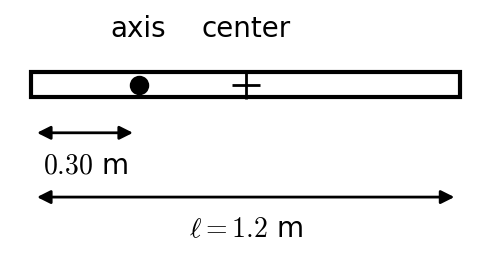
:::

::: {layout="[58,42]" layout-valign="top"}
::: {}
**13.** A solid sphere ($I = \tfrac{2}{5}MR^2$) rolls without slipping down a $25^\circ$ incline. What is the acceleration of its center down the incline?\
a)\ 2.07\ m/s² $\quad$ b)\ 2.96\ m/s² $\quad$ c)\ 4.14\ m/s² $\quad$ d)\ 6.34\ m/s² $\quad$ e)\ 7.00\ m/s²
:::

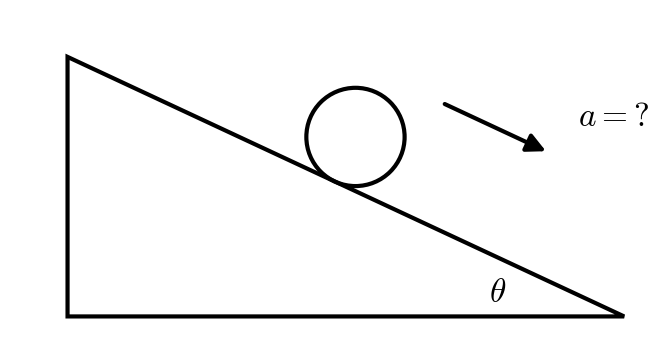
:::

::: {layout="[58,42]" layout-valign="top"}
::: {}
**14.** A merry-go-round (a disk, $I = \tfrac{1}{2}MR^2$, $M = 300$ kg, $R = 2.5$ m) rotates at 1.2 rad/s. A 60 kg person standing still on the ground steps straight down onto it at a distance of 1.5 m from the center. What is the new angular velocity? (Treat the person as a point mass.)\
a)\ 1.05\ rad/s $\quad$ b)\ 1.10\ rad/s $\quad$ c)\ 1.12\ rad/s $\quad$ d)\ 1.20\ rad/s $\quad$ e)\ 1.37\ rad/s
:::

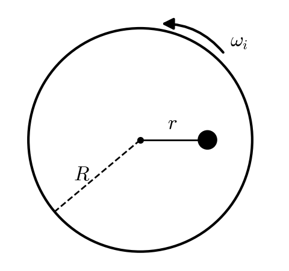
:::

::: {layout="[58,42]" layout-valign="top"}
::: {}
**15.** A merry-go-round (a disk, $I = \tfrac{1}{2}MR^2$, $M = 400$ kg, $R = 3.0$ m) rotates at 1.5 rad/s. A uniform 60 kg rod, 3.0 m long, is dropped onto it so that it lies along a radius from the center to the edge. What is the new angular velocity?\
a)\ 1.36\ rad/s $\quad$ b)\ 1.43\ rad/s $\quad$ c)\ 1.46\ rad/s $\quad$ d)\ 1.50\ rad/s $\quad$ e)\ 1.73\ rad/s
:::

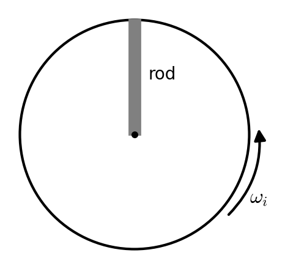
:::
