Use $g = 9.8\ \text{m/s}^2$. Choose the single best answer. Answers are rounded to the precision shown. For a minimum or maximum, choose the answer choice that actually works.

::: {layout="[58,42]" layout-valign="top"}
::: {}
**1.** A highway curve of radius 78 m is banked at $\theta = 20^\circ$. The coefficient of static friction between the tires and the road is $\mu_s = 0.25$. What is the maximum speed at which a car can take the curve without sliding up the bank?\
a)\ 9\ m/s $\quad$ b)\ 14\ m/s $\quad$ c)\ 17\ m/s $\quad$ d)\ 21\ m/s $\quad$ e)\ 23\ m/s
:::

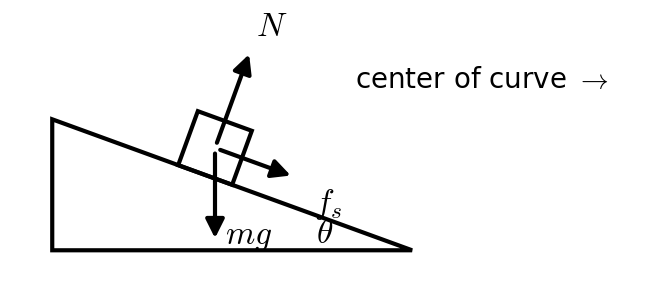
:::

**2.** As defined in class, energy is\
a)\ the rate at which work is done.\
b)\ a vector quantity measured in newtons.\
c)\ the product of mass and velocity.\
d)\ the resistance of an object to rotation.\
e)\ the ability to do work.

::: {layout="[58,42]" layout-valign="top"}
::: {}
**3.** A sled is pulled 12 m across level snow by a rope that makes an angle of $30^\circ$ above the horizontal. The tension in the rope is 50 N. How much work does the rope do on the sled?\
a)\ 0\ J $\quad$ b)\ 300\ J $\quad$ c)\ 520\ J $\quad$ d)\ 600\ J $\quad$ e)\ 1200\ J
:::

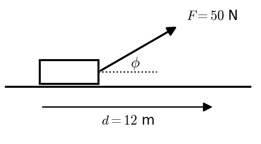
:::

::: {layout="[58,42]" layout-valign="top"}
::: {}
**4.** A coyote steps off the edge of a 45 m cliff, starting from rest. Ignoring air resistance, how fast is it moving just before it hits the ground below?\
a)\ 29.7\ m/s $\quad$ b)\ 42.0\ m/s $\quad$ c)\ 59.4\ m/s $\quad$ d)\ 441\ m/s $\quad$ e)\ 882\ m/s
:::

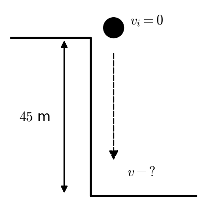
:::

::: {layout="[58,42]" layout-valign="top"}
::: {}
**5.** A skateboarder starts from rest 1.8 m up one wall of a halfpipe. The halfpipe is frictionless except for a 4.0 m long section of the flat bottom with $\mu = 0.10$. She rolls back and forth until she comes to rest. How many times does she cross the **entire** rough section?\
a)\ 1 $\quad$ b)\ 2 $\quad$ c)\ 3 $\quad$ d)\ 4 $\quad$ e)\ 5
:::

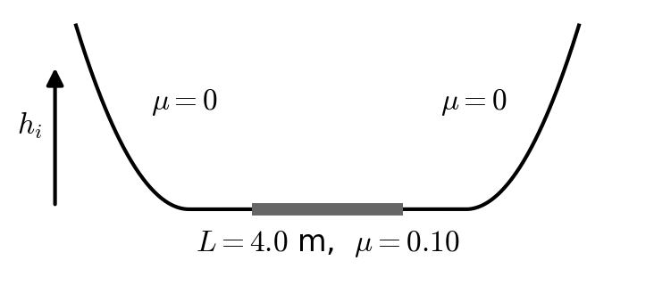
:::

::: {layout="[58,42]" layout-valign="top"}
::: {}
**6.** A 2.0 kg block slides **up** a $30^\circ$ incline ($\mu_k = 0.20$) with an initial speed of 8.0 m/s. How far along the incline does it slide before it comes to rest?\
a)\ 0.61\ m $\quad$ b)\ 2.42\ m $\quad$ c)\ 3.27\ m $\quad$ d)\ 4.66\ m $\quad$ e)\ 4.85\ m
:::

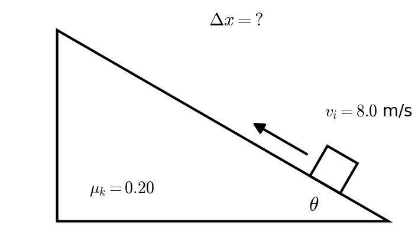
:::

::: {layout="[58,42]" layout-valign="top"}
::: {}
**7.** A horizontal spring ($k = 800$ N/m) is compressed 0.10 m. A 0.20 kg block placed against it is released and slides along a frictionless floor. How fast is the block moving after it leaves the spring?\
a)\ 4.47\ m/s $\quad$ b)\ 6.32\ m/s $\quad$ c)\ 8.94\ m/s $\quad$ d)\ 20.0\ m/s $\quad$ e)\ 40.0\ m/s
:::

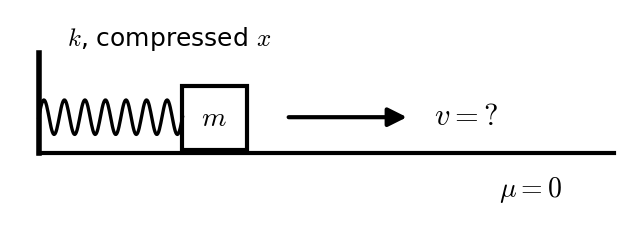
:::

::: {layout="[58,42]" layout-valign="top"}
::: {}
**8.** A 500 kg roller coaster car starts from rest at a height $h = 30$ m and slides down a frictionless track into a vertical circular loop of radius $R = 10$ m. What is the normal force the track exerts on the car at the **top** of the loop?\
a)\ 0\ N $\quad$ b)\ 4900\ N $\quad$ c)\ 9800\ N $\quad$ d)\ 14,700\ N $\quad$ e)\ 24,500\ N
:::

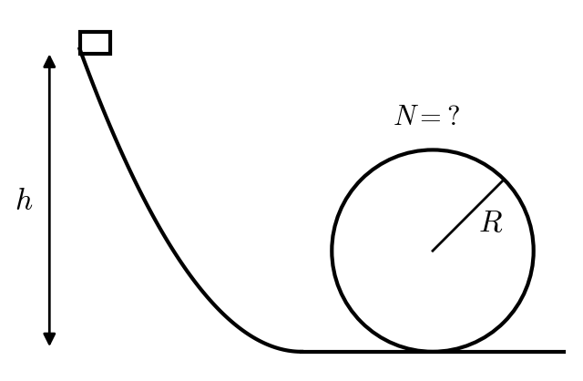
:::

::: {layout="[58,42]" layout-valign="top"}
::: {}
**9.** A cue ball moving at 3.0 m/s hits an 8-ball of the same mass head on. The 8-ball is initially at rest, and the collision is elastic. What is the velocity of the cue ball right after the collision? (Positive is the cue ball's original direction.)\
a)\ −3.0\ m/s $\quad$ b)\ −1.5\ m/s $\quad$ c)\ 0\ m/s $\quad$ d)\ +1.5\ m/s $\quad$ e)\ +3.0\ m/s
:::

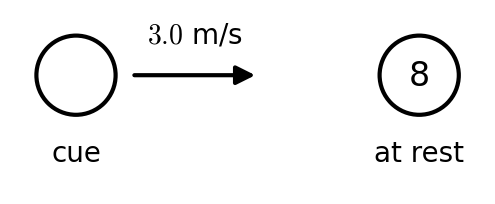
:::

::: {layout="[58,42]" layout-valign="top"}
::: {}
**10.** A 2.0 kg ball moving to the right at 6.0 m/s catches up to and collides **elastically** with a 4.0 kg ball moving to the right at 1.0 m/s. What is the velocity of the 2.0 kg ball after the collision? Positive to the right / negative to the left.\
a)\ +4.33\ m/s $\quad$ b)\ +2.67\ m/s $\quad$ c)\ +0.67\ m/s $\quad$ d)\ 0\ m/s $\quad$ e)\ −0.67\ m/s
:::

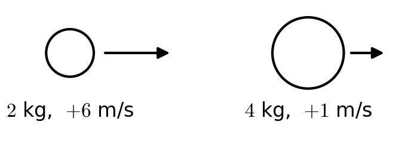
:::

::: {layout="[58,42]" layout-valign="top"}
::: {}
**11.** A 0.010 kg bullet moving at 400 m/s embeds itself in a 2.0 kg block of wood hanging at rest from light strings. How high does the block swing?\
a)\ 0.10\ m $\quad$ b)\ 0.20\ m $\quad$ c)\ 0.40\ m $\quad$ d)\ 1.99\ m $\quad$ e)\ 40.6\ m
:::

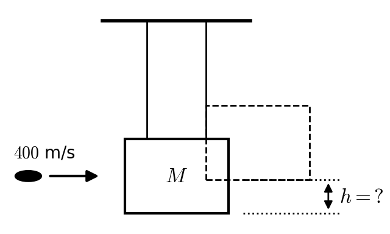
:::

::: {layout="[58,42]" layout-valign="top"}
::: {}
**12.** A 3.0 kg mass hangs from a light string wrapped around a pulley that is a thin ring ($I = MR^2$, $M = 4.0$ kg) on a frictionless axle. The mass is released. What is the tension in the string while the mass falls?\
a)\ 0\ N $\quad$ b)\ 11.8\ N $\quad$ c)\ 16.8\ N $\quad$ d)\ 29.4\ N $\quad$ e)\ 42.0\ N
:::

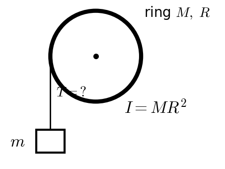
:::

::: {layout="[58,42]" layout-valign="top"}
::: {}
**13.** A thin hoop ($I = MR^2$) starts from rest and rolls without slipping down an incline from a height of 1.5 m. How fast is its center moving at the bottom?\
a)\ 3.83\ m/s $\quad$ b)\ 4.43\ m/s $\quad$ c)\ 4.58\ m/s $\quad$ d)\ 5.42\ m/s $\quad$ e)\ 7.67\ m/s
:::

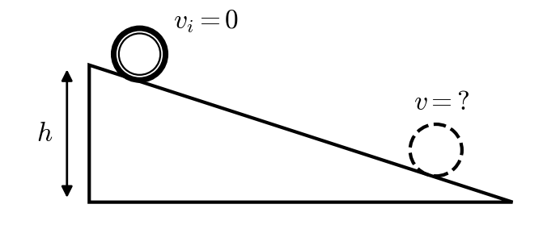
:::

::: {layout="[58,42]" layout-valign="top"}
::: {}
**14.** A disk ($I = \tfrac{1}{2}MR^2$, $M = 200$ kg, $R = 1.5$ m) rotates at 4.0 rad/s. A second disk ($I = \tfrac{1}{2}MR^2$, $M = 100$ kg, $R = 1.0$ m) that is **not** rotating is dropped centered onto it, and the two end up turning together. What is their final angular velocity?\
a)\ 2.00\ rad/s $\quad$ b)\ 2.67\ rad/s $\quad$ c)\ 2.77\ rad/s $\quad$ d)\ 3.27\ rad/s $\quad$ e)\ 4.00\ rad/s
:::

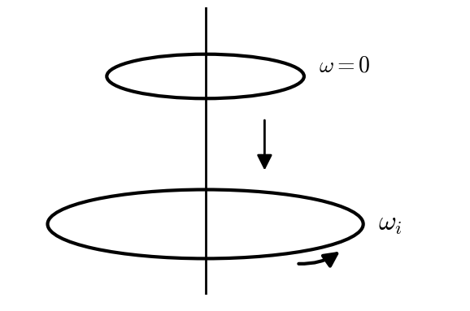
:::

::: {layout="[58,42]" layout-valign="top"}
::: {}
**15.** A merry-go-round (a disk, $I = \tfrac{1}{2}MR^2$, $M = 200$ kg, $R = 2.0$ m) rotates at 1.0 rad/s. A 30 kg child runs at 4.0 m/s tangent to the rim, **opposite** to the direction the rim is moving, and jumps on at the rim. What is the new rotation rate (in the merry-go-round's original direction)?\
a)\ 0.31\ rad/s $\quad$ b)\ 0.40\ rad/s $\quad$ c)\ 0.77\ rad/s $\quad$ d)\ 1.23\ rad/s $\quad$ e)\ 1.60\ rad/s
:::

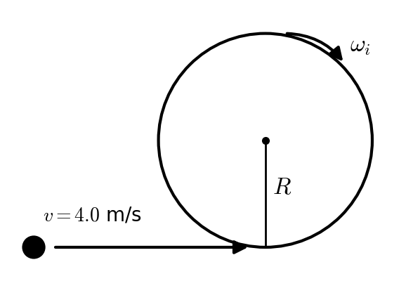
:::
