Use $g = 9.8\ \text{m/s}^2$. Choose the single best answer. Answers are rounded to the precision shown. For a minimum or maximum, choose the answer choice that actually works.

::: {layout="[58,42]" layout-valign="top"}
::: {}
**1.** A highway curve of radius 45 m is banked at $\theta = 12^\circ$. The coefficient of static friction between the tires and the road is $\mu_s = 0.30$. What is the maximum speed at which a car can take the curve without sliding up the bank?\
a)\ 9.7\ m/s $\quad$ b)\ 11.5\ m/s $\quad$ c)\ 15.5\ m/s $\quad$ d)\ 21.9\ m/s $\quad$ e)\ 241\ m/s
:::

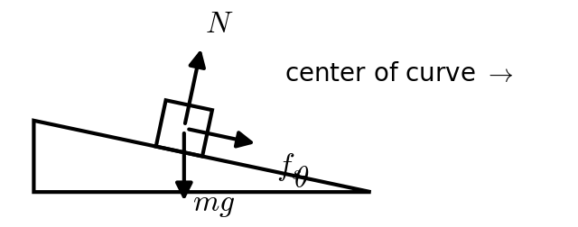
:::

::: {layout="[58,42]" layout-valign="top"}
::: {}
**2.** A roller coaster car starts from rest on a frictionless track and enters a vertical circular loop of radius $R = 7.5$ m. What is the minimum starting height (measured from the bottom of the loop) for the car to make it all the way around the loop?\
a)\ 11\ m $\quad$ b)\ 15\ m $\quad$ c)\ 18\ m $\quad$ d)\ 20\ m $\quad$ e)\ 38\ m
:::

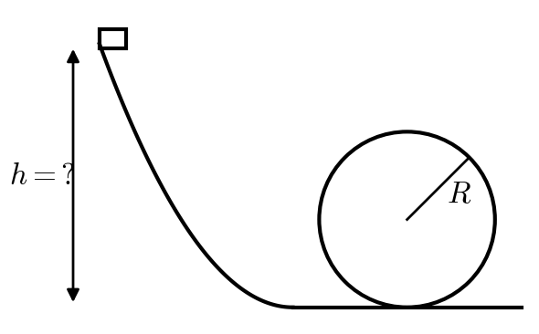
:::

::: {layout="[58,42]" layout-valign="top"}
::: {}
**3.** A skateboarder starts from rest 4.0 m up one wall of a halfpipe. The halfpipe is frictionless except for a 6.0 m long rough section of the flat bottom. After one pass across the rough section, she rises to a height of 3.1 m on the far wall. What is the coefficient of kinetic friction of the rough section?\
a)\ 0.15 $\quad$ b)\ 0.52 $\quad$ c)\ 0.67 $\quad$ d)\ 0.78 $\quad$ e)\ 0.90
:::

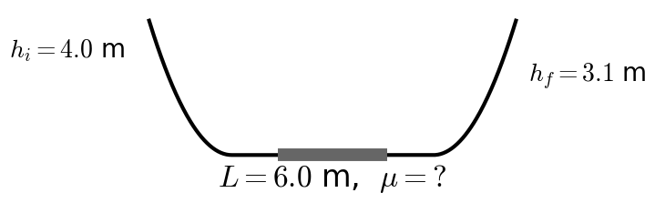
:::

::: {layout="[58,42]" layout-valign="top"}
::: {}
**4.** A block slides **down** a $35^\circ$ incline ($\mu_k = 0.25$) with an initial speed of 2.0 m/s. How fast is it moving after it has slid 3.0 m along the incline?\
a)\ 2.0\ m/s $\quad$ b)\ 3.85\ m/s $\quad$ c)\ 4.66\ m/s $\quad$ d)\ 4.80\ m/s $\quad$ e)\ 5.07\ m/s
:::

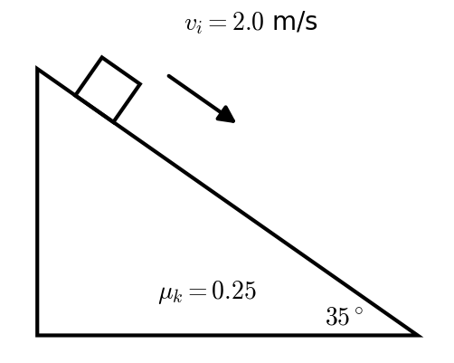
:::

::: {layout="[58,42]" layout-valign="top"}
::: {}
**5.** A 1.5 kg block slides at 4.0 m/s along a frictionless floor into a spring with $k = 600$ N/m. How far is the spring compressed when the block comes to rest?\
a)\ 0.010\ m $\quad$ b)\ 0.040\ m $\quad$ c)\ 0.14\ m $\quad$ d)\ 0.20\ m $\quad$ e)\ 0.28\ m
:::

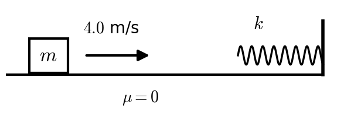
:::

::: {layout="[58,42]" layout-valign="top"}
::: {}
**6.** A motor lifts a 250 kg crate straight up at a constant speed of 1.2 m/s. What power does the motor deliver?\
a)\ 180\ W $\quad$ b)\ 300\ W $\quad$ c)\ 2940\ W $\quad$ d)\ 5880\ W $\quad$ e)\ 29,400\ W
:::

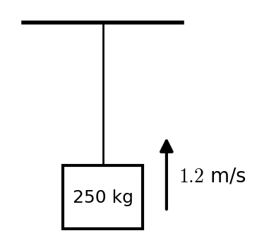
:::

::: {layout="[58,42]" layout-valign="top"}
::: {}
**7.** A 6.0 kg block on a $20^\circ$ incline ($\mu_k = 0.20$) is tied by a light string over a pulley to a 5.0 kg hanging mass. The pulley is a uniform disk ($I = \tfrac12 MR^2$, $M = 4.0$ kg). The system is released from rest, and the hanging mass falls. How fast is it moving after it has fallen 1.2 m?\
a)\ 1.69\ m/s $\quad$ b)\ 1.81\ m/s $\quad$ c)\ 1.97\ m/s $\quad$ d)\ 2.31\ m/s $\quad$ e)\ 4.85\ m/s
:::

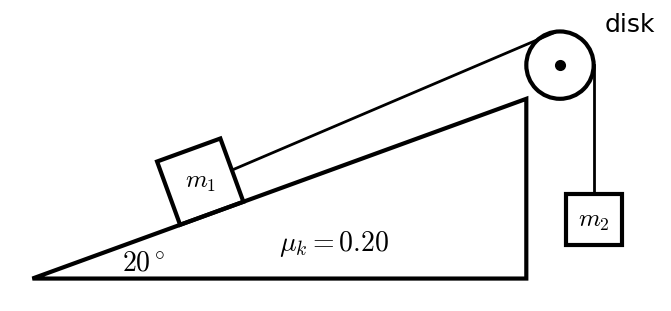
:::

::: {layout="[58,42]" layout-valign="top"}
::: {}
**8.** A 1500 kg car moving at 25 m/s rear-ends a 2500 kg truck moving at 15 m/s in the same direction. They lock together. What is their speed just after the collision?\
a)\ 0\ m/s $\quad$ b)\ 9.4\ m/s $\quad$ c)\ 18.8\ m/s $\quad$ d)\ 20.0\ m/s $\quad$ e)\ 40.0\ m/s
:::

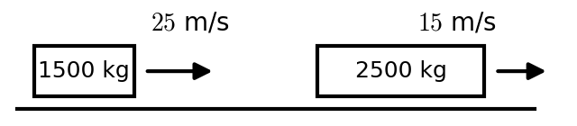
:::

::: {layout="[58,42]" layout-valign="top"}
::: {}
**9.** A 4.0 kg ball moving to the right at 3.0 m/s collides **elastically** head-on with a 1.0 kg ball at rest. What is the velocity of the 1.0 kg ball after the collision?\
a)\ 0\ m/s $\quad$ b)\ +1.8\ m/s $\quad$ c)\ +2.4\ m/s $\quad$ d)\ +3.0\ m/s $\quad$ e)\ +4.8\ m/s
:::

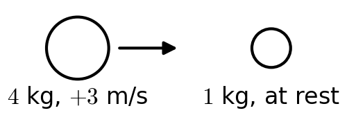
:::

::: {layout="[58,42]" layout-valign="top"}
::: {}
**10.** A 0.012 kg bullet is fired into a 1.5 kg block of wood hanging at rest from light strings. The bullet lodges in the block, which swings up to a height of 0.12 m. What was the bullet's speed?\
a)\ 1.5\ m/s $\quad$ b)\ 17\ m/s $\quad$ c)\ 126\ m/s $\quad$ d)\ 193\ m/s $\quad$ e)\ 386\ m/s
:::

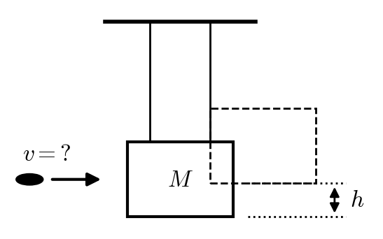
:::

::: {layout="[58,42]" layout-valign="top"}
::: {}
**11.** A ceiling fan spinning at 30 rad/s is switched off and slows uniformly to a stop in 6.0 s. Through what angle does it turn while stopping?\
a)\ 5.0\ rad $\quad$ b)\ 14.3\ rad $\quad$ c)\ 15\ rad $\quad$ d)\ 45\ rad $\quad$ e)\ 90\ rad
:::

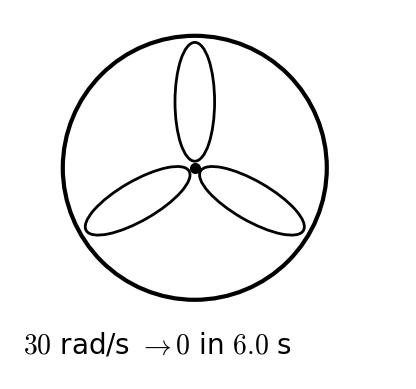
:::

::: {layout="[58,42]" layout-valign="top"}
::: {}
**12.** A 2.0 kg mass hangs from a light string wrapped around a pulley that is a thin ring ($I = MR^2$, $M = 3.0$ kg) on a frictionless axle. The mass is released. What is its acceleration?\
a)\ 2.45\ m/s² $\quad$ b)\ 3.92\ m/s² $\quad$ c)\ 5.60\ m/s² $\quad$ d)\ 6.53\ m/s² $\quad$ e)\ 9.80\ m/s²
:::

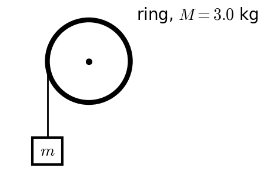
:::

::: {layout="[58,42]" layout-valign="top"}
::: {}
**13.** A solid cylinder ($I = \tfrac12 MR^2$) rolls without slipping down a $30^\circ$ incline. What is the acceleration of its center?\
a)\ 2.45\ m/s² $\quad$ b)\ 3.27\ m/s² $\quad$ c)\ 3.50\ m/s² $\quad$ d)\ 4.90\ m/s² $\quad$ e)\ 6.53\ m/s²
:::

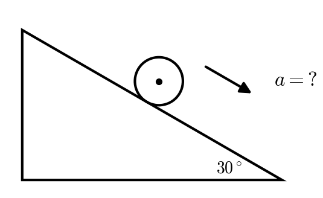
:::

::: {layout="[58,42]" layout-valign="top"}
::: {}
**14.** A platform (a disk, $I = \tfrac12 MR^2$, $M = 150$ kg, $R = 2.0$ m) rotates at +2.5 rad/s. A thin ring ($I = mr^2$, $m = 40$ kg, $r = 1.5$ m) spinning in the **opposite** direction at −3.0 rad/s is dropped centered onto it, and the two end up turning together. What is their final angular velocity?\
a)\ +1.23\ rad/s $\quad$ b)\ +1.78\ rad/s $\quad$ c)\ +1.92\ rad/s $\quad$ d)\ +2.50\ rad/s $\quad$ e)\ +2.62\ rad/s
:::

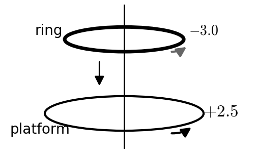
:::

::: {layout="[58,42]" layout-valign="top"}
::: {}
**15.** A 60 kg person stands at the **center** of a merry-go-round (a disk, $I = \tfrac12 MR^2$, $M = 250$ kg, $R = 2.0$ m) that rotates at 1.8 rad/s. The person walks out to the rim. What is the angular velocity when the person reaches the rim? (Treat the person as a point mass.)\
a)\ 1.22\ rad/s $\quad$ b)\ 1.45\ rad/s $\quad$ c)\ 1.80\ rad/s $\quad$ d)\ 2.23\ rad/s $\quad$ e)\ 2.66\ rad/s
:::

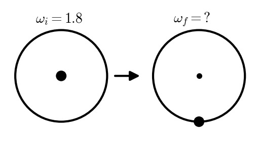
:::
