Use $g = 9.8\ \text{m/s}^2$. Choose the single best answer. Answers are rounded to the precision shown. For a minimum or maximum, choose the answer choice that actually works.

::: {layout="[58,42]" layout-valign="top"}
::: {}
**1.** A highway curve of radius 103 m is banked at $\theta = 25^\circ$. The coefficient of static friction between the tires and the road is $\mu_s = 0.12$. What is the minimum speed at which a car can take the curve without sliding down the bank?\
a)\ 11\ m/s $\quad$ b)\ 18\ m/s $\quad$ c)\ 19\ m/s $\quad$ d)\ 22\ m/s $\quad$ e)\ 25\ m/s
:::

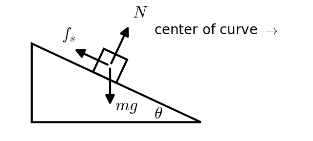
:::

::: {layout="[58,42]" layout-valign="top"}
::: {}
**2.** Masses $m_1 = 5.0$ kg and $m_2 = 3.0$ kg hang from opposite ends of a light string over a pulley that is a uniform disk ($I = \tfrac12 MR^2$, $M = 2.0$ kg). They are released from rest. How fast is $m_1$ moving after it has fallen 2.0 m?\
a)\ 2.80\ m/s $\quad$ b)\ 2.95\ m/s $\quad$ c)\ 3.13\ m/s $\quad$ d)\ 3.61\ m/s $\quad$ e)\ 6.26\ m/s
:::

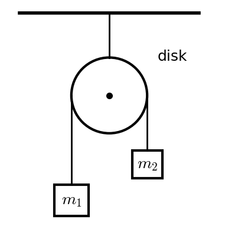
:::

::: {layout="[58,42]" layout-valign="top"}
::: {}
**3.** A roller coaster car passes over the top of a 30 m hill at 8.0 m/s. The track is frictionless. How fast is it moving when it reaches a section of track 12 m above the ground?\
a)\ 15.5\ m/s $\quad$ b)\ 18.8\ m/s $\quad$ c)\ 20.4\ m/s $\quad$ d)\ 25.5\ m/s $\quad$ e)\ 26.8\ m/s
:::

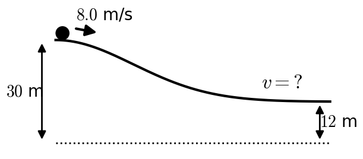
:::

::: {layout="[58,42]" layout-valign="top"}
::: {}
**4.** A block slides **up** a $20^\circ$ incline ($\mu_k = 0.15$) with an initial speed of 6.0 m/s. How fast is it moving after it has slid 2.0 m along the incline?\
a)\ 4.13\ m/s $\quad$ b)\ 4.75\ m/s $\quad$ c)\ 5.15\ m/s $\quad$ d)\ 7.41\ m/s $\quad$ e)\ it stops before it slides the whole 2.0 m
:::

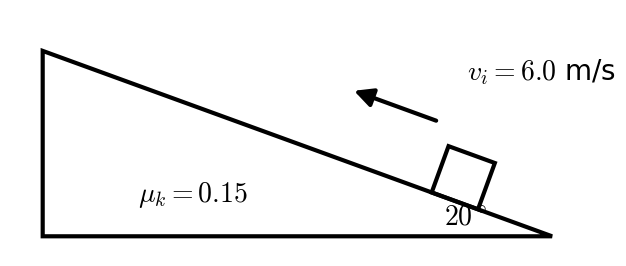
:::

::: {layout="[58,42]" layout-valign="top"}
::: {}
**5.** A vertical spring ($k = 1200$ N/m) is used to launch a 0.25 kg ball straight up. How far must the spring be compressed for the ball to rise 3.0 m above the release point?\
a)\ 0.006\ m $\quad$ b)\ 0.012\ m $\quad$ c)\ 0.055\ m $\quad$ d)\ 0.078\ m $\quad$ e)\ 0.11\ m
:::

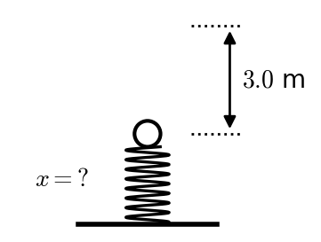
:::

::: {layout="[58,42]" layout-valign="top"}
::: {}
**6.** A 60 kg rider in a roller coaster car starts from rest 20 m above the bottom of a vertical loop of radius $R = 8.0$ m. The track is frictionless. What normal force does the seat exert on the rider at the **bottom** of the loop?\
a)\ 588\ N $\quad$ b)\ 2350\ N $\quad$ c)\ 2940\ N $\quad$ d)\ 3530\ N $\quad$ e)\ 7060\ N
:::

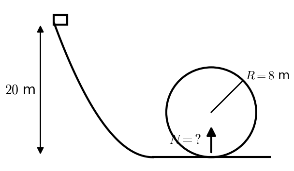
:::

::: {layout="[58,42]" layout-valign="top"}
::: {}
**7.** A 3.0 kg block starts from rest and slides **down** a $35^\circ$ incline ($\mu = 0.20$). It is tied by a light string to a pulley at the top of the incline. The pulley is a uniform disk ($I = \tfrac12 MR^2$, $M = 2.0$ kg) that unwinds as the block slides. How fast is the block moving after it has slid 1.5 m?\
a)\ 2.69\ m/s $\quad$ b)\ 3.01\ m/s $\quad$ c)\ 3.47\ m/s $\quad$ d)\ 3.56\ m/s $\quad$ e)\ 4.11\ m/s
:::

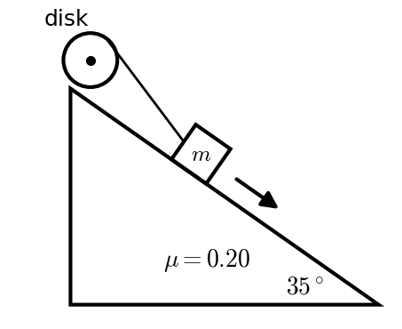
:::

::: {layout="[58,42]" layout-valign="top"}
::: {}
**8.** A 0.40 kg ball hits a wall head-on at 15 m/s and bounces straight back at 10 m/s. The ball is in contact with the wall for 0.050 s. What is the magnitude of the average force on the ball?\
a)\ 40\ N $\quad$ b)\ 80\ N $\quad$ c)\ 120\ N $\quad$ d)\ 160\ N $\quad$ e)\ 200\ N
:::

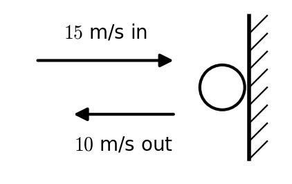
:::

::: {layout="[58,42]" layout-valign="top"}
::: {}
**9.** A cart of mass $m$ moving right at speed $v$ collides head-on with a cart of mass $3m$ moving **left** at speed $v/3$. The carts couple together. What fraction of the initial kinetic energy is retained after the collision?\
a)\ 0% $\quad$ b)\ 25% $\quad$ c)\ 50% $\quad$ d)\ 75% $\quad$ e)\ 100%
:::

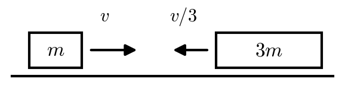
:::

::: {layout="[58,42]" layout-valign="top"}
::: {}
**10.** A 2.0 kg ball moving right at 5.0 m/s collides **elastically** head-on with a 3.0 kg ball moving left at 4.0 m/s. What is the velocity of the 3.0 kg ball after the collision? Positive to the right / negative to the left.\
a)\ +5.8\ m/s $\quad$ b)\ +5.0\ m/s $\quad$ c)\ +4.0\ m/s $\quad$ d)\ +3.2\ m/s $\quad$ e)\ −0.4\ m/s
:::

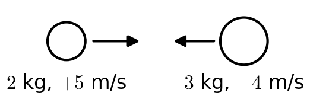
:::

::: {layout="[58,42]" layout-valign="top"}
::: {}
**11.** A 0.020 kg bullet is fired into a 3.98 kg block of wood hanging at rest from light strings, and lodges in it. The block swings upward. What fraction of the bullet's initial kinetic energy remains in the motion of the block (with the bullet) just after the collision?\
a)\ <\ 0.1% $\quad$ b)\ 0.1–1% $\quad$ c)\ 1–10% $\quad$ d)\ 10–50% $\quad$ e)\ >\ 50%
:::

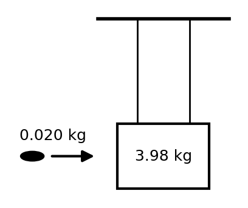
:::

::: {layout="[58,42]" layout-valign="top"}
::: {}
**12.** A thin uniform rod has mass 2.0 kg and length 1.0 m ($I_{cm} = \tfrac1{12}m\ell^2$). It rotates about an axis perpendicular to the rod, located 0.20 m from one end. What is the rod's moment of inertia about this axis?\
a)\ 0.08\ kg·m² $\quad$ b)\ 0.17\ kg·m² $\quad$ c)\ 0.25\ kg·m² $\quad$ d)\ 0.35\ kg·m² $\quad$ e)\ 0.67\ kg·m²
:::

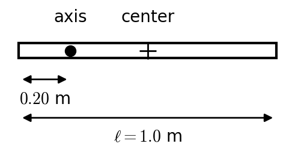
:::

::: {layout="[58,42]" layout-valign="top"}
::: {}
**13.** A solid sphere ($I = \tfrac25 MR^2$, $M = 1.5$ kg, $R = 0.050$ m) starts from rest and rolls without slipping down an incline from a height of 0.80 m. What is its rotational velocity $\omega$ at the bottom?\
a)\ 3.3\ rad/s $\quad$ b)\ 33\ rad/s $\quad$ c)\ 56\ rad/s $\quad$ d)\ 65\ rad/s $\quad$ e)\ 67\ rad/s
:::

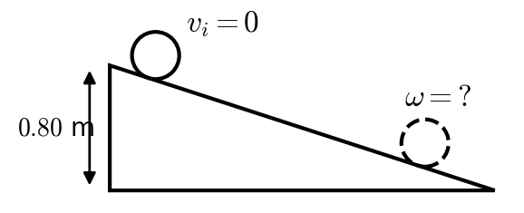
:::

::: {layout="[58,42]" layout-valign="top"}
::: {}
**14.** A merry-go-round (a disk, $I = \tfrac12 MR^2$, $M = 200$ kg, $R = 2.5$ m) rotates at 0.80 rad/s. A 30 kg child runs at 4.0 m/s in the direction of rotation, along a line that passes 1.5 m from the center, and jumps on at that point (1.5 m from the center, not at the rim). What is the new angular velocity?\
a)\ 0.72\ rad/s $\quad$ b)\ 0.80\ rad/s $\quad$ c)\ 0.98\ rad/s $\quad$ d)\ 1.09\ rad/s $\quad$ e)\ 1.16\ rad/s
:::

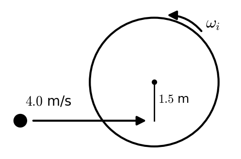
:::

::: {layout="[58,42]" layout-valign="top"}
::: {}
**15.** A wheel starts from rest and speeds up with a constant angular acceleration of 4.0 rad/s². How long does it take to turn through 50 rad?\
a)\ 5.0\ s $\quad$ b)\ 6.25\ s $\quad$ c)\ 12.5\ s $\quad$ d)\ 25\ s $\quad$ e)\ 50\ s
:::

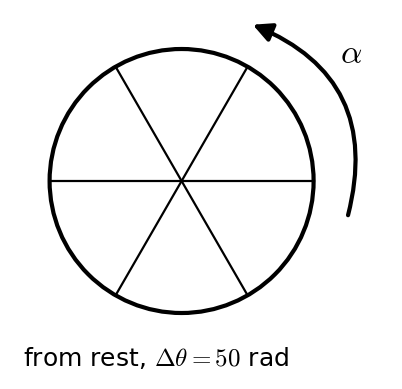
:::
