Use $g = 9.8\ \text{m/s}^2$. Choose the single best answer. Answers are rounded to the precision shown. For a minimum or maximum, choose the answer choice that actually works.

::: {layout="[58,42]" layout-valign="top"}
::: {}
**1.** A car drives around a flat (unbanked) curve of radius 40 m. The coefficient of static friction between the tires and the road is $\mu_s = 0.55$. What is the maximum speed at which the car can take the curve without sliding?\
a)\ 4.7\ m/s $\quad$ b)\ 10.4\ m/s $\quad$ c)\ 14\ m/s $\quad$ d)\ 15\ m/s $\quad$ e)\ 19.8\ m/s
:::

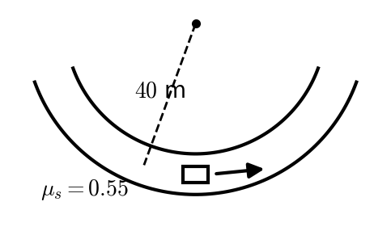
:::

::: {layout="[58,42]" layout-valign="top"}
::: {}
**2.** A 5.0 kg mass hangs from a light string wrapped around a pulley that is a uniform disk ($I = \tfrac12 MR^2$, $M = 6.0$ kg) on a frictionless axle. The mass is released. What is the tension in the string while the mass falls?\
a)\ 0\ N $\quad$ b)\ 18.4\ N $\quad$ c)\ 26.7\ N $\quad$ d)\ 30.6\ N $\quad$ e)\ 49.0\ N
:::

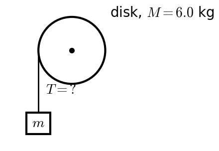
:::

::: {layout="[58,42]" layout-valign="top"}
::: {}
**3.** A skateboarder is 2.0 m up one wall of a halfpipe, moving **down** the wall at 3.0 m/s. The halfpipe is frictionless except for a 5.0 m long section of the flat bottom with $\mu = 0.12$. How high up the far wall does she rise?\
a)\ 0.46\ m $\quad$ b)\ 1.26\ m $\quad$ c)\ 1.40\ m $\quad$ d)\ 1.86\ m $\quad$ e)\ 2.46\ m
:::

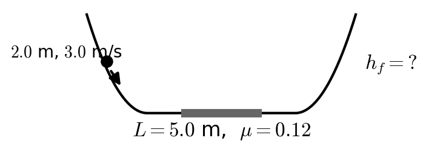
:::

::: {layout="[58,42]" layout-valign="top"}
::: {}
**4.** A 7.0 kg mass and a 5.0 kg mass hang from opposite ends of a light string over a massless, frictionless pulley. What is the magnitude of their acceleration?\
a)\ 1.63\ m/s² $\quad$ b)\ 2.80\ m/s² $\quad$ c)\ 3.92\ m/s² $\quad$ d)\ 9.80\ m/s² $\quad$ e)\ 19.6\ m/s²
:::

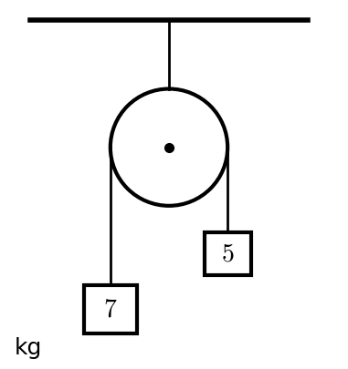
:::

::: {layout="[58,42]" layout-valign="top"}
::: {}
**5.** A block is sliding **down** a $15^\circ$ incline ($\mu_k = 0.45$) at 5.0 m/s. Friction slows it down. How long does it take to come to rest?\
a)\ 0.74\ s $\quad$ b)\ 1.45\ s $\quad$ c)\ 2.67\ s $\quad$ d)\ 2.90\ s $\quad$ e)\ it never stops; it speeds up
:::

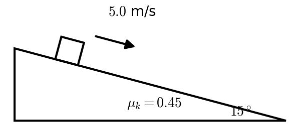
:::

::: {layout="[58,42]" layout-valign="top"}
::: {}
**6.** A vertical spring ($k = 900$ N/m) is compressed 0.080 m with a 0.15 kg ball resting on it, then released. How fast is the ball moving when it is 0.50 m above the release point?\
a)\ 3.13\ m/s $\quad$ b)\ 3.78\ m/s $\quad$ c)\ 5.35\ m/s $\quad$ d)\ 6.20\ m/s $\quad$ e)\ 8.19\ m/s
:::

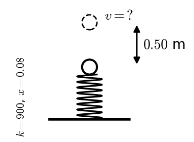
:::

::: {layout="[58,42]" layout-valign="top"}
::: {}
**7.** A 12 kg block on a $40^\circ$ incline ($\mu_k = 0.25$) is tied by a light string over a massless pulley at the top to a 3.0 kg hanging mass. The block is sliding **down** the incline at 1.0 m/s (so the hanging mass is rising). How fast is the block moving after it has slid 0.80 m down the incline?\
a)\ 1.59\ m/s $\quad$ b)\ 1.88\ m/s $\quad$ c)\ 2.04\ m/s $\quad$ d)\ 2.43\ m/s $\quad$ e)\ it stops before it slides the whole 0.80 m
:::

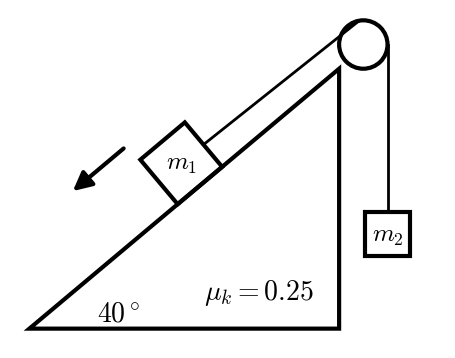
:::

::: {layout="[58,42]" layout-valign="top"}
::: {}
**8.** A ball is thrown from the edge of a 12 m high ledge at 18 m/s, $55^\circ$ above the horizontal. How high above the ground below is the ball at the highest point of its path?\
a)\ 5.4\ m $\quad$ b)\ 11.1\ m $\quad$ c)\ 12.0\ m $\quad$ d)\ 17.4\ m $\quad$ e)\ 23.1\ m
:::

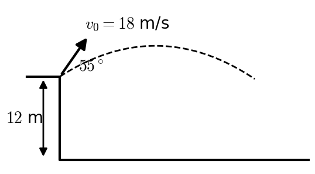
:::

::: {layout="[58,42]" layout-valign="top"}
::: {}
**9.** A 0.015 kg bullet moving at 300 m/s embeds itself in a 2.0 kg block resting on a frictionless table. How fast does the block (with the bullet) move just after the collision?\
a)\ 2.23\ m/s $\quad$ b)\ 2.25\ m/s $\quad$ c)\ 4.5\ m/s $\quad$ d)\ 25.9\ m/s $\quad$ e)\ 300\ m/s
:::

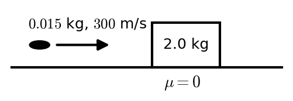
:::

::: {layout="[58,42]" layout-valign="top"}
::: {}
**10.** A 0.50 kg ball moving right at 6.0 m/s collides **elastically** head-on with a 1.5 kg ball at rest. What is the velocity of the 0.50 kg ball after the collision? Positive to the right / negative to the left.\
a)\ +6.0\ m/s $\quad$ b)\ +3.0\ m/s $\quad$ c)\ +1.5\ m/s $\quad$ d)\ 0\ m/s $\quad$ e)\ −3.0\ m/s
:::

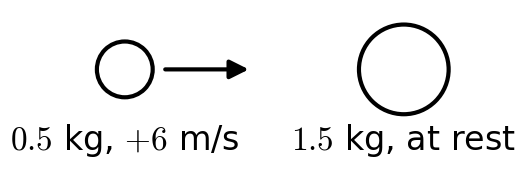
:::

::: {layout="[58,42]" layout-valign="top"}
::: {}
**11.** A wheel spinning at 12 rad/s slows down with a constant angular deceleration of 1.5 rad/s². Through what angle does it turn before it stops?\
a)\ 7.6\ rad $\quad$ b)\ 8.0\ rad $\quad$ c)\ 24\ rad $\quad$ d)\ 48\ rad $\quad$ e)\ 96\ rad
:::

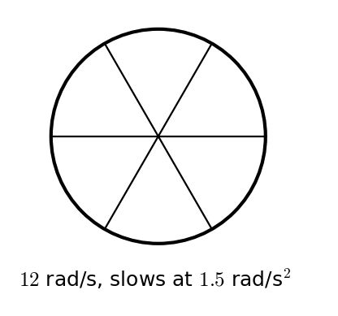
:::

::: {layout="[58,42]" layout-valign="top"}
::: {}
**12.** A uniform disk ($I_{cm} = \tfrac12 MR^2$, $M = 4.0$ kg, $R = 0.30$ m) rotates about an axis perpendicular to the disk through a point on its **edge**. What is its moment of inertia about this axis?\
a)\ 0.12\ kg·m² $\quad$ b)\ 0.18\ kg·m² $\quad$ c)\ 0.27\ kg·m² $\quad$ d)\ 0.36\ kg·m² $\quad$ e)\ 0.54\ kg·m²
:::

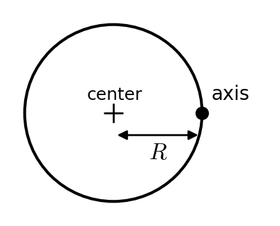
:::

::: {layout="[58,42]" layout-valign="top"}
::: {}
**13.** A thin hoop ($I = MR^2$) rolls without slipping down a $28^\circ$ incline. What is the acceleration of its center?\
a)\ 2.30\ m/s² $\quad$ b)\ 3.07\ m/s² $\quad$ c)\ 3.29\ m/s² $\quad$ d)\ 4.33\ m/s² $\quad$ e)\ 4.60\ m/s²
:::

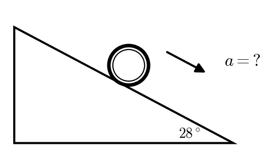
:::

::: {layout="[58,42]" layout-valign="top"}
::: {}
**14.** A disk ($I = \tfrac12 MR^2$, $M = 40$ kg, $R = 0.50$ m) spins at +6.0 rad/s. A second disk ($I = \tfrac12 MR^2$, $M = 20$ kg, $R = 0.50$ m) spinning the **opposite** way at −2.0 rad/s is dropped onto it, and the two end up turning together. What is their final angular velocity?\
a)\ +2.00\ rad/s $\quad$ b)\ +3.33\ rad/s $\quad$ c)\ +4.00\ rad/s $\quad$ d)\ +4.67\ rad/s $\quad$ e)\ +6.00\ rad/s
:::

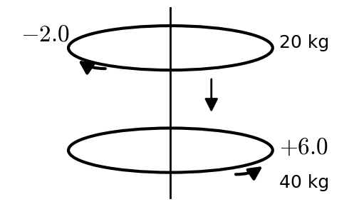
:::

::: {layout="[58,42]" layout-valign="top"}
::: {}
**15.** A 75 kg person stands at the rim of a merry-go-round (a disk, $I = \tfrac12 MR^2$, $M = 300$ kg, $R = 3.0$ m) that rotates at 1.0 rad/s. The person walks **halfway** in, to 1.5 m from the center. What is the new angular velocity? (Treat the person as a point mass.)\
a)\ 0.75\ rad/s $\quad$ b)\ 1.00\ rad/s $\quad$ c)\ 1.33\ rad/s $\quad$ d)\ 1.50\ rad/s $\quad$ e)\ 2.00\ rad/s
:::

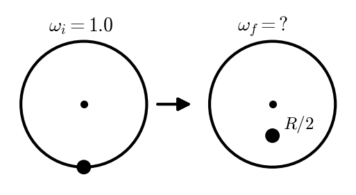
:::
