Use $g = 9.8\ \text{m/s}^2$. Choose the single best answer. Answers are rounded to the precision shown. For a minimum or maximum, choose the answer choice that actually works.

::: {layout="[58,42]" layout-valign="top"}
::: {}
**1.** A skateboarder rides down the wall of a halfpipe from an initial height of 5.0 m, starting from rest. The halfpipe is frictionless except for a region 4.0 m long on the bottom with a coefficient of friction $\mu = 0.15$. How high up the far side of the halfpipe does he rise before he comes to rest?\
a)\ 4.7\ m $\quad$ b)\ 4.6\ m $\quad$ c)\ 4.5\ m $\quad$ d)\ 4.4\ m $\quad$ e)\ 4.3\ m
:::

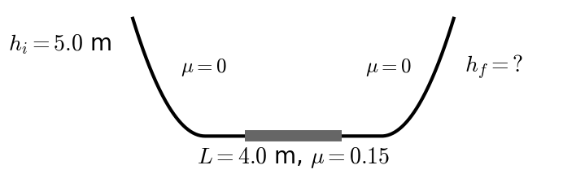
:::

::: {layout="[58,42]" layout-valign="top"}
::: {}
**2.** A mass is fired from a height of 4.0 m above the flat ground below at 22 m/s at an angle of $40^\circ$ above the horizontal. How high above the ground below does the mass fly at the highest point in its trajectory?\
a)\ 4.0\ m $\quad$ b)\ 10.2\ m $\quad$ c)\ 14.2\ m $\quad$ d)\ 18.5\ m $\quad$ e)\ 28.7\ m
:::

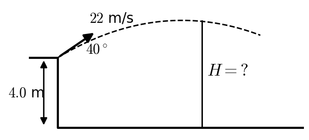
:::

::: {layout="[58,42]" layout-valign="top"}
::: {}
**3.** In order to go all the way around a circular loop of radius $R = 12$ m, how fast must a mass be moving as it enters the bottom of the loop?\
a)\ 11\ m/s $\quad$ b)\ 19\ m/s $\quad$ c)\ 22\ m/s $\quad$ d)\ 24\ m/s $\quad$ e)\ 26\ m/s
:::

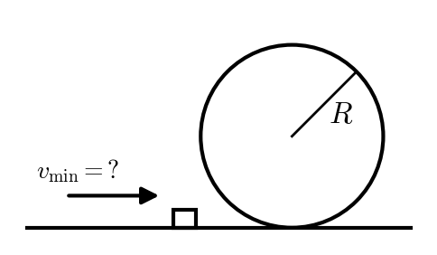
:::

::: {layout="[58,42]" layout-valign="top"}
::: {}
**4.** A mass of 4.0 kg is sliding up a ramp ($\mu = 0.50$ and $\theta = 8^\circ$), initially sliding at 6.0 m/s. How long does it continue to slide along the ramp before it comes to rest?\
a)\ 0.97\ s $\quad$ b)\ 1.72\ s $\quad$ c)\ 1.93\ s $\quad$ d)\ 2.90\ s $\quad$ e)\ 4.40\ s
:::

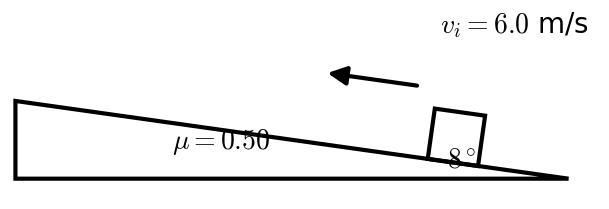
:::

::: {layout="[58,42]" layout-valign="top"}
::: {}
**5.** A 0.040 kg mass is placed on a vertical spring of spring constant $k = 1500$ N/m. The spring is compressed 0.030 m from its equilibrium length. When the mass on the compressed spring is released, it shoots the mass straight up. How far does the mass fly above the release point?\
a)\ 0.17\ m $\quad$ b)\ 0.86\ m $\quad$ c)\ 1.7\ m $\quad$ d)\ 3.4\ m $\quad$ e)\ 17\ m
:::

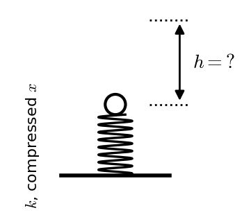
:::

::: {layout="[58,42]" layout-valign="top"}
::: {}
**6.** A 2.0 kg mass moving to the right at 4.0 m/s collides **elastically** in a head-on collision with a 3.0 kg mass moving at 3.0 m/s to the left. How fast and in what direction is the 3.0 kg mass moving after the collision? Positive to the right / negative to the left.\
a)\ +4.4\ m/s $\quad$ b)\ +2.6\ m/s $\quad$ c)\ −0.2\ m/s $\quad$ d)\ −2.6\ m/s $\quad$ e)\ −4.4\ m/s
:::

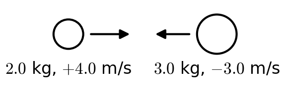
:::

::: {layout="[58,42]" layout-valign="top"}
::: {}
**7.** A railroad car of mass $3m$ and velocity $2v$ collides completely **inelastically** with another railroad car of mass $m$ and velocity $v$ (same direction). The two cars collide and couple together. What fraction of the initial kinetic energy is still retained by the cars after the collision?\
a)\ <1% $\quad$ b)\ 2–5% $\quad$ c)\ 10–20% $\quad$ d)\ 30–50% $\quad$ e)\ >90%
:::

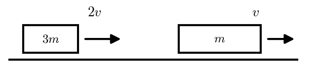
:::

::: {layout="[58,42]" layout-valign="top"}
::: {}
**8.** A bullet (mass 0.008 kg) is fired into a suspended block of wood (6.0 kg). Initially the wood is not moving. The bullet lodges in the wood. Recoil of the wood causes it to swing (rising 0.02 m). What fraction of the initial kinetic energy remained in the motion of the block of wood?\
a)\ <0.1% $\quad$ b)\ 0.1–0.5% $\quad$ c)\ 0.5–1% $\quad$ d)\ 1–10% $\quad$ e)\ >10%
:::

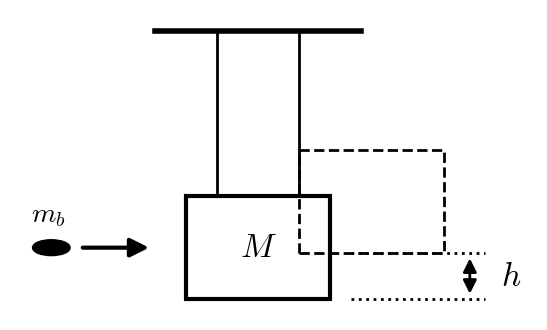
:::

::: {layout="[58,42]" layout-valign="top"}
::: {}
**9.** A mass of 1.5 kg hangs from a pulley ($I = \tfrac35 MR^2$, $M = 8.0$ kg, $R = 0.20$ m) as shown. What is the downward linear acceleration of the hanging mass?\
a)\ 0.83\ m/s² $\quad$ b)\ 1.33\ m/s² $\quad$ c)\ 1.83\ m/s² $\quad$ d)\ 2.33\ m/s² $\quad$ e)\ 2.83\ m/s²
:::

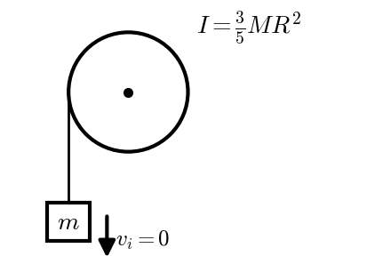
:::

::: {layout="[58,42]" layout-valign="top"}
::: {}
**10.** A sphere ($M = 3.0$ kg, $R = 0.020$ m, $I = \tfrac25 MR^2$) rolls down an incline from a height of 1.5 m, starting from rest. At the bottom of the incline, what is the sphere's rotational velocity $\omega$?\
a)\ 4.6\ rad/s $\quad$ b)\ 229\ rad/s $\quad$ c)\ 458\ rad/s $\quad$ d)\ 2290\ rad/s $\quad$ e)\ 52,500\ rad/s
:::

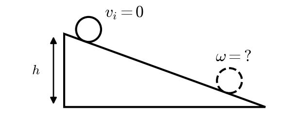
:::

::: {layout="[58,42]" layout-valign="top"}
::: {}
**11.** A disk ($I = \tfrac12 MR^2$, mass 150 kg, radius 2.0 m) rotates at 3.0 rad/s. A wheel ($I = 0.8MR^2$, mass 50 kg, radius 1.5 m, initially rotating in the opposite direction at −2.0 rad/s) is dropped onto the disk. Their collision is completely inelastic. After they stop bouncing, what is the angular velocity (rad/s) of the two-object stack?\
a)\ −0.5\ rad/s $\quad$ b)\ 0\ rad/s $\quad$ c)\ +1\ rad/s $\quad$ d)\ +1.5\ rad/s $\quad$ e)\ +2\ rad/s
:::

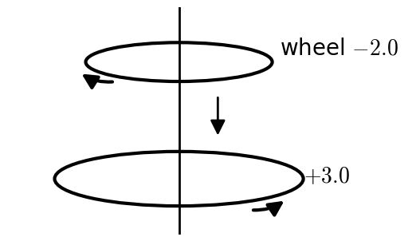
:::

::: {layout="[58,42]" layout-valign="top"}
::: {}
**12.** A merry-go-round (a disk $I = \tfrac12 MR^2$, $M = 400$ kg, $R = 2.5$ m) rotates at +0.60 rad/s. A child with a mass of 45 kg jumps onto the merry-go-round (going the same direction) at the rim. The child was running at 6.0 m/s as she jumps on. What is the new rotation rate for the merry-go-round WITH the child?\
a)\ 0.3\ rad/s $\quad$ b)\ 0.5\ rad/s $\quad$ c)\ 0.7\ rad/s $\quad$ d)\ 0.9\ rad/s $\quad$ e)\ 1.1\ rad/s
:::

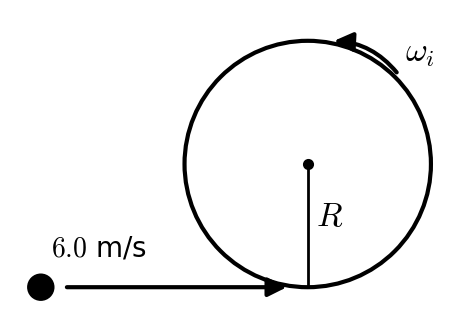
:::

::: {layout="[58,42]" layout-valign="top"}
::: {}
**13.** A mass of 6.0 kg slides down a $25^\circ$ inclined surface (with $\mu = 0.12$) at 0.50 m/s. It is connected to a pulley (as shown). The pulley is a disk with mass 3.0 kg, radius 0.06 m, and moment of inertia $0.5MR^2$. How fast is the mass sliding when it has slid 0.80 m down along the incline?\
a)\ 2.05\ m/s $\quad$ b)\ 1.98\ m/s $\quad$ c)\ 1.88\ m/s $\quad$ d)\ 1.49\ m/s $\quad$ e)\ it stops before it slides the whole 0.80 m
:::

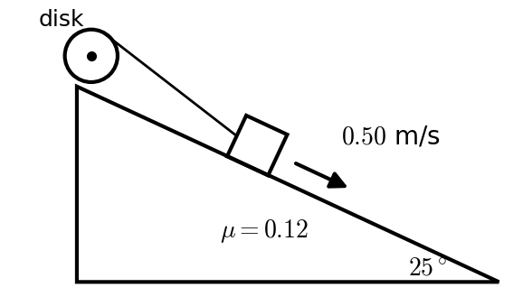
:::

::: {layout="[58,42]" layout-valign="top"}
::: {}
**14.** In an Atwood's machine, $m_1 = 12$ kg and $m_2 = 8.0$ kg hang from a light string over a massless, frictionless pulley. They are released from rest. How fast is $m_1$ moving after it has fallen 1.5 m?\
a)\ 2.42\ m/s $\quad$ b)\ 3.13\ m/s $\quad$ c)\ 3.83\ m/s $\quad$ d)\ 4.85\ m/s $\quad$ e)\ 5.42\ m/s
:::

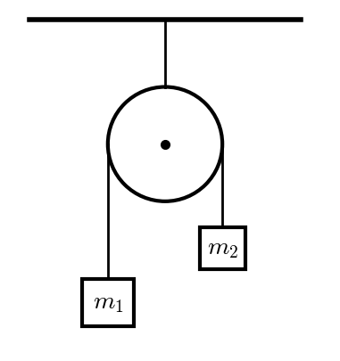
:::

::: {layout="[58,42]" layout-valign="top"}
::: {}
**15.** A wheel speeds up uniformly from 20 rad/s to 60 rad/s while turning through 100 rad. What is its angular acceleration?\
a)\ 0.40\ rad/s² $\quad$ b)\ 8.0\ rad/s² $\quad$ c)\ 16\ rad/s² $\quad$ d)\ 32\ rad/s² $\quad$ e)\ 36\ rad/s²
:::

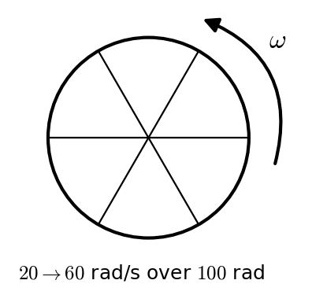
:::
