Use $g = 9.8\ \text{m/s}^2$. Choose the single best answer. Answers are rounded to the precision shown. For a minimum or maximum, choose the answer choice that actually works.

::: {layout="[58,42]" layout-valign="top"}
::: {}
**1.** A skater starts from rest at a height of 2.5 m on one side of a halfpipe. Overnight a puddle dried and left a rough strip 8.0 m long on the flat bottom with $\mu_k = 0.02$; the rest of the halfpipe is frictionless. How high up the far side does the skater rise?\
a)\ 2.34\ m $\quad$ b)\ 2.26\ m $\quad$ c)\ 2.18\ m $\quad$ d)\ 2.10\ m $\quad$ e)\ 2.02\ m
:::

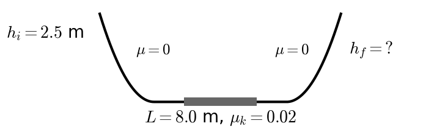
:::

::: {layout="[58,42]" layout-valign="top"}
::: {}
**2.** A roller coaster car starts from rest at the top of a 75 m hill and rolls down a frictionless track. How fast is it moving at a point on the track 30 m above the ground?\
a)\ 21.0\ m/s $\quad$ b)\ 29.7\ m/s $\quad$ c)\ 38.3\ m/s $\quad$ d)\ 42.0\ m/s $\quad$ e)\ 882\ m/s
:::

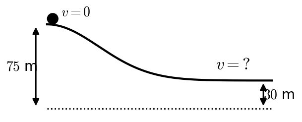
:::

::: {layout="[58,42]" layout-valign="top"}
::: {}
**3.** A block slides up a frictionless incline ($\theta = 12^\circ$) with an initial speed of 5.0 m/s. How fast is it moving after it has slid 4.0 m along the incline?\
a)\ 2.95\ m/s $\quad$ b)\ 4.10\ m/s $\quad$ c)\ 6.43\ m/s $\quad$ d)\ 8.70\ m/s $\quad$ e)\ it stops before it slides the whole 4.0 m
:::

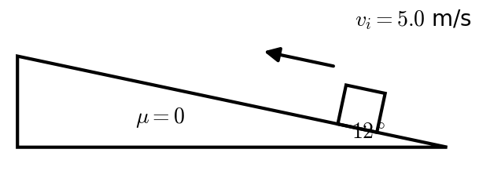
:::

::: {layout="[58,42]" layout-valign="top"}
::: {}
**4.** A block is given a speed of 4.0 m/s up a $15^\circ$ incline with $\mu_k = 0.30$. How far up the incline does it slide before it comes to rest?\
a)\ 0.74\ m $\quad$ b)\ 1.49\ m $\quad$ c)\ 2.98\ m $\quad$ d)\ 3.15\ m $\quad$ e)\ 6.30\ m
:::

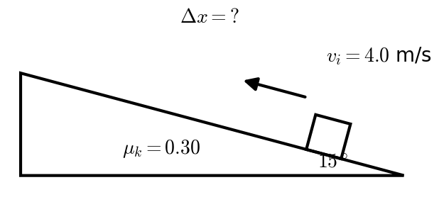
:::

::: {layout="[58,42]" layout-valign="top"}
::: {}
**5.** A block is sliding **down** an $8^\circ$ incline ($\mu_k = 0.25$) at 2.5 m/s. How far does it slide before it comes to rest?\
a)\ 0.82\ m $\quad$ b)\ 1.29\ m $\quad$ c)\ 2.94\ m $\quad$ d)\ 5.88\ m $\quad$ e)\ it never stops; it speeds up
:::

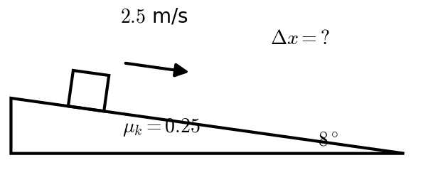
:::

::: {layout="[58,42]" layout-valign="top"}
::: {}
**6.** A 2.0 kg mass starts from rest at the top of a frictionless ramp 1.5 m high. It slides down and across a frictionless floor into a spring with $k = 1500$ N/m. How far is the spring compressed when the mass comes to rest?\
a)\ 0.020\ m $\quad$ b)\ 0.039\ m $\quad$ c)\ 0.099\ m $\quad$ d)\ 0.14\ m $\quad$ e)\ 0.20\ m
:::

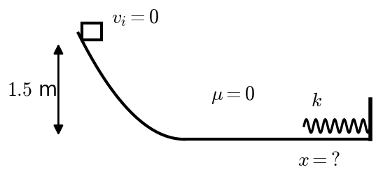
:::

::: {layout="[58,42]" layout-valign="top"}
::: {}
**7.** An 80 kg man climbs 18 m of stairs in 15 s. What is his average power output?\
a)\ 96\ W $\quad$ b)\ 941\ W $\quad$ c)\ 1880\ W $\quad$ d)\ 14,100\ W $\quad$ e)\ 254,000\ W
:::

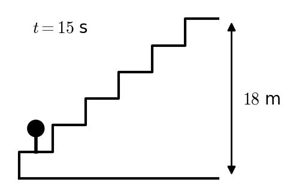
:::

::: {layout="[58,42]" layout-valign="top"}
::: {}
**8.** A 15 kg block on a $25^\circ$ incline ($\mu_k = 0.30$) is tied by a light string over a massless pulley to a 3.0 kg hanging mass. The block is moving **up** the incline at 2.5 m/s (the hanging mass is moving down). How fast is the block moving after it has slid 1.0 m up the incline?\
a)\ 1.49\ m/s $\quad$ b)\ 1.62\ m/s $\quad$ c)\ 2.33\ m/s $\quad$ d)\ 3.79\ m/s $\quad$ e)\ it stops before it slides the whole 1.0 m
:::

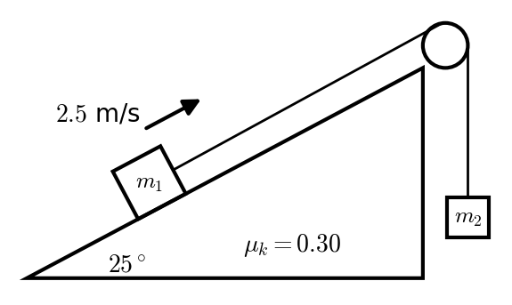
:::

::: {layout="[58,42]" layout-valign="top"}
::: {}
**9.** A roller coaster car is launched from rest at height $h$ on a frictionless track that leads into a vertical circular loop of radius $R = 9.0$ m. How high must the launch height be for the car to stay on the track (barely) at the top of the loop?\
a)\ 18\ m $\quad$ b)\ 20\ m $\quad$ c)\ 22\ m $\quad$ d)\ 24\ m $\quad$ e)\ 27\ m
:::

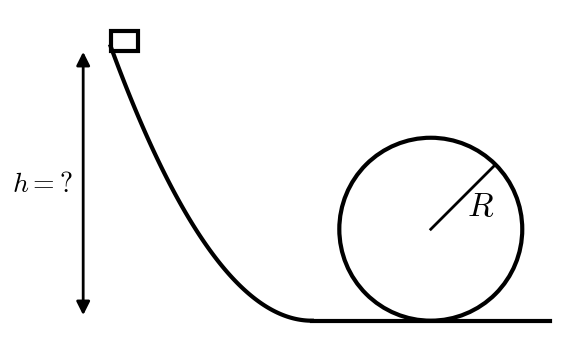
:::

::: {layout="[58,42]" layout-valign="top"}
::: {}
**10.** A 6.0 kg ball moving right at 4.0 m/s catches up to and collides **elastically** with a 2.0 kg ball moving right at 1.0 m/s. What is the velocity of the 2.0 kg ball after the collision?\
a)\ +1.0\ m/s $\quad$ b)\ +2.5\ m/s $\quad$ c)\ +3.25\ m/s $\quad$ d)\ +4.0\ m/s $\quad$ e)\ +5.5\ m/s
:::

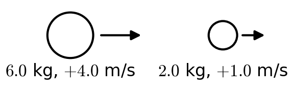
:::

::: {layout="[58,42]" layout-valign="top"}
::: {}
**11.** A merry-go-round (a disk, $I = \tfrac12 MR^2$, $M = 300$ kg, $R = 2.5$ m) rotates at 1.6 rad/s. A 50 kg rod, 2.5 m long, is dropped onto it so that it lies from the center to the edge. What is the new angular velocity?\
a)\ 1.20\ rad/s $\quad$ b)\ 1.37\ rad/s $\quad$ c)\ 1.44\ rad/s $\quad$ d)\ 1.56\ rad/s $\quad$ e)\ 1.60\ rad/s
:::

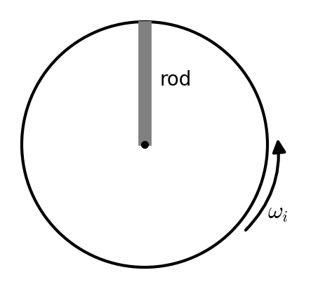
:::

::: {layout="[58,42]" layout-valign="top"}
::: {}
**12.** A 0.006 kg bullet is fired into a 2.0 kg block hanging from light strings. The bullet lodges in the block, and the block swings up 0.080 m. What was the bullet's speed?\
a)\ 1.25\ m/s $\quad$ b)\ 22.9\ m/s $\quad$ c)\ 334\ m/s $\quad$ d)\ 419\ m/s $\quad$ e)\ 837\ m/s
:::

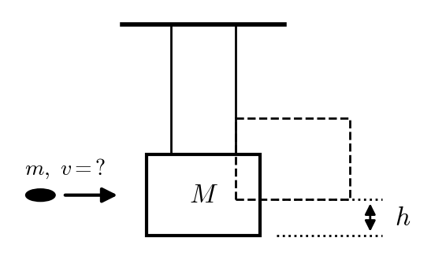
:::

::: {layout="[58,42]" layout-valign="top"}
::: {}
**13.** A 2.0 kg mass hangs from a light string wrapped around a pulley that is a uniform disk ($I = \tfrac12 MR^2$, $M = 6.0$ kg, $R = 0.40$ m). The mass is moving **down** at 1.0 m/s. How fast is it moving after it has dropped another 1.5 m?\
a)\ 2.62\ m/s $\quad$ b)\ 2.89\ m/s $\quad$ c)\ 3.43\ m/s $\quad$ d)\ 3.57\ m/s $\quad$ e)\ 5.51\ m/s
:::

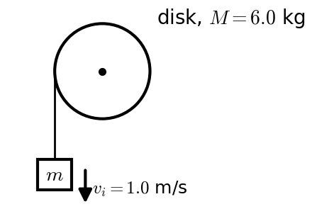
:::

::: {layout="[58,42]" layout-valign="top"}
::: {}
**14.** A solid disk ($I = \tfrac12 MR^2$) starts from rest and rolls without slipping down an incline from a height of 1.8 m. How fast is its center moving at the bottom?\
a)\ 3.43\ m/s $\quad$ b)\ 4.20\ m/s $\quad$ c)\ 4.85\ m/s $\quad$ d)\ 5.02\ m/s $\quad$ e)\ 5.94\ m/s
:::

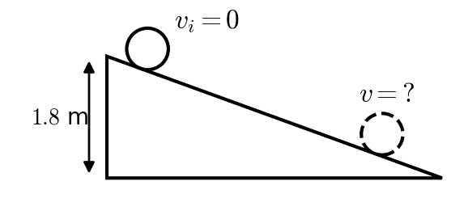
:::

::: {layout="[58,42]" layout-valign="top"}
::: {}
**15.** A disk ($I_1 = \tfrac12 MR^2$, $M = 400$ kg, $R = 2.0$ m) rotates at 2.5 rad/s. A second disk ($I_2 = \tfrac12 mr^2$, $m = 150$ kg, $r = 1.2$ m) that is **not** rotating drops onto it; it bounces, chatters, and the two stick. What is their final angular velocity?\
a)\ 2.20\ rad/s $\quad$ b)\ 2.50\ rad/s $\quad$ c)\ 2.84\ rad/s $\quad$ d)\ 4.40\ rad/s $\quad$ e)\ 5.00\ rad/s
:::

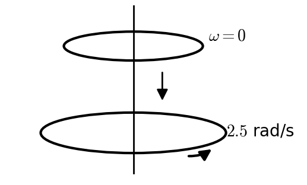
:::
