Use $g = 9.8\ \text{m/s}^2$. Choose the single best answer. Answers are rounded to the precision shown. For a minimum or maximum, choose the answer choice that actually works.

::: {layout="[58,42]" layout-valign="top"}
::: {}
**1.** A car goes around a flat curve of radius 55 m. The coefficient of static friction between the tires and the road is $\mu_s = 0.35$. What is the maximum speed at which the car can take the curve?\
a)\ 4.4\ m/s $\quad$ b)\ 9.7\ m/s $\quad$ c)\ 13\ m/s $\quad$ d)\ 14\ m/s $\quad$ e)\ 23\ m/s
:::

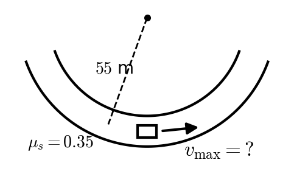
:::

::: {layout="[58,42]" layout-valign="top"}
::: {}
**2.** A 70 kg rider starts from rest at the minimum launch height ($h = \tfrac52 R$) needed to barely make it around a frictionless vertical loop. What normal force does the seat exert on the rider at the **bottom** of the loop?\
a)\ 686\ N $\quad$ b)\ 1370\ N $\quad$ c)\ 2740\ N $\quad$ d)\ 3430\ N $\quad$ e)\ 4120\ N
:::

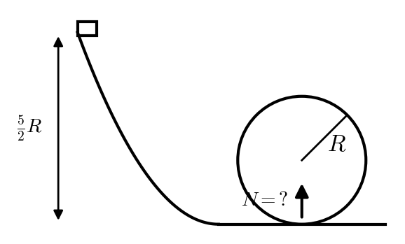
:::

::: {layout="[58,42]" layout-valign="top"}
::: {}
**3.** A 4.0 kg block slides up a $25^\circ$ incline at 3.5 m/s. The coefficient of kinetic friction is 0.15. When the block has slid 0.80 m, how fast is it still moving?\
a)\ 1.87\ m/s $\quad$ b)\ 2.37\ m/s $\quad$ c)\ 2.81\ m/s $\quad$ d)\ 4.58\ m/s $\quad$ e)\ it stops before it slides the whole 0.80 m
:::

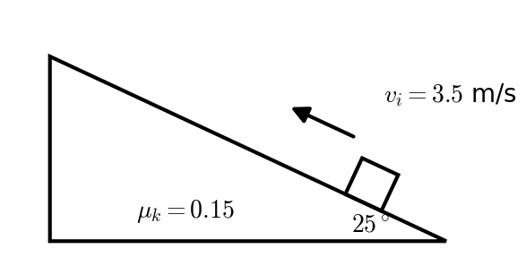
:::

::: {layout="[58,42]" layout-valign="top"}
::: {}
**4.** A block is sliding **down** a $20^\circ$ incline ($\mu_k = 0.30$) at 2.0 m/s. How fast is it moving after it has slid 2.5 m?\
a)\ 1.72\ m/s $\quad$ b)\ 2.00\ m/s $\quad$ c)\ 2.34\ m/s $\quad$ d)\ 2.46\ m/s $\quad$ e)\ 2.64\ m/s
:::

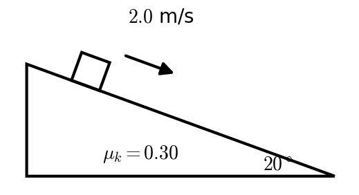
:::

::: {layout="[58,42]" layout-valign="top"}
::: {}
**5.** A 10 kg block on a $35^\circ$ incline ($\mu_k = 0.20$) is tied over a massless pulley at the top to a 2.0 kg hanging mass. The block slides **down** the incline at 1.5 m/s while the hanging mass rises. How fast is the block moving after it has slid 0.60 m?\
a)\ 1.43\ m/s $\quad$ b)\ 2.07\ m/s $\quad$ c)\ 2.17\ m/s $\quad$ d)\ 2.43\ m/s $\quad$ e)\ it stops before it slides the whole 0.60 m
:::

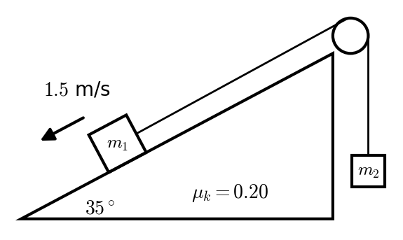
:::

::: {layout="[58,42]" layout-valign="top"}
::: {}
**6.** A 0.080 kg mass is placed on a vertical spring of spring constant $k = 1800$ N/m. The spring is compressed 0.025 m from its equilibrium length. When the mass on the compressed spring is released, it shoots the mass straight up. How far does the mass fly above the release point?\
a)\ 0.36\ m $\quad$ b)\ 0.72\ m $\quad$ c)\ 1.43\ m $\quad$ d)\ 7.03\ m $\quad$ e)\ 28.7\ m
:::

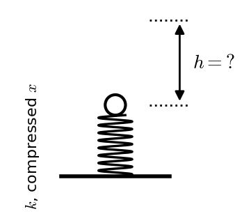
:::

::: {layout="[58,42]" layout-valign="top"}
::: {}
**7.** A 0.060 kg tennis ball hits a wall head-on at 40 m/s and bounces straight back at 40 m/s. It is in contact with the wall for 0.0040 s. What is the magnitude of the average force on the ball?\
a)\ 0\ N $\quad$ b)\ 4.8\ N $\quad$ c)\ 600\ N $\quad$ d)\ 1200\ N $\quad$ e)\ 2400\ N
:::

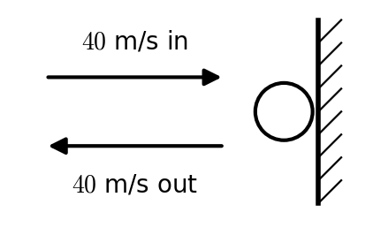
:::

::: {layout="[58,42]" layout-valign="top"}
::: {}
**8.** A 900 kg car moving east at 20 m/s collides head-on with a 1200 kg car moving west at 10 m/s. The cars stick together. What is their velocity just after the collision? (East is positive.)\
a)\ +2.86\ m/s $\quad$ b)\ +8.57\ m/s $\quad$ c)\ +14.3\ m/s $\quad$ d)\ +20.0\ m/s $\quad$ e)\ +30.0\ m/s
:::

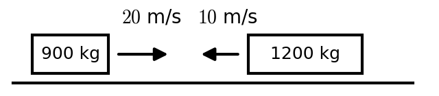
:::

::: {layout="[58,42]" layout-valign="top"}
::: {}
**9.** A 1.5 kg mass moving to the right at 4.0 m/s collides **elastically** in a head-on collision with a 2.5 kg mass moving at 2.0 m/s to the left. How fast and in what direction is the 2.5 kg mass moving after the collision? Positive to the right / negative to the left.\
a)\ −3.5\ m/s $\quad$ b)\ −2.0\ m/s $\quad$ c)\ +0.25\ m/s $\quad$ d)\ +2.0\ m/s $\quad$ e)\ +2.5\ m/s
:::

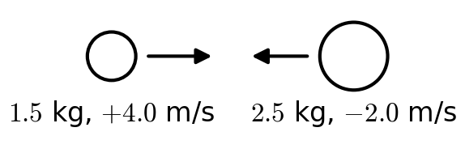
:::

::: {layout="[58,42]" layout-valign="top"}
::: {}
**10.** A bullet (mass 0.010 kg) is fired into a suspended block of wood (4.99 kg). Initially the wood is not moving. The bullet lodges in the wood, and the block swings up. What fraction of the initial kinetic energy remained in the motion of the block of wood?\
a)\ <0.1% $\quad$ b)\ 0.1–0.5% $\quad$ c)\ 0.5–1% $\quad$ d)\ 1–10% $\quad$ e)\ >10%
:::

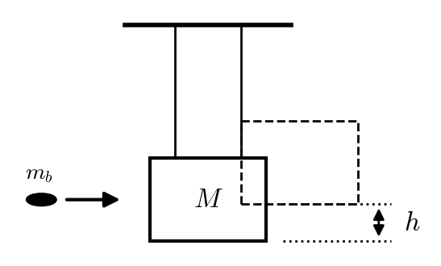
:::

::: {layout="[58,42]" layout-valign="top"}
::: {}
**11.** A wheel speeds up uniformly from 40 rad/s to 100 rad/s in 12 s. What is its angular acceleration?\
a)\ 2.5\ rad/s² $\quad$ b)\ 3.33\ rad/s² $\quad$ c)\ 5.0\ rad/s² $\quad$ d)\ 8.33\ rad/s² $\quad$ e)\ 11.7\ rad/s²
:::

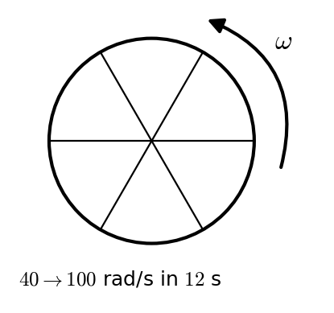
:::

::: {layout="[58,42]" layout-valign="top"}
::: {}
**12.** A solid ball ($I = \tfrac25 mr^2$) rolls without slipping down a $22^\circ$ incline. What is the acceleration of its center?\
a)\ 1.84\ m/s² $\quad$ b)\ 2.45\ m/s² $\quad$ c)\ 2.62\ m/s² $\quad$ d)\ 3.67\ m/s² $\quad$ e)\ 6.49\ m/s²
:::

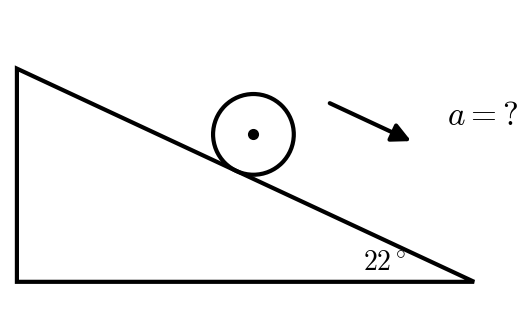
:::

::: {layout="[58,42]" layout-valign="top"}
::: {}
**13.** A rotating disk ($I = \tfrac12 MR^2$, $M = 400$ kg, $R = 2.0$ m, $\omega = +2.5$ rad/s) has a counter-rotating ring fall onto it ($I = mr^2$, $m = 150$ kg, $r = 1.2$ m, $\omega = -3.0$ rad/s). What is their final angular velocity?\
a)\ +1.33\ rad/s $\quad$ b)\ +1.85\ rad/s $\quad$ c)\ +1.97\ rad/s $\quad$ d)\ +2.50\ rad/s $\quad$ e)\ +2.61\ rad/s
:::

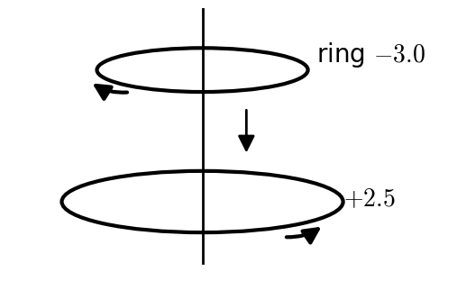
:::

::: {layout="[58,42]" layout-valign="top"}
::: {}
**14.** A 90 kg man runs at 3.5 m/s up to a turning merry-go-round (a disk, $I = \tfrac12 MR^2$, $M = 350$ kg, $R = 2.2$ m, $\omega_i = 0.40$ rad/s) and jumps on at the rim, moving in the same direction as the rim. What is the new angular velocity?\
a)\ −0.28\ rad/s $\quad$ b)\ 0.26\ rad/s $\quad$ c)\ 0.40\ rad/s $\quad$ d)\ 0.80\ rad/s $\quad$ e)\ 1.22\ rad/s
:::

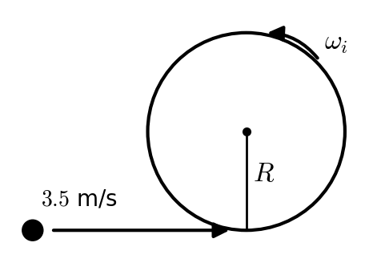
:::

::: {layout="[58,42]" layout-valign="top"}
::: {}
**15.** An 80 kg man rides on the rim of a merry-go-round ($I = \tfrac12 MR^2$, $M = 300$ kg, $R = 2.5$ m). Initially the angular velocity is 1.2 rad/s. He walks from the rim to the center. What is the angular velocity when he reaches the center?\
a)\ 0.78\ rad/s $\quad$ b)\ 1.20\ rad/s $\quad$ c)\ 1.52\ rad/s $\quad$ d)\ 1.84\ rad/s $\quad$ e)\ 2.48\ rad/s
:::

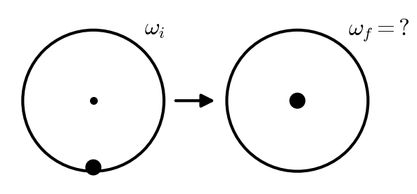
:::
