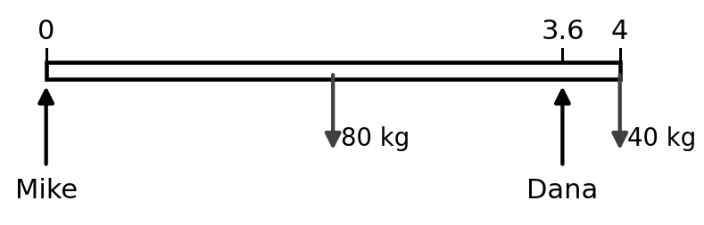
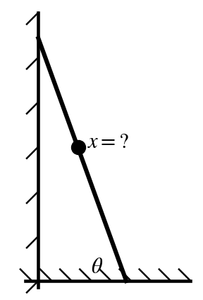
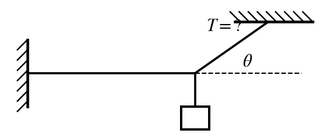
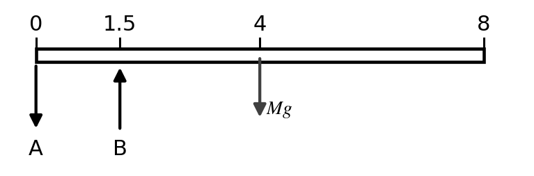
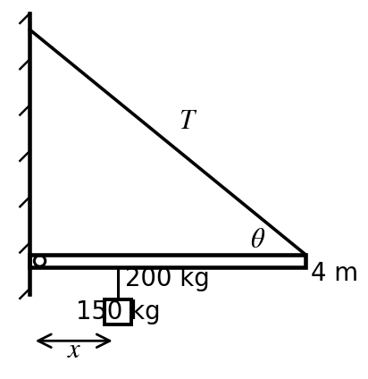
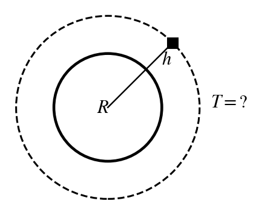
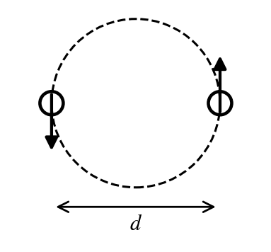

Every numeric answer was computed and checked in `_scripts/build_practice-exam_3_1.py`. Constants are the ones printed on the 2015 Exam 3: $G = 6.67\times10^{-11}$, $M_{earth} = 5.98\times10^{24}$ kg, $R_{earth} = 6.37\times10^{6}$ m, and $g = 9.8$ m/s².

**Sources.** "Ch 12 notes p. 6/10" means page 6 of the professor's *Chapter 12 Statics* notes (he numbers his pages "6/10"). "2015 Exam 3 #2" is question 2 of the previous exam in `Professors-Notes/exam 3-4.pdf`.

Practice Exam 3-1 follows the 2015 Exam 3 (its Ch 12 and 13 questions, #1–5 and #9–13) with new numbers, plus lecture-note examples: the diving board, the seesaw, the wall beam with a cable, and the orbit altitude from a period. Question 2 is a **maximum**: pick the largest choice that still works. Every question is a procedure worked in the notes or on the 2015 exam.

| Q | Ans | Answer | Type | Topic (source) | Notecard |
|:-:|:-:|:--|:--|:--|:--|
| 1 | **d** | 871 N | Calc | Two people carry a sofa (Ch 12 p. 4–5; 2015 #1) | Sofa / beam |
| 2 | **a** | 5.0 m | Max | Man climbing a ladder, $x_{max}$ (Ch 12 p. 8; 2015 #2) | Ladder |
| 3 | **e** | 256 N | Calc | Light hung by two cords (2015 #3; Ch 12 p. 1) | Two cords |
| 4 | **b** | 3.92 mm | Calc | Young's modulus, compressed block (2015 #4; Ch 12 p. 10) | Moduli |
| 5 | **e** | 0.0250 m | Calc | Young's modulus, wire stretch (Ch 12 p. 10; 2015 #5) | Moduli |
| 6 | **c** | 15,700 N | Calc | Diving board, support B (Ch 12 p. 3) | Diving board |
| 7 | **b** | 0.625 m | Calc | Seesaw balance (Ch 12 p. 4) | Seesaw |
| 8 | **d** | 2.58 m | Calc | Beam on a wall hinge with a cable ($x_{max}$) (Ch 12 p. 6) | Wall beam + cable |
| 9 | **a** | 8.45 m/s² | Calc | $g$ at an altitude (Ch 13 p. 1–2; 2015 #12) | Gravity |
| 10 | **e** | 11.8 hours | Calc | Satellite period (Ch 13 p. 2; 2015 #10) | Orbit |
| 11 | **c** | 6.04 hours | Calc | Binary stars, period (Ch 13 p. 4; 2015 #11) | Binary stars |
| 12 | **c** | 3.28 km/s | Calc | Launch speed to reach a height (Ch 13 p. 7–8; 2015 #9) | Rocket |
| 13 | **d** | 89.6% | Calc | Equal-pull point (2015 #13; Ch 13 p. 1) | Equal pull |
| 14 | **b** | 2.38 km/s | Calc | Escape speed (Ch 13 p. 9) | Escape |
| 15 | **a** | 13,900 km | Calc | Orbit altitude from the period (Ch 13 p. 3) | Orbit |

```{=latex}
\needspace{8\baselineskip}
```
# 1. Two people carry a sofa — **d) 871 N**

**Source:** Ch 12 notes p. 4/10 (two men carry a sofa: $\sum\tau_{Jim}$, $\sum\tau_{Sam}$) and p. 5/10 (20 kg kid set on the sofa 1 m from Jim).  
**Previous-exam match:** 2015 Exam 3 #1 (sofa + box of books on Sarah's end), new numbers  
**Notecard:** Sofa / beam  
**What it tests:** torque balance about one carrier to find the other carrier's force.

{width=3.2in fig-align="center"}

**Step 1: pick the pivot at Mike's hands.** A force applied at the pivot has $r = 0$, so its torque is zero and it drops out of the equation. The notes do this on p. 3/10 ("A is eliminated").

**Step 2: torque balance about Mike.** Every force here is vertical and the sofa is horizontal, so each torque is $\tau = rF$, with $r$ measured from Mike. The sofa's weight acts at its center, $L/2$. Dana's upward push is counterclockwise; the weights are clockwise.

$$
\sum\tau_{Mike} = 0:\quad x_{Dana}\,F_{Dana} = \tfrac{L}{2}\,Mg + x_{1}\,m_{1}g
$$

**Step 3: plug in** ($x_{Dana} = 3.6$ m):

$$
3.6\ \text{m}\times F_{Dana} = \underbrace{2\ \text{m}}_{\text{sofa center}}\,\underbrace{(80)(9.8)}_{\text{sofa weight}} + \underbrace{4\ \text{m}}_{\text{box of books position}}\,\underbrace{(40)(9.8)}_{\text{box of books weight}}
$$

$$
F_{Dana} = \frac{3{,}136\ \text{N m}}{3.6\ \text{m}} = 871.1\ \text{N}
$$

Why the other choices are wrong:

* a) 305 N: is the force on Mike, the other person.
* b) 436 N: leaves out the sofa's own weight.
* c) 588 N: splits the total weight evenly; that is only true with nothing extra and both at the ends.
* e) 1,180 N: is the total weight of everything; the two people share it.

```{=latex}
\needspace{8\baselineskip}
```
# 2. Man climbing a ladder, $x_{max}$ — **a) 5.0 m**

**Source:** Ch 12 notes p. 8/10 (leaning ladder with a man climbing it, $x = \tfrac{L}{M}(\mu_s(M+m)\tan\theta - \tfrac{m}{2})$ = 8.8 m).  
**Previous-exam match:** 2015 Exam 3 #2 (150 kg man, 20 kg ladder, 71°, $\mu = 0.25$, 5 m), new numbers  
**Notecard:** Ladder  
**What it tests:** ladder torque balance with a climber, then the maximum-answer rule.

{width=1.5in fig-align="center"}

**Step 1: forces** (notes p. 8/10). $\sum F_y$: $N = (M + m)g$. $\sum F_x$: $N_w = F_f$, and at the limit $F_f = \mu_s N = \mu_s(M+m)g$.

**Step 2: torque about the base.** Ladder weight at $L/2$ (arm $\tfrac{L}{2}\cos\theta$), man at $x$ (arm $x\cos\theta$), wall force at the top (arm $L\sin\theta$):

$$
\tfrac{L}{2}\cos\theta\,mg + x\cos\theta\,Mg - L\sin\theta\,\mu_s(M+m)g = 0
$$

Cancel $g$, divide by $\cos\theta$:

$$
x = \frac{L}{M}\Big(\mu_s(M+m)\tan\theta - \frac{m}{2}\Big)
$$

**Step 3: plug in** ($\tan 70^\circ = 2.747$):

$$
x = \frac{\overbrace{6}^{L}}{\underbrace{120}_{M}}\Big(\underbrace{(0.3)}_{\mu_s}\underbrace{(145)}_{M+m}(2.747) - \underbrace{\tfrac{25}{2}}_{m/2}\Big) = 5.35\ \text{m}
$$

**Step 4: it's a maximum.** He can go up to 5.35 m; any farther and the ladder slips. The largest choice that still works is **5.0 m**. (On the 2015 exam, $x = 3.78$ m and the answer was b) 3.5 m.)

Why the other choices are wrong:

* b) 5.5 m: is more than the maximum, so it fails.
* c) 6.0 m: is more than the maximum, so it fails.
* d) 6.5 m: is more than the maximum, so it fails.
* e) 7.0 m: is more than the maximum, so it fails.

```{=latex}
\needspace{8\baselineskip}
```
# 3. Light hung by two cords — **e) 256 N**

**Source:** 2015 Exam 3 #3, solved with $\sum F_x = \sum F_y = 0$ from Ch 12 notes p. 1/10 ("Static means not moving").  
**Previous-exam match:** 2015 Exam 3 #3 (20 kg light, 40° with the ceiling: 305 N $\rightarrow$ b) 300 N), new numbers  
**Notecard:** Two cords  
**What it tests:** $\sum F_y = 0$ on the knot: $T\sin\theta = mg$.

{width=2.3in fig-align="center"}

**Step 1: forces on the knot** (static, so $\sum F_x = \sum F_y = 0$, notes p. 1/10). Ceiling cord $T$ at $\theta$ above the horizontal; horizontal cord $T_h$; the light's weight $mg$ hangs straight down.

**Step 2: $\sum F_y = 0$.** Only the ceiling cord has a vertical part, $T\sin\theta$:

$$
T\sin\theta = mg \;\Rightarrow\; T = \frac{mg}{\sin\theta} = \frac{\underbrace{(15)(9.8)}_{mg = 147.0\ \text{N}}}{\sin 35^\circ} = 256.3\ \text{N}
$$

Why the other choices are wrong:

* a) 84.3 N: multiplies by $\sin\theta$ instead of dividing.
* b) 147 N: is just the light's weight.
* c) 179 N: uses $\cos\theta$: that would be the angle from the vertical.
* d) 210 N: is the tension in the horizontal cord.

```{=latex}
\needspace{8\baselineskip}
```
# 4. Young's modulus, compressed block — **b) 3.92 mm**

**Source:** 2015 Exam 3 #4, solved with Young's modulus from Ch 12 notes p. 10/10.  
**Previous-exam match:** 2015 Exam 3 #4 (jello 3 m × 4 m × 0.1 m, 500 kg: 1.36 mm $\rightarrow$ e) 1.3 mm), new numbers  
**Notecard:** Moduli  
**What it tests:** compressive stress on the top face, strain = $\Delta h/h$.

**Step 1: the formula** (Ch 12 notes p. 10/10), with compression instead of stretch:

$$
Y = \frac{F/A}{\Delta h/h} \;\Rightarrow\; \Delta h = \frac{F\,h}{A\,Y}
$$

**Step 2: the pieces.** The mass pushes down on the **top** face, so $A$ = width × length. $h$ is the original height.

$$
F = (400)(9.8) = 3{,}920\ \text{N}
$$

$$
A = (2)(3) = 6.000\ \text{m}^2
$$

**Step 3: plug in:**

$$
\Delta h = \frac{\underbrace{(3{,}920)}_{F}\underbrace{(0.15)}_{h}}{\underbrace{(6.000)}_{\text{top area}}\underbrace{(25{,}000)}_{Y}} = 0.00392\ \text{m} = 3.92\ \text{mm}
$$

Why the other choices are wrong:

* a) 0.400 mm: forgets $g$.
* c) 26.1 mm: finds the strain and stops (forgets to multiply by the height).
* d) 52.3 mm: uses the other side face ($l \times h$).
* e) 78.4 mm: uses a side face ($w \times h$) as the area.

```{=latex}
\needspace{8\baselineskip}
```
# 5. Young's modulus, wire stretch — **e) 0.0250 m**

**Source:** Ch 12 notes p. 10/10 (Young's modulus $Y = \frac{F/A}{\Delta\ell/\ell}$).  
**Previous-exam match:** 2015 Exam 3 #5 (500 kg, 4.00 m, 0.001 m diameter, $8\times10^{10}$: 0.312 m $\rightarrow$ e) 0.3 m), new numbers  
**Notecard:** Moduli  
**What it tests:** tensile stress/strain with a circular cross-section ($r = d/2$).

**Step 1: the formula** (Ch 12 notes p. 10/10):

$$
Y = \frac{\text{tensile stress}}{\text{tensile strain}} = \frac{F/A}{\Delta\ell/\ell}
$$

**Step 2: the pieces.** The force is the load's weight, and the area is the wire's circular cross-section (radius = half the diameter):

$$
F = mg = (300)(9.8) = 2{,}940\ \text{N}
$$

$$
A = \pi r^2 = \pi\Big(\underbrace{\tfrac{0.0015}{2}}_{r}\Big)^2 = 1.767\times10^{-6}\ \text{m}^2
$$

**Step 3: solve for the stretch:**

$$
\Delta\ell = \frac{F\,\ell}{A\,Y} = \frac{\underbrace{(2{,}940)}_{F}\underbrace{(3)}_{\ell}}{\underbrace{(1.767\times10^{-6})}_{A}\underbrace{(2\times10^{11})}_{Y}} = 0.0250\ \text{m}
$$

Why the other choices are wrong:

* a) 0.00255 m: forgets $g$ (uses the mass instead of the weight).
* b) 0.00624 m: uses the diameter as the radius in $A = \pi r^2$.
* c) 0.00832 m: finds the strain $\Delta\ell/\ell$ and stops.
* d) 0.0196 m: uses $A = d^2$ (no $\pi$, no half).

```{=latex}
\needspace{8\baselineskip}
```
# 6. Diving board, support B — **c) 15,700 N**

**Source:** Ch 12 notes p. 3/10 (diving board, $L = 10$ m, $M = 1000$ kg: $B = 5Mg$, $A = 4Mg$).  
**Previous-exam match:** none (lecture-notes example)  
**Notecard:** Diving board  
**What it tests:** choosing the pivot to eliminate one support, then $\sum F_y = 0$ (A pulls down).

{width=3.2in fig-align="center"}

**Step 1: draw the forces** (notes p. 3/10). The board's weight $Mg$ acts at its center, $L/2 = 4$ m. B pushes **up**. A must pull **down**, or the board would tip off B.

**Step 2: torque about A** removes A ($r = 0$):

$$
\sum\tau_A = 0:\quad a\,B - \tfrac{L}{2}\,Mg = 0
$$

$$
B = \frac{L/2}{a}\,Mg = \frac{\overbrace{4\ \text{m}}^{L/2}}{\underbrace{1.5\ \text{m}}_{\text{A to B}}}\,\underbrace{(600)(9.8)}_{Mg = 5{,}880\ \text{N}} = 15{,}680\ \text{N}
$$

**Step 3: $\sum F_y = 0$** with B up and A, $Mg$ down:

$$
B - A - Mg = 0 \;\Rightarrow\; A = B - Mg = 15{,}680 - 5{,}880 = 9{,}800\ \text{N}
$$

In the notes ($L = 10$ m, $a = 1$ m) this gives $B = 5Mg$ and $A = 4Mg$.

Why the other choices are wrong:

* a) 5,880 N: is just the board's weight $Mg$.
* b) 9,800 N: is the force from support A, not B.
* d) 21,600 N: adds $Mg$ instead of subtracting it.
* e) 31,400 N: puts the board's weight at the far end ($L$) instead of its center ($L/2$).

```{=latex}
\needspace{8\baselineskip}
```
# 7. Seesaw balance — **b) 0.625 m**

**Source:** Ch 12 notes p. 4/10 (seesaw, $m_k = 20$ kg, $M = 100$ kg, $x = L/10$).  
**Previous-exam match:** none (lecture-notes example)  
**Notecard:** Seesaw  
**What it tests:** torque balance about the pivot; the seesaw's own mass drops out.

{width=2.6in fig-align="center"}

**Step 1: torque about the center (pivot).** The seesaw's own weight acts at the center, so its lever arm is zero. That's why the notes say its mass "don't care!" The kid is $L/2$ from the pivot; the adult is $x$ from it.

$$
\sum\tau_{center} = 0:\quad \tfrac{L}{2}\,m_k g - x\,M_T g = 0 \;\Rightarrow\; x = \frac{L\,m_k}{2M_T}
$$

$g$ cancels.

**Step 2: plug in:**

$$
x = \frac{\underbrace{5\ \text{m}}_{\text{length}}\,\underbrace{20\ \text{kg}}_{\text{kid}}}{2\,\underbrace{80\ \text{kg}}_{\text{adult}}} = 0.625\ \text{m}
$$

In the notes, $m_k = 20$ kg and $M_T = 100$ kg give $x = L/10$.

Why the other choices are wrong:

* a) 0.417 m: adds the seesaw's mass to the adult's; its weight acts at the pivot and has no torque.
* c) 1.25 m: forgets that the kid's lever arm is $L/2$, not $L$.
* d) 1.88 m: measures from the end of the seesaw instead of from the center.
* e) 3.12 m: adds the half-length.

```{=latex}
\needspace{8\baselineskip}
```
# 8. Beam on a wall hinge with a cable ($x_{max}$) — **d) 2.58 m**

**Source:** Ch 12 notes p. 6/10 (beam hinged at the wall, cable at $\theta = 30^\circ$, find $x_{max}$); $\tau = rF_\perp$ from p. 1/10.  
**Previous-exam match:** none (lecture-notes example)  
**Notecard:** Wall beam + cable  
**What it tests:** torque about the hinge with the perpendicular part of the tension.

{width=2.4in fig-align="center"}

**Step 1: torque about the hinge** (left end). The notes say "Do torque at left to remove reaction forces": the hinge forces $R_x$, $R_y$ act at $r = 0$.

Only the **perpendicular** part of the tension, $T\sin\theta$, makes torque at the far end ($\tau = rF_\perp$, notes p. 1/10). The beam's weight acts at $L/2$; the mass's weight acts at $x$.

$$
\sum\tau_{left} = 0:\quad -x\,mg - \tfrac{L}{2}\,Mg + L\,T\sin\theta = 0
$$

**Step 2: solve for $x$:**

$$
x = \frac{L}{mg}\left(T\sin\theta - \frac{Mg}{2}\right)
$$

**Step 3: plug in $T = T_{max}$:**

$$
x_{max} = \frac{4\ \text{m}}{\underbrace{(150)(9.8)}_{mg}}\left(\underbrace{(3{,}000)(\sin 40^\circ)}_{T\sin\theta = 1{,}928\ \text{N}} - \underbrace{\frac{(200)(9.8)}{2}}_{Mg/2 = 980.0\ \text{N}}\right) = 2.58\ \text{m}
$$

Notes numbers: $L = 5$ m, $T_{max} = 10^4$ N, $M = 1000$ kg, $m = 100$ kg, $\theta = 30^\circ$ give $x_{max} = 0.510$ m.

Why the other choices are wrong:

* a) 0.658 m: No standard mistake gives this value; it is a spacing choice.
* b) 0.921 m: No standard mistake gives this value; it is a spacing choice.
* c) 1.29 m: divides by 2 one time too many.
* e) 3.59 m: uses $\cos\theta$ instead of $\sin\theta$ for the cable's perpendicular part.

```{=latex}
\needspace{8\baselineskip}
```
# 9. $g$ at an altitude — **a) 8.45 m/s²**

**Source:** Ch 13 notes p. 1/10 ($g = GM_E/R_E^2 = 9.81$ m/s²) and p. 2/10 ($r = R + h$).  
**Previous-exam match:** 2015 Exam 3 #12 (750 km: 7.87 m/s² $\rightarrow$ b) 8 m/s²), new numbers  
**Notecard:** Gravity  
**What it tests:** $g = GM/r^2$ with $r$ measured from Earth's center.

**Step 1: the formula** (notes p. 1/10): $mg = \dfrac{GMm}{R^2}$, so $g = \dfrac{GM}{R^2}$ at the surface. Above the surface the distance is measured from Earth's **center**: $r = R + h$ (notes p. 2/10).

$$
g = \frac{GM_{earth}}{(R + h)^2}
$$

**Step 2: distance from the center:**

$$
r = \underbrace{6.37\times10^{6}}_{R_{earth}} + \underbrace{5\times10^{5}}_{h\ \text{in m}} = 6.870\times10^{6}\ \text{m}
$$

**Step 3: plug in:**

$$
g = \frac{\underbrace{(6.67\times10^{-11})}_{G}\underbrace{(5.98\times10^{24})}_{M_{earth}}}{(6.870\times10^{6})^2} = 8.45\ \text{m/s}^2
$$

The person's mass cancels ($mg = GMm/r^2$); it's extra information.

Why the other choices are wrong:

* b) 9.83 m/s²: uses $R_{earth}$ (surface $g$), ignoring the height.
* c) 1,600 m/s²: uses $h$ instead of $R + h$ (the 2015 exam's e) 700 m/s² is this mistake).
* d) 2,240 m/s²: No standard mistake gives this value; it is a spacing choice.
* e) 3,140 m/s²: No standard mistake gives this value; it is a spacing choice.

```{=latex}
\needspace{8\baselineskip}
```
# 10. Satellite period — **e) 11.8 hours**

**Source:** Ch 13 notes p. 2/10 (satellite orbiting a planet, $T^2 = 4\pi^2r^3/GM$, $r = R + h$; $h = 400$ km $\rightarrow$ 92.4 min).  
**Previous-exam match:** 2015 Exam 3 #10 (altitude $10^8$ m: 3.99 days $\rightarrow$ d) 4 days), new numbers  
**Notecard:** Orbit  
**What it tests:** $T^2 = 4\pi^2r^3/GM$ with $r = R + h$.

{width=1.5in fig-align="center"}

**Step 1: gravity supplies the centripetal force** (notes p. 2/10):

$$
\frac{GMm}{r^2} = \frac{mv^2}{r},\qquad v = \frac{2\pi r}{T}\;\Rightarrow\; T^2 = \frac{4\pi^2 r^3}{GM}
$$

The satellite's mass $m$ cancels.

**Step 2: orbit radius from Earth's center:**

$$
r = \underbrace{6.37\times10^{6}}_{R} + \underbrace{2\times10^{7}}_{h} = 2.637\times10^{7}\ \text{m}
$$

**Step 3: plug in:**

$$
T = \sqrt{\frac{4\pi^2(2.637\times10^{7})^3}{\underbrace{(6.67\times10^{-11})(5.98\times10^{24})}_{GM_{earth}}}} = 42{,}600\ \text{s}
$$

**Step 4: convert:** $42{,}600\ \text{s} = 11.8$ hours.

Notes example: $h = 400$ km gives $T = 5546$ s = 92.4 min (low Earth orbit).

Why the other choices are wrong:

* a) 1.40 hours: uses $R_{earth}$ (an orbit skimming the surface).
* b) 1.88 hours: drops the $4\pi^2$ (forgets the $2\pi$ in $v = 2\pi r/T$).
* c) 5.92 hours: uses $\pi$ instead of $2\pi$.
* d) 7.82 hours: uses $h$ instead of $r = R + h$.

```{=latex}
\needspace{8\baselineskip}
```
# 11. Binary stars, period — **c) 6.04 hours**

**Source:** Ch 13 notes p. 4/10 (two equal-mass stars, $T^2 = 16\pi^2r^3/GM$; "separation btwn the masses is $2r$ (not $r$)").  
**Previous-exam match:** 2015 Exam 3 #11 ($10^{31}$ kg each, $d = 10^8$ m: 2.9 min $\rightarrow$ a) 3 minutes), new numbers  
**Notecard:** Binary stars  
**What it tests:** $T^2 = 16\pi^2r^3/GM$ with $r$ = half the separation.

{width=1.5in fig-align="center"}

**Step 1: the force uses the separation, the circle uses $r$** (notes p. 4/10). Each star moves on a circle of radius $r$ about the center; the distance between the stars is $2r$:

$$
\frac{GM^2}{(2r)^2} = \frac{Mv^2}{r},\qquad v = \frac{2\pi r}{T}\;\Rightarrow\; T^2 = \frac{16\pi^2 r^3}{GM}
$$

**Step 2: the orbit radius:** $r = d/2 = 1\times10^{9}\ \text{m}$.

**Step 3: plug in:**

$$
T = \sqrt{\frac{16\pi^2(1\times10^{9})^3}{\underbrace{(6.67\times10^{-11})}_{G}\underbrace{(5\times10^{30})}_{M}}} = 21{,}760\ \text{s} = 6.04\ \text{hours}
$$

Notes example: $M = 2\times10^{30}$ kg, $r = 6\times10^{10}$ m gives 185 days.

Why the other choices are wrong:

* a) 3.02 hours: uses the single-planet $4\pi^2$ formula (forgets that the separation is $2r$ in the force).
* b) 4.27 hours: uses $2M$ for the mass.
* d) 8.55 hours: uses the single-planet formula with $r = d$.
* e) 17.1 hours: uses the separation $d$ as the orbit radius (the notes warn: separation is $2r$, not $r$).

```{=latex}
\needspace{8\baselineskip}
```
# 12. Launch speed to reach a height — **c) 3.28 km/s**

**Source:** Ch 13 notes p. 7/10 ($U = -GMm/r$, energy conservation) and p. 8/10 ("given a target altitude $h = 1000$ km, what $v$ to launch?" 4119 m/s).  
**Previous-exam match:** 2015 Exam 3 #9 (1000 km), new numbers  
**Notecard:** Rocket  
**What it tests:** energy conservation with $U = -GMm/r$, solved for $v$.

**Step 1: conservation of energy** (notes p. 7–8/10). At launch $r = R$, speed $v$; at the top $r = R + h$, speed 0. Gravitational PE is $U = -GMm/r$:

$$
-\frac{GMm}{R} + \frac12mv^2 = -\frac{GMm}{r} \;\Rightarrow\; v = \sqrt{2GM\Big(\frac1R - \frac1r\Big)}
$$

**Step 2: top of the flight:** $r = R + h = 6.37\times10^{6} + 6\times10^{5} = 6.970\times10^{6}$ m.

**Step 3: plug in:**

$$
v = \sqrt{2\,\underbrace{(6.67\times10^{-11})(5.98\times10^{24})}_{GM_{earth}}\Big(\underbrace{\frac{1}{6.37\times10^{6}}}_{1/R} - \underbrace{\frac{1}{6.970\times10^{6}}}_{1/r}\Big)} = 3{,}283\ \text{m/s} = 3.28\ \text{km/s}
$$

Notes example: $h = 1000$ km needs $v = 4119$ m/s.

Why the other choices are wrong:

* a) 1.66 km/s: No standard mistake gives this value; it is a spacing choice.
* b) 2.32 km/s: forgets the 2 from $\tfrac12mv^2$.
* d) 7.56 km/s: is the orbital speed at that height, not the launch speed.
* e) 11.2 km/s: is the escape speed.

```{=latex}
\needspace{8\baselineskip}
```
# 13. Equal-pull point — **d) 89.6%**

**Source:** 2015 Exam 3 #13, solved with $F = GMm/r^2$ from Ch 13 notes p. 1/10.  
**Previous-exam match:** 2015 Exam 3 #13 (moon $7\times10^{22}$ kg, 400,000 km: 90.2% $\rightarrow$ b) 90%), new numbers  
**Notecard:** Equal pull  
**What it tests:** setting two inverse-square pulls equal: $x/d = k/(1+k)$, $k = \sqrt{M_E/M_b}$.

**Step 1: set the two pulls equal** with Newton's law (Ch 13 notes p. 1/10). Let $x$ be the distance from Earth's center, so the distance to the moon is $d - x$. The test mass $m$ cancels:

$$
\frac{GM_Em}{x^2} = \frac{GM_bm}{(d - x)^2} \;\Rightarrow\; \frac{x}{d - x} = \sqrt{\frac{M_E}{M_b}}
$$

**Step 2: the square root:**

$$
k = \sqrt{\frac{\overbrace{5.98\times10^{24}}^{M_E}}{\underbrace{8\times10^{22}}_{M_b}}} = 8.646
$$

**Step 3: solve for the fraction:** $x = k(d - x)$, so

$$
\frac{x}{d} = \frac{k}{1 + k} = \frac{8.646}{9.646} = 0.8963 = 89.6\%
$$

The distance doesn't matter for the percentage; only the mass ratio does.

Why the other choices are wrong:

* a) 10.4%: gives the distance from the moon's center.
* b) 50.0%: assumes the halfway point.
* c) 80.8%: uses a cube root.
* e) 98.7%: uses the mass ratio without the square root.

```{=latex}
\needspace{8\baselineskip}
```
# 14. Escape speed — **b) 2.38 km/s**

**Source:** Ch 13 notes p. 9/10 ($v_{escape} = \sqrt{2GM/R}$ = 11.2 km/s for Earth).  
**Previous-exam match:** none (lecture-notes example)  
**Notecard:** Escape  
**What it tests:** $v_{esc} = \sqrt{2GM/R}$.

**Step 1: energy conservation** (notes p. 9/10). To escape, the object just reaches $r = \infty$ with $v = 0$, where $U = 0$ and $K = 0$:

$$
-\frac{GMm}{R} + \frac{mv^2}{2} = 0 + 0 \;\Rightarrow\; v_{esc} = \sqrt{\frac{2GM}{R}}
$$

**Step 2: plug in:**

$$
v_{esc} = \sqrt{\frac{2\,\underbrace{(6.67\times10^{-11})}_{G}\underbrace{(7.4\times10^{22})}_{M}}{\underbrace{1.74\times10^{6}}_{R}}} = 2{,}382\ \text{m/s} = 2.38\ \text{km/s}
$$

For Earth the notes get 11,181 m/s, about 11.2 km/s.

Why the other choices are wrong:

* a) 1.68 km/s: forgets the 2 (that is the orbital speed at the surface).
* c) 4.76 km/s: doubles the answer.
* d) 6.66 km/s: No standard mistake gives this value; it is a spacing choice.
* e) 9.32 km/s: No standard mistake gives this value; it is a spacing choice.

```{=latex}
\needspace{8\baselineskip}
```
# 15. Orbit altitude from the period — **a) 13,900 km**

**Source:** Ch 13 notes p. 3/10 (geosynchronous orbit: $T = 24$ h $\rightarrow$ $r = 4.22\times10^7$ m, $h = 35{,}900$ km).  
**Previous-exam match:** none (lecture-notes example)  
**Notecard:** Orbit  
**What it tests:** the geosynchronous-orbit procedure (notes p. 3): $r = (T^2GM/4\pi^2)^{1/3}$, then $h = r - R$.

**Step 1: solve the period formula for $r$** (notes p. 3/10, geosynchronous orbit):

$$
T^2 = \frac{4\pi^2r^3}{GM} \;\Rightarrow\; r = \left(\frac{T^2GM}{4\pi^2}\right)^{1/3}
$$

**Step 2: period in seconds:** $T = 8\ \text{h} \times 3600\ \text{s/h} = 28{,}800$ s.

**Step 3: plug in:**

$$
r = \left(\frac{\underbrace{(28{,}800)^2}_{T^2}\underbrace{(6.67\times10^{-11})(5.98\times10^{24})}_{GM_{earth}}}{4\pi^2}\right)^{1/3} = 2.031\times10^{7}\ \text{m}
$$

**Step 4: altitude above the surface:**

$$
h = r - R = 2.031\times10^{7} - 6.37\times10^{6} = 1.39\times10^{7}\ \text{m} = 13{,}900\ \text{km}
$$

Notes example: $T = 24$ h gives $r = 4.22\times10^{7}$ m and $h = 35{,}900$ km.

Why the other choices are wrong:

* b) 20,300 km: gives $r$ (from Earth's center); forgets to subtract $R$.
* c) 62,800 km: drops the $4\pi^2$.
* d) 91,500 km: takes a square root instead of a cube root.
* e) $1.28\times10^{5}$ km: No standard mistake gives this value; it is a spacing choice.
