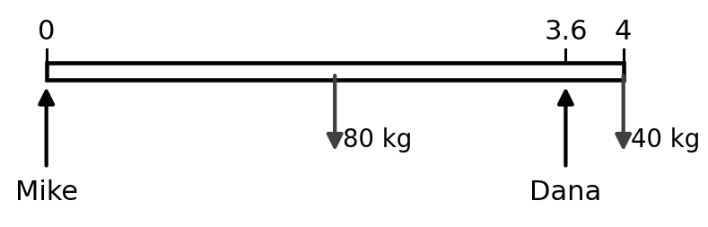
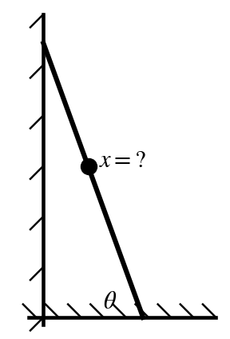
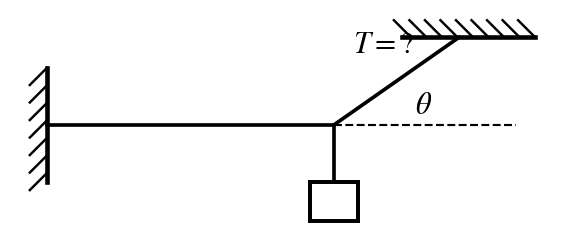
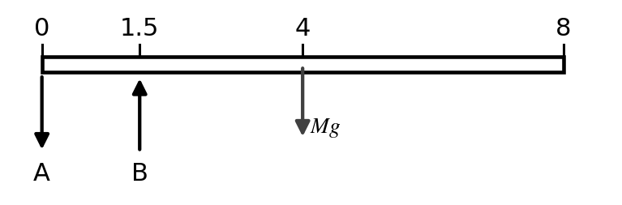
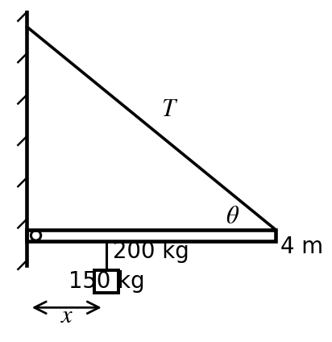
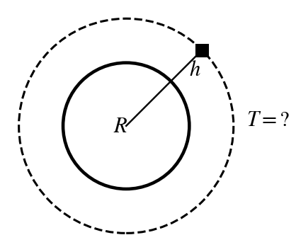
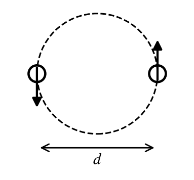

$G = 6.67\times10^{-11}\ \tfrac{\text{N m}^2}{\text{kg}^2}$ $\qquad$ $M_{earth} = 5.98\times10^{24}$ kg $\qquad$ $R_{earth} = 6.37\times10^{6}$ m $\qquad$ $g = 9.8\ \text{m/s}^2$

**Instructions.** Choose the single best answer (a–e). Answers are rounded; pick the nearest choice. For a **maximum** ("how far can he safely…"), pick the largest choice that still works; for a **minimum**, the smallest choice that still works. A calculator and your 3×5 notecard are allowed.

```{=latex}
\needspace{14\baselineskip}
```
::: {layout="[52,48]" layout-valign="top"}
::: {}
**1.** A 80 kg sofa 4 m long is carried by Mike and Dana. Mike has one end; Dana holds the sofa 0.4 m from the other end. A helper sets a 40 kg box of books on the very end of the sofa that Dana is holding. How much force must Dana exert now?

```{=latex}
\begingroup\leftskip=1.5em
```
a)\ 305 N\
b)\ 436 N\
c)\ 588 N\
d)\ 871 N\
e)\ 1,180 N

```{=latex}
\par\endgroup
```

:::


:::

```{=latex}
\medskip
```

```{=latex}
\needspace{14\baselineskip}
```
::: {layout="[64,36]" layout-valign="top"}
::: {}
**2.** A 120 kg man (with the load he carries) climbs a uniform 6 m, 25 kg ladder that leans against a frictionless wall at 70° to the floor. The coefficient of static friction between the ladder and the floor is 0.3. How far up the ladder can he safely climb?

```{=latex}
\begingroup\leftskip=1.5em
```
a)\ 5.0 m\
b)\ 5.5 m\
c)\ 6.0 m\
d)\ 6.5 m\
e)\ 7.0 m

```{=latex}
\par\endgroup
```

:::


:::

```{=latex}
\medskip
```

```{=latex}
\needspace{14\baselineskip}
```
::: {layout="[64,36]" layout-valign="top"}
::: {}
**3.** A 15 kg light hangs from a knot. One cord runs from the knot to the ceiling, making a 35° angle with the ceiling. A second cord is exactly horizontal and is anchored in the wall. What is the tension in the cord connected to the ceiling?

```{=latex}
\begingroup\leftskip=1.5em
```
a)\ 84.3 N\
b)\ 147 N\
c)\ 179 N\
d)\ 210 N\
e)\ 256 N

```{=latex}
\par\endgroup
```

:::


:::

```{=latex}
\medskip
```

```{=latex}
\needspace{10\baselineskip}
```
**4.** A block of jello with $Y = 25{,}000$ N/m² is 2 m wide, 3 m long and 0.15 m high. A 400 kg mass resting on top compresses it. By how much does the height shrink?

```{=latex}
\begingroup\leftskip=1.5em
```
a)\ 0.400 mm\
b)\ 3.92 mm\
c)\ 26.1 mm\
d)\ 52.3 mm\
e)\ 78.4 mm

```{=latex}
\par\endgroup
```

```{=latex}
\medskip
```

```{=latex}
\needspace{10\baselineskip}
```
**5.** A 300 kg load hangs from a circular wire 3 m long with a diameter of 0.0015 m and a Young's modulus of $2\times10^{11}$ N/m². By how much does the wire stretch?

```{=latex}
\begingroup\leftskip=1.5em
```
a)\ 0.00255 m\
b)\ 0.00624 m\
c)\ 0.00832 m\
d)\ 0.0196 m\
e)\ 0.0250 m

```{=latex}
\par\endgroup
```

```{=latex}
\medskip
```

```{=latex}
\needspace{14\baselineskip}
```
::: {layout="[52,48]" layout-valign="top"}
::: {}
**6.** A uniform diving board is 8 m long and has a mass of 600 kg. It rests on two supports: support A at the back end (x = 0) and support B 1.5 m from that end. Nothing is standing on the board. What is the magnitude of the force from support B?

```{=latex}
\begingroup\leftskip=1.5em
```
a)\ 5,880 N\
b)\ 9,800 N\
c)\ 15,700 N\
d)\ 21,600 N\
e)\ 31,400 N

```{=latex}
\par\endgroup
```

:::


:::

```{=latex}
\medskip
```

```{=latex}
\needspace{14\baselineskip}
```
::: {layout="[64,36]" layout-valign="top"}
::: {}
**7.** A seesaw 5 m long pivots at its center. A 20 kg kid sits at one end. How far from the center must a 80 kg adult sit on the other side so that the seesaw balances? The seesaw itself has a mass of 40 kg.

```{=latex}
\begingroup\leftskip=1.5em
```
a)\ 0.417 m\
b)\ 0.625 m\
c)\ 1.25 m\
d)\ 1.88 m\
e)\ 3.12 m

```{=latex}
\par\endgroup
```

:::


:::

```{=latex}
\medskip
```

```{=latex}
\needspace{14\baselineskip}
```
::: {layout="[64,36]" layout-valign="top"}
::: {}
**8.** A uniform 4 m, 200 kg beam sticks straight out from a wall on a hinge. A cable runs from the far end of the beam back to the wall above the hinge, making a 40° angle with the beam. The cable can hold at most $T_{max} = 3{,}000$ N. A 150 kg mass hangs from the beam a distance $x$ from the wall. What is the largest $x$ the cable can support?

```{=latex}
\begingroup\leftskip=1.5em
```
a)\ 0.658 m\
b)\ 0.921 m\
c)\ 1.29 m\
d)\ 2.58 m\
e)\ 3.59 m

```{=latex}
\par\endgroup
```

:::


:::

```{=latex}
\medskip
```

```{=latex}
\needspace{10\baselineskip}
```
**9.** What is the acceleration due to gravity on a 90 kg astronaut at a height of 500 km above the Earth's surface?

```{=latex}
\begingroup\leftskip=1.5em
```
a)\ 8.45 m/s²\
b)\ 9.83 m/s²\
c)\ 1,600 m/s²\
d)\ 2,240 m/s²\
e)\ 3,140 m/s²

```{=latex}
\par\endgroup
```

```{=latex}
\medskip
```

```{=latex}
\needspace{14\baselineskip}
```
::: {layout="[64,36]" layout-valign="top"}
::: {}
**10.** What is the period of a satellite in a circular orbit around the Earth at an altitude of 20,000 km above the Earth's surface?

```{=latex}
\begingroup\leftskip=1.5em
```
a)\ 1.40 hours\
b)\ 1.88 hours\
c)\ 5.92 hours\
d)\ 7.82 hours\
e)\ 11.8 hours

```{=latex}
\par\endgroup
```

:::


:::

```{=latex}
\medskip
```

```{=latex}
\needspace{14\baselineskip}
```
::: {layout="[64,36]" layout-valign="top"}
::: {}
**11.** Two equal-mass stars ($5\times10^{30}$ kg each) orbit their common center of mass, halfway between them. Their separation is $d = 2\times10^{9}$ m. What is the period of their orbit?

```{=latex}
\begingroup\leftskip=1.5em
```
a)\ 3.02 hours\
b)\ 4.27 hours\
c)\ 6.04 hours\
d)\ 8.55 hours\
e)\ 17.1 hours

```{=latex}
\par\endgroup
```

:::


:::

```{=latex}
\medskip
```

```{=latex}
\needspace{10\baselineskip}
```
**12.** A rocket fired straight up from the Earth's surface rises to a maximum height of 600 km. At what speed was it launched? (Ignore air resistance.)

```{=latex}
\begingroup\leftskip=1.5em
```
a)\ 1.66 km/s\
b)\ 2.32 km/s\
c)\ 3.28 km/s\
d)\ 7.56 km/s\
e)\ 11.2 km/s

```{=latex}
\par\endgroup
```

```{=latex}
\medskip
```

```{=latex}
\needspace{10\baselineskip}
```
**13.** The Earth and the moon (mass $8\times10^{22}$ kg) are 380,000 km apart, center to center. How far from the center of the Earth toward the moon, as a percentage of the Earth–moon distance, is the point where the gravitational pull toward the Earth equals the pull toward the moon?

```{=latex}
\begingroup\leftskip=1.5em
```
a)\ 10.4%\
b)\ 50.0%\
c)\ 80.8%\
d)\ 89.6%\
e)\ 98.7%

```{=latex}
\par\endgroup
```

```{=latex}
\medskip
```

```{=latex}
\needspace{10\baselineskip}
```
**14.** What is the escape speed from the surface of the Moon (mass $7.4\times10^{22}$ kg, radius $1.74\times10^{6}$ m)?

```{=latex}
\begingroup\leftskip=1.5em
```
a)\ 1.68 km/s\
b)\ 2.38 km/s\
c)\ 4.76 km/s\
d)\ 6.66 km/s\
e)\ 9.32 km/s

```{=latex}
\par\endgroup
```

```{=latex}
\medskip
```

```{=latex}
\needspace{10\baselineskip}
```
**15.** A satellite is to circle the Earth once every 8 hours. At what altitude above the Earth's surface must it orbit?

```{=latex}
\begingroup\leftskip=1.5em
```
a)\ 13,900 km\
b)\ 20,300 km\
c)\ 62,800 km\
d)\ 91,500 km\
e)\ $1.28\times10^{5}$ km

```{=latex}
\par\endgroup
```

```{=latex}
\medskip
```
