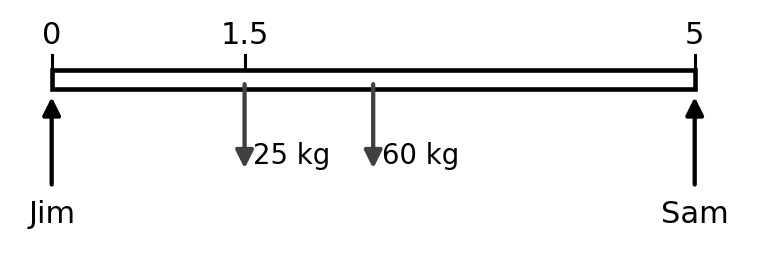
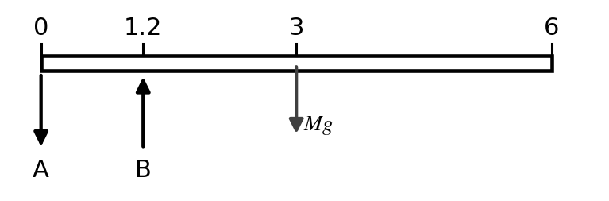
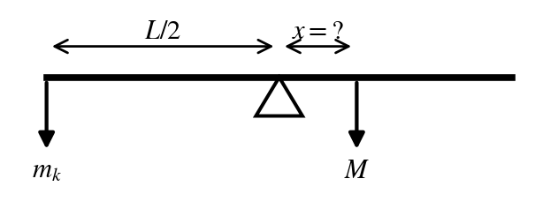
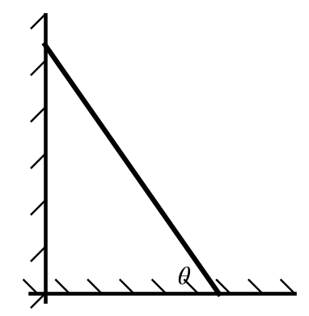
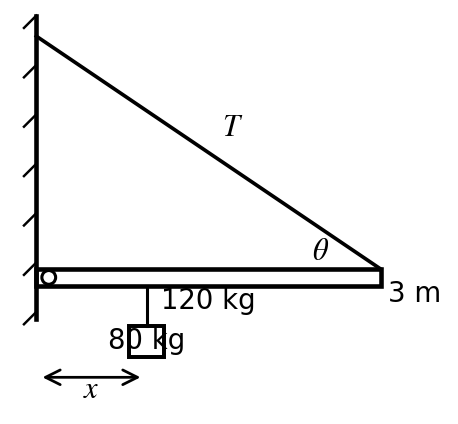
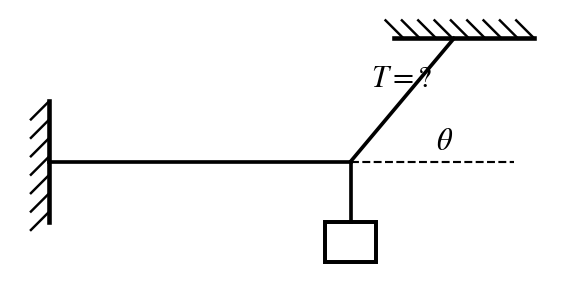
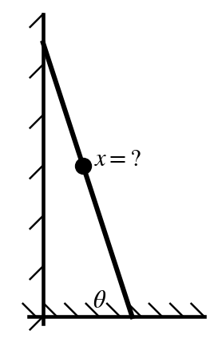
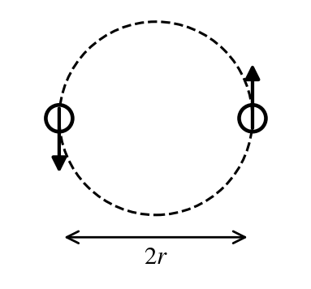

Every numeric answer was computed and checked in `_scripts/build_practice-exam_3_2.py`. Constants are the ones printed on the 2015 Exam 3: $G = 6.67\times10^{-11}$, $M_{earth} = 5.98\times10^{24}$ kg, $R_{earth} = 6.37\times10^{6}$ m, and $g = 9.8$ m/s².

**Sources.** "Ch 12 notes p. 6/10" means page 6 of the professor's *Chapter 12 Statics* notes (he numbers his pages "6/10"). "2015 Exam 3 #2" is question 2 of the previous exam in `Professors-Notes/exam 3-4.pdf`.

Practice Exam 3-2 leans on the **lecture-note examples** with new numbers: the sofa with a child on it, the diving board's back support (which pulls **down**), the seesaw, the minimum ladder angle, the wall beam, the orbit altitude from a period, binary stars, the rocket height, the event horizon, and a planet's orbital speed. It also has the 2015 types: two cords, the wire, the climbing man (a **maximum**), $g$ at an altitude, and the equal-pull point. Every question is a procedure worked in the notes or on the 2015 exam.

| Q | Ans | Answer | Type | Topic (source) | Notecard |
|:-:|:-:|:--|:--|:--|:--|
| 1 | **e** | 466 N | Calc | Two people carry a sofa (Ch 12 p. 4–5) | Sofa / beam |
| 2 | **b** | 5,880 N | Calc | Diving board, support A (Ch 12 p. 3) | Diving board |
| 3 | **b** | 0.800 m | Calc | Seesaw balance (Ch 12 p. 4) | Seesaw |
| 4 | **c** | 55.0° | Calc | Ladder, minimum angle (Ch 12 p. 7) | Ladder |
| 5 | **e** | 2.14 m | Calc | Beam on a wall hinge with a cable ($x_{max}$) (Ch 12 p. 6) | Wall beam + cable |
| 6 | **d** | 154 N | Calc | Light hung by two cords (2015 #3; Ch 12 p. 1) | Two cords |
| 7 | **e** | 0.0535 m | Calc | Young's modulus, wire stretch (Ch 12 p. 10; 2015 #5) | Moduli |
| 8 | **a** | 8.5 m | Max | Man climbing a ladder, $x_{max}$ (Ch 12 p. 8; 2015 #2) | Ladder |
| 9 | **a** | 6.96 m/s² | Calc | $g$ at an altitude (Ch 13 p. 1–2; 2015 #12) | Gravity |
| 10 | **b** | 20,200 km | Calc | Orbit altitude from the period (Ch 13 p. 3) | Orbit |
| 11 | **c** | 65.4 days | Calc | Binary stars, period (Ch 13 p. 4) | Binary stars |
| 12 | **c** | 210 km | Calc | Height reached from the launch speed (Ch 13 p. 7–8) | Rocket |
| 13 | **d** | $5.93\times10^{9}$ m | Calc | Event horizon radius (Ch 13 p. 9) | Escape |
| 14 | **a** | 17.8 km/s | Calc | Orbital speed of a planet (Ch 13 p. 10) | Planet speed |
| 15 | **d** | 87.6% | Calc | Equal-pull point (2015 #13; Ch 13 p. 1) | Equal pull |

```{=latex}
\needspace{8\baselineskip}
```
# 1. Two people carry a sofa — **e) 466 N**

**Source:** Ch 12 notes p. 4/10 (two men carry a sofa: $\sum\tau_{Jim}$, $\sum\tau_{Sam}$) and p. 5/10 (20 kg kid set on the sofa 1 m from Jim).  
**Previous-exam match:** none (lecture-notes example)  
**Notecard:** Sofa / beam  
**What it tests:** torque balance about one carrier to find the other carrier's force.

{width=3.2in fig-align="center"}

**Step 1: pick the pivot at Jim's hands.** A force applied at the pivot has $r = 0$, so its torque is zero and it drops out of the equation. The notes do this on p. 3/10 ("A is eliminated").

**Step 2: torque balance about Jim.** Every force here is vertical and the sofa is horizontal, so each torque is $\tau = rF$, with $r$ measured from Jim. The sofa's weight acts at its center, $L/2$. Sam's upward push is counterclockwise; the weights are clockwise.

$$
\sum\tau_{Jim} = 0:\quad x_{Sam}\,F_{Sam} = \tfrac{L}{2}\,Mg + x_{1}\,m_{1}g
$$

**Step 3: plug in** ($x_{Sam} = 5$ m):

$$
5\ \text{m}\times F_{Sam} = \underbrace{2.5\ \text{m}}_{\text{sofa center}}\,\underbrace{(60)(9.8)}_{\text{sofa weight}} + \underbrace{1.5\ \text{m}}_{\text{child position}}\,\underbrace{(25)(9.8)}_{\text{child weight}}
$$

$$
F_{Sam} = \frac{1{,}838\ \text{N m}}{5\ \text{m}} = 367.5\ \text{N}
$$

**Step 4: forces up = forces down** ($\sum F_y = 0$) gives Jim's share:

$$
F_{Jim} = \underbrace{833.0\ \text{N}}_{\text{total weight}} - \underbrace{367.5\ \text{N}}_{F_{Sam}} = 465.5\ \text{N}
$$

(You can also take torques about Sam directly, as the notes do on p. 5/10 for Jim.)

Why the other choices are wrong:

* a) 47.5 N: forgets $g$ (answers in kg, not N).
* b) 172 N: leaves out the sofa's own weight.
* c) 294 N: leaves out the added load.
* d) 368 N: is the force on Sam, the other person.

```{=latex}
\needspace{8\baselineskip}
```
# 2. Diving board, support A — **b) 5,880 N**

**Source:** Ch 12 notes p. 3/10 (diving board, $L = 10$ m, $M = 1000$ kg: $B = 5Mg$, $A = 4Mg$).  
**Previous-exam match:** none (lecture-notes example)  
**Notecard:** Diving board  
**What it tests:** choosing the pivot to eliminate one support, then $\sum F_y = 0$ (A pulls down).

{width=3.2in fig-align="center"}

**Step 1: draw the forces** (notes p. 3/10). The board's weight $Mg$ acts at its center, $L/2 = 3$ m. B pushes **up**. A must pull **down**, or the board would tip off B.

**Step 2: torque about A** removes A ($r = 0$):

$$
\sum\tau_A = 0:\quad a\,B - \tfrac{L}{2}\,Mg = 0
$$

$$
B = \frac{L/2}{a}\,Mg = \frac{\overbrace{3\ \text{m}}^{L/2}}{\underbrace{1.2\ \text{m}}_{\text{A to B}}}\,\underbrace{(400)(9.8)}_{Mg = 3{,}920\ \text{N}} = 9{,}800\ \text{N}
$$

**Step 3: $\sum F_y = 0$** with B up and A, $Mg$ down:

$$
B - A - Mg = 0 \;\Rightarrow\; A = B - Mg = 9{,}800 - 3{,}920 = 5{,}880\ \text{N}
$$

In the notes ($L = 10$ m, $a = 1$ m) this gives $B = 5Mg$ and $A = 4Mg$.

Why the other choices are wrong:

* a) 3,920 N: is just the board's weight $Mg$.
* c) 9,800 N: is the force from support B, not A.
* d) 13,700 N: gets the direction of A wrong: with A pushing up, $\sum F_y$ gives a nonsense $B + Mg$.
* e) 15,700 N: puts the board's weight at the far end ($L$) instead of its center.

```{=latex}
\needspace{8\baselineskip}
```
# 3. Seesaw balance — **b) 0.800 m**

**Source:** Ch 12 notes p. 4/10 (seesaw, $m_k = 20$ kg, $M = 100$ kg, $x = L/10$).  
**Previous-exam match:** none (lecture-notes example)  
**Notecard:** Seesaw  
**What it tests:** torque balance about the pivot; the seesaw's own mass drops out.

{width=2.6in fig-align="center"}

**Step 1: torque about the center (pivot).** The seesaw's own weight acts at the center, so its lever arm is zero. That's why the notes say its mass "don't care!" The kid is $L/2$ from the pivot; the adult is $x$ from it.

$$
\sum\tau_{center} = 0:\quad \tfrac{L}{2}\,m_k g - x\,M_T g = 0 \;\Rightarrow\; x = \frac{L\,m_k}{2M_T}
$$

$g$ cancels.

**Step 2: plug in:**

$$
x = \frac{\underbrace{4\ \text{m}}_{\text{length}}\,\underbrace{24\ \text{kg}}_{\text{kid}}}{2\,\underbrace{60\ \text{kg}}_{\text{adult}}} = 0.800\ \text{m}
$$

In the notes, $m_k = 20$ kg and $M_T = 100$ kg give $x = L/10$.

Why the other choices are wrong:

* a) 0.533 m: adds the seesaw's mass to the adult's; its weight acts at the pivot and has no torque.
* c) 1.20 m: measures from the end of the seesaw instead of from the center.
* d) 1.60 m: forgets that the kid's lever arm is $L/2$, not $L$.
* e) 2.80 m: adds the half-length.

```{=latex}
\needspace{8\baselineskip}
```
# 4. Ladder, minimum angle — **c) 55.0°**

**Source:** Ch 12 notes p. 7/10 ("ladder leans at $\theta$, what is minimum $\theta$ for it not to slide?" $\theta_{min} = \tan^{-1}\tfrac{1}{2\mu_s}$).  
**Previous-exam match:** none (lecture-notes example)  
**Notecard:** Ladder  
**What it tests:** ladder torque balance about the base; $\theta_{min} = \tan^{-1}(1/2\mu_s)$.

{width=1.5in fig-align="center"}

**Step 1: forces** (notes p. 7/10). Floor: $N = mg$ up and friction $F_f$ toward the wall. Wall (frictionless): $N_w$ only, horizontal. At $\theta_{min}$ friction is at its maximum, $F_f = \mu_s N$, so $N_w = F_f = \mu_s mg$.

**Step 2: torque about the base.** Weight $mg$ acts at $L/2$ with lever arm $\tfrac{L}{2}\cos\theta$; $N_w$ acts at the top with lever arm $L\sin\theta$:

$$
\tfrac{L}{2}\cos\theta\,mg - L\sin\theta\,\mu_s mg = 0 \;\Rightarrow\; \tan\theta = \frac{1}{2\mu_s}
$$

**Step 3: plug in:**

$$
\theta_{min} = \tan^{-1}\frac{1}{2\,\underbrace{(0.35)}_{\mu_s}} = \tan^{-1}(1.429) = 55.0^\circ
$$

$L$ and $m$ both cancel: only $\mu_s$ matters.

Why the other choices are wrong:

* a) 19.3°: is $\tan^{-1}\mu_s$, the angle of a block sliding on a slope, not the ladder.
* b) 35.0°: is $\tan^{-1}(2\mu_s)$, the complement of the right angle (measured from the wall).
* d) 70.7°: drops the $\tfrac12$ (puts the ladder's weight at the top instead of the middle).
* e) 80.3°: No standard mistake gives this value; it is a spacing choice.

```{=latex}
\needspace{8\baselineskip}
```
# 5. Beam on a wall hinge with a cable ($x_{max}$) — **e) 2.14 m**

**Source:** Ch 12 notes p. 6/10 (beam hinged at the wall, cable at $\theta = 30^\circ$, find $x_{max}$); $\tau = rF_\perp$ from p. 1/10.  
**Previous-exam match:** none (lecture-notes example)  
**Notecard:** Wall beam + cable  
**What it tests:** torque about the hinge with the perpendicular part of the tension.

{width=2.4in fig-align="center"}

**Step 1: torque about the hinge** (left end). The notes say "Do torque at left to remove reaction forces": the hinge forces $R_x$, $R_y$ act at $r = 0$.

Only the **perpendicular** part of the tension, $T\sin\theta$, makes torque at the far end ($\tau = rF_\perp$, notes p. 1/10). The beam's weight acts at $L/2$; the mass's weight acts at $x$.

$$
\sum\tau_{left} = 0:\quad -x\,mg - \tfrac{L}{2}\,Mg + L\,T\sin\theta = 0
$$

**Step 2: solve for $x$:**

$$
x = \frac{L}{mg}\left(T\sin\theta - \frac{Mg}{2}\right)
$$

**Step 3: plug in $T = T_{max}$:**

$$
x_{max} = \frac{3\ \text{m}}{\underbrace{(80)(9.8)}_{mg}}\left(\underbrace{(2{,}000)(\sin 35^\circ)}_{T\sin\theta = 1{,}147\ \text{N}} - \underbrace{\frac{(120)(9.8)}{2}}_{Mg/2 = 588.0\ \text{N}}\right) = 2.14\ \text{m}
$$

Notes numbers: $L = 5$ m, $T_{max} = 10^4$ N, $M = 1000$ kg, $m = 100$ kg, $\theta = 30^\circ$ give $x_{max} = 0.510$ m.

Why the other choices are wrong:

* a) 0.390 m: No standard mistake gives this value; it is a spacing choice.
* b) 0.546 m: No standard mistake gives this value; it is a spacing choice.
* c) 0.764 m: No standard mistake gives this value; it is a spacing choice.
* d) 1.07 m: divides by 2 one time too many.

```{=latex}
\needspace{8\baselineskip}
```
# 6. Light hung by two cords — **d) 154 N**

**Source:** 2015 Exam 3 #3, solved with $\sum F_x = \sum F_y = 0$ from Ch 12 notes p. 1/10 ("Static means not moving").  
**Previous-exam match:** 2015 Exam 3 #3 (20 kg light, 40° with the ceiling: 305 N $\rightarrow$ b) 300 N), new numbers  
**Notecard:** Two cords  
**What it tests:** $\sum F_y = 0$ on the knot: $T\sin\theta = mg$.

{width=2.3in fig-align="center"}

**Step 1: forces on the knot** (static, so $\sum F_x = \sum F_y = 0$, notes p. 1/10). Ceiling cord $T$ at $\theta$ above the horizontal; horizontal cord $T_h$; the light's weight $mg$ hangs straight down.

**Step 2: $\sum F_y = 0$.** Only the ceiling cord has a vertical part, $T\sin\theta$:

$$
T\sin\theta = mg \;\Rightarrow\; T = \frac{mg}{\sin\theta} = \frac{\underbrace{(12)(9.8)}_{mg = 117.6\ \text{N}}}{\sin 50^\circ} = 153.5\ \text{N}
$$

Why the other choices are wrong:

* a) 70.5 N: No standard mistake gives this value; it is a spacing choice.
* b) 98.7 N: is the tension in the horizontal cord.
* c) 118 N: is just the light's weight.
* e) 183 N: uses $\cos\theta$: that would be the angle from the vertical.

```{=latex}
\needspace{8\baselineskip}
```
# 7. Young's modulus, wire stretch — **e) 0.0535 m**

**Source:** Ch 12 notes p. 10/10 (Young's modulus $Y = \frac{F/A}{\Delta\ell/\ell}$).  
**Previous-exam match:** 2015 Exam 3 #5 (500 kg, 4.00 m, 0.001 m diameter, $8\times10^{10}$: 0.312 m $\rightarrow$ e) 0.3 m), new numbers  
**Notecard:** Moduli  
**What it tests:** tensile stress/strain with a circular cross-section ($r = d/2$).

**Step 1: the formula** (Ch 12 notes p. 10/10):

$$
Y = \frac{\text{tensile stress}}{\text{tensile strain}} = \frac{F/A}{\Delta\ell/\ell}
$$

**Step 2: the pieces.** The force is the load's weight, and the area is the wire's circular cross-section (radius = half the diameter):

$$
F = mg = (150)(9.8) = 1{,}470\ \text{N}
$$

$$
A = \pi r^2 = \pi\Big(\underbrace{\tfrac{0.001}{2}}_{r}\Big)^2 = 7.854\times10^{-7}\ \text{m}^2
$$

**Step 3: solve for the stretch:**

$$
\Delta\ell = \frac{F\,\ell}{A\,Y} = \frac{\underbrace{(1{,}470)}_{F}\underbrace{(2)}_{\ell}}{\underbrace{(7.854\times10^{-7})}_{A}\underbrace{(7\times10^{10})}_{Y}} = 0.0535\ \text{m}
$$

Why the other choices are wrong:

* a) 0.00546 m: forgets $g$ (uses the mass instead of the weight).
* b) 0.0134 m: uses the diameter as the radius in $A = \pi r^2$.
* c) 0.0267 m: finds the strain $\Delta\ell/\ell$ and stops.
* d) 0.0420 m: uses $A = d^2$ (no $\pi$, no half).

```{=latex}
\needspace{8\baselineskip}
```
# 8. Man climbing a ladder, $x_{max}$ — **a) 8.5 m**

**Source:** Ch 12 notes p. 8/10 (leaning ladder with a man climbing it, $x = \tfrac{L}{M}(\mu_s(M+m)\tan\theta - \tfrac{m}{2})$ = 8.8 m).  
**Previous-exam match:** 2015 Exam 3 #2 (150 kg man, 20 kg ladder, 71°, $\mu = 0.25$, 5 m), new numbers  
**Notecard:** Ladder  
**What it tests:** ladder torque balance with a climber, then the maximum-answer rule.

{width=1.5in fig-align="center"}

**Step 1: forces** (notes p. 8/10). $\sum F_y$: $N = (M + m)g$. $\sum F_x$: $N_w = F_f$, and at the limit $F_f = \mu_s N = \mu_s(M+m)g$.

**Step 2: torque about the base.** Ladder weight at $L/2$ (arm $\tfrac{L}{2}\cos\theta$), man at $x$ (arm $x\cos\theta$), wall force at the top (arm $L\sin\theta$):

$$
\tfrac{L}{2}\cos\theta\,mg + x\cos\theta\,Mg - L\sin\theta\,\mu_s(M+m)g = 0
$$

Cancel $g$, divide by $\cos\theta$:

$$
x = \frac{L}{M}\Big(\mu_s(M+m)\tan\theta - \frac{m}{2}\Big)
$$

**Step 3: plug in** ($\tan 72^\circ = 3.078$):

$$
x = \frac{\overbrace{9}^{L}}{\underbrace{140}_{M}}\Big(\underbrace{(0.3)}_{\mu_s}\underbrace{(155)}_{M+m}(3.078) - \underbrace{\tfrac{15}{2}}_{m/2}\Big) = 8.72\ \text{m}
$$

**Step 4: it's a maximum.** He can go up to 8.72 m; any farther and the ladder slips. The largest choice that still works is **8.5 m**. (On the 2015 exam, $x = 3.78$ m and the answer was b) 3.5 m.)

Why the other choices are wrong:

* b) 9.0 m: is more than the maximum, so it fails.
* c) 9.5 m: is more than the maximum, so it fails.
* d) 10.0 m: is more than the maximum, so it fails.
* e) 10.5 m: is more than the maximum, so it fails.

```{=latex}
\needspace{8\baselineskip}
```
# 9. $g$ at an altitude — **a) 6.96 m/s²**

**Source:** Ch 13 notes p. 1/10 ($g = GM_E/R_E^2 = 9.81$ m/s²) and p. 2/10 ($r = R + h$).  
**Previous-exam match:** 2015 Exam 3 #12 (750 km: 7.87 m/s² $\rightarrow$ b) 8 m/s²), new numbers  
**Notecard:** Gravity  
**What it tests:** $g = GM/r^2$ with $r$ measured from Earth's center.

**Step 1: the formula** (notes p. 1/10): $mg = \dfrac{GMm}{R^2}$, so $g = \dfrac{GM}{R^2}$ at the surface. Above the surface the distance is measured from Earth's **center**: $r = R + h$ (notes p. 2/10).

$$
g = \frac{GM_{earth}}{(R + h)^2}
$$

**Step 2: distance from the center:**

$$
r = \underbrace{6.37\times10^{6}}_{R_{earth}} + \underbrace{1.2\times10^{6}}_{h\ \text{in m}} = 7.570\times10^{6}\ \text{m}
$$

**Step 3: plug in:**

$$
g = \frac{\underbrace{(6.67\times10^{-11})}_{G}\underbrace{(5.98\times10^{24})}_{M_{earth}}}{(7.570\times10^{6})^2} = 6.96\ \text{m/s}^2
$$

Why the other choices are wrong:

* b) 8.25 m/s²: scales by $R/(R+h)$ without squaring.
* c) 9.83 m/s²: uses $R_{earth}$ (surface $g$), ignoring the height.
* d) 277 m/s²: uses $h$ instead of $R + h$ (the 2015 exam's e) 700 m/s² is this mistake).
* e) 388 m/s²: No standard mistake gives this value; it is a spacing choice.

```{=latex}
\needspace{8\baselineskip}
```
# 10. Orbit altitude from the period — **b) 20,200 km**

**Source:** Ch 13 notes p. 3/10 (geosynchronous orbit: $T = 24$ h $\rightarrow$ $r = 4.22\times10^7$ m, $h = 35{,}900$ km).  
**Previous-exam match:** none (lecture-notes example)  
**Notecard:** Orbit  
**What it tests:** the geosynchronous-orbit procedure (notes p. 3): $r = (T^2GM/4\pi^2)^{1/3}$, then $h = r - R$.

**Step 1: solve the period formula for $r$** (notes p. 3/10, geosynchronous orbit):

$$
T^2 = \frac{4\pi^2r^3}{GM} \;\Rightarrow\; r = \left(\frac{T^2GM}{4\pi^2}\right)^{1/3}
$$

**Step 2: period in seconds:** $T = 12\ \text{h} \times 3600\ \text{s/h} = 43{,}200$ s.

**Step 3: plug in:**

$$
r = \left(\frac{\underbrace{(43{,}200)^2}_{T^2}\underbrace{(6.67\times10^{-11})(5.98\times10^{24})}_{GM_{earth}}}{4\pi^2}\right)^{1/3} = 2.662\times10^{7}\ \text{m}
$$

**Step 4: altitude above the surface:**

$$
h = r - R = 2.662\times10^{7} - 6.37\times10^{6} = 2.02\times10^{7}\ \text{m} = 20{,}200\ \text{km}
$$

Notes example: $T = 24$ h gives $r = 4.22\times10^{7}$ m and $h = 35{,}900$ km.

Why the other choices are wrong:

* a) 10,400 km: uses half the period.
* c) 26,600 km: gives $r$ (from Earth's center); forgets to subtract $R$.
* d) 84,300 km: drops the $4\pi^2$.
* e) $1.37\times10^{5}$ km: takes a square root instead of a cube root.

```{=latex}
\needspace{8\baselineskip}
```
# 11. Binary stars, period — **c) 65.4 days**

**Source:** Ch 13 notes p. 4/10 (two equal-mass stars, $T^2 = 16\pi^2r^3/GM$; "separation btwn the masses is $2r$ (not $r$)").  
**Previous-exam match:** none (lecture-notes example)  
**Notecard:** Binary stars  
**What it tests:** $T^2 = 16\pi^2r^3/GM$ with $r$ = half the separation.

{width=1.5in fig-align="center"}

**Step 1: the force uses the separation, the circle uses $r$** (notes p. 4/10). Each star moves on a circle of radius $r$ about the center; the distance between the stars is $2r$:

$$
\frac{GM^2}{(2r)^2} = \frac{Mv^2}{r},\qquad v = \frac{2\pi r}{T}\;\Rightarrow\; T^2 = \frac{16\pi^2 r^3}{GM}
$$

**Step 2: the orbit radius:** $r = 3\times10^{10}\ \text{m}\ (\text{given})$.

**Step 3: plug in:**

$$
T = \sqrt{\frac{16\pi^2(3\times10^{10})^3}{\underbrace{(6.67\times10^{-11})}_{G}\underbrace{(2\times10^{30})}_{M}}} = 5.653\times10^{6}\ \text{s} = 65.4\ \text{days}
$$

Notes example: $M = 2\times10^{30}$ kg, $r = 6\times10^{10}$ m gives 185 days.

Why the other choices are wrong:

* a) 32.7 days: uses the single-planet $4\pi^2$ formula (forgets that the separation is $2r$ in the force).
* b) 46.3 days: uses $2M$ for the mass.
* d) 92.5 days: uses the single-planet formula with $r = d$.
* e) 185 days: uses the separation $d$ as the orbit radius (the notes warn: separation is $2r$, not $r$).

```{=latex}
\needspace{8\baselineskip}
```
# 12. Height reached from the launch speed — **c) 210 km**

**Source:** Ch 13 notes p. 7/10 and p. 8/10 (rocket launch $v_i = 1000$ m/s, $h = \tfrac{2GMR}{2GM - v_i^2R} - R$).  
**Previous-exam match:** none (lecture-notes example)  
**Notecard:** Rocket  
**What it tests:** energy conservation with $U = -GMm/r$, solved for $h$.

**Step 1: conservation of energy** (notes p. 7/10), launch at $r = R$ with speed $v_i$, top at $r$ with speed 0:

$$
-\frac{GMm}{R} + \frac12mv_i^2 = -\frac{GMm}{r} \;\Rightarrow\; r = \frac{1}{\frac1R - \frac{v_i^2}{2GM}} = \frac{2GMR}{2GM - v_i^2R}
$$

**Step 2: plug in** ($2GM = 2(6.67\times10^{-11})(5.98\times10^{24}) = 7.977\times10^{14}$):

$$
r = \frac{\underbrace{(7.977\times10^{14})}_{2GM}\underbrace{(6.37\times10^{6})}_{R}}{7.977\times10^{14} - \underbrace{(2{,}000)^2}_{v_i^2}(6.37\times10^{6})} = 6.5802\times10^{6}\ \text{m}
$$

**Step 3: height above the surface:**

$$
h = r - R = 6.5802\times10^{6} - 6.37\times10^{6} = 2.10\times10^{5}\ \text{m} = 210\ \text{km}
$$

Keep at least 4 significant figures until the subtraction: $r$ and $R$ are close, so early rounding changes the answer. The notes' $v_i = 1000$ m/s example shows $h = 50.73$ km; carried through without rounding, it is 51.4 km.

Why the other choices are wrong:

* a) 107 km: No standard mistake gives this value; it is a spacing choice.
* b) 150 km: No standard mistake gives this value; it is a spacing choice.
* d) 435 km: forgets the $\tfrac12$ in $\tfrac12mv^2$.
* e) 6,580 km: gives $r$, the distance from Earth's center; forgets to subtract $R$.

```{=latex}
\needspace{8\baselineskip}
```
# 13. Event horizon radius — **d) $5.93\times10^{9}$ m**

**Source:** Ch 13 notes p. 9/10 ("if $v_{escape} = c$ … $r$ is the radius of the event horizon", $r = 2GM/c^2$).  
**Previous-exam match:** none (lecture-notes example)  
**Notecard:** Escape  
**What it tests:** setting $v_{esc} = c$: $r = 2GM/c^2$.

**Set $v_{escape} = c$** (notes p. 9/10). Then $r$ is the radius of the event horizon:

$$
c^2 = \frac{2GM}{r} \;\Rightarrow\; r = \frac{2GM}{c^2}
$$

$$
r = \frac{2\,\underbrace{(6.67\times10^{-11})}_{G}\underbrace{(4\times10^{36})}_{M}}{\underbrace{(3\times10^{8})^2}_{c^2}} = 5.93\times10^{9}\ \text{m}
$$

Notes example: $M = 10^{37}$ kg gives $r = 1.48\times10^{10}$ m, about $\tfrac{1}{10}$ the radius of Earth's orbit.

Why the other choices are wrong:

* a) 55,000 m: No standard mistake gives this value; it is a spacing choice.
* b) 77,000 m: takes a square root.
* c) $2.96\times10^{9}$ m: forgets the 2.
* e) $1.19\times10^{10}$ m: uses $4GM$.

```{=latex}
\needspace{8\baselineskip}
```
# 14. Orbital speed of a planet — **a) 17.8 km/s**

**Source:** Ch 13 notes p. 10/10 (orbital speed of planets, $v = \sqrt{GM/r}$ with $GM_{sun} = 1.33\times10^{20}$).  
**Previous-exam match:** none (lecture-notes example)  
**Notecard:** Planet speed  
**What it tests:** $v = \sqrt{GM/r}$ with $r$ converted from AU.

**Gravity is the centripetal force** (notes p. 10/10):

$$
\frac{GMm}{r^2} = \frac{mv^2}{r} \;\Rightarrow\; v = \sqrt{\frac{GM_{sun}}{r}}
$$

**Distance in meters:** $r = 2.8\ \text{AU} \times 1.5\times10^{11}\ \text{m/AU} = 4.200\times10^{11}$ m.

$$
v = \sqrt{\frac{\underbrace{(6.67\times10^{-11})(2\times10^{30})}_{GM_{sun} = 1.33\times10^{20}}}{4.200\times10^{11}}} = 17{,}820\ \text{m/s} = 17.8\ \text{km/s}
$$

The notes' table on p. 10/10 gives Earth 29.8 km/s and Jupiter 13.1 km/s: "only a factor of 10" across the planets.

Why the other choices are wrong:

* b) 25.2 km/s: uses $\sqrt{2GM/r}$ (escape speed).
* c) 29.8 km/s: uses 1 AU (Earth's distance).
* d) 41.7 km/s: No standard mistake gives this value; it is a spacing choice.
* e) 58.4 km/s: No standard mistake gives this value; it is a spacing choice.

```{=latex}
\needspace{8\baselineskip}
```
# 15. Equal-pull point — **d) 87.6%**

**Source:** 2015 Exam 3 #13, solved with $F = GMm/r^2$ from Ch 13 notes p. 1/10.  
**Previous-exam match:** 2015 Exam 3 #13 (moon $7\times10^{22}$ kg, 400,000 km: 90.2% $\rightarrow$ b) 90%), new numbers  
**Notecard:** Equal pull  
**What it tests:** setting two inverse-square pulls equal: $x/d = k/(1+k)$, $k = \sqrt{M_E/M_b}$.

**Step 1: set the two pulls equal** with Newton's law (Ch 13 notes p. 1/10). Let $x$ be the distance from Earth's center, so the distance to the moon is $d - x$. The test mass $m$ cancels:

$$
\frac{GM_Em}{x^2} = \frac{GM_bm}{(d - x)^2} \;\Rightarrow\; \frac{x}{d - x} = \sqrt{\frac{M_E}{M_b}}
$$

**Step 2: the square root:**

$$
k = \sqrt{\frac{\overbrace{5.98\times10^{24}}^{M_E}}{\underbrace{1.2\times10^{23}}_{M_b}}} = 7.059
$$

**Step 3: solve for the fraction:** $x = k(d - x)$, so

$$
\frac{x}{d} = \frac{k}{1 + k} = \frac{7.059}{8.059} = 0.8759 = 87.6\%
$$

The distance doesn't matter for the percentage; only the mass ratio does.

Why the other choices are wrong:

* a) 12.4%: gives the distance from the moon's center.
* b) 50.0%: assumes the halfway point.
* c) 78.6%: uses a cube root.
* e) 98.0%: uses the mass ratio without the square root.
