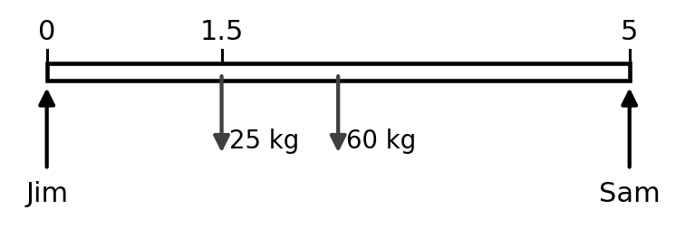
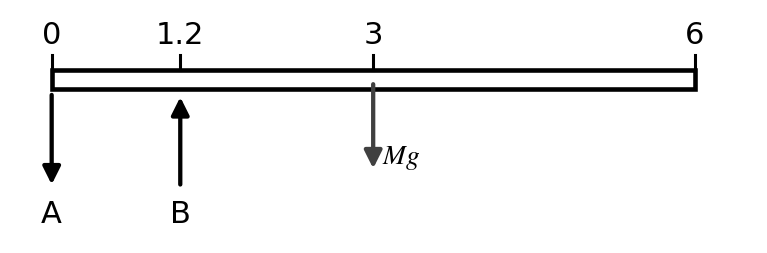
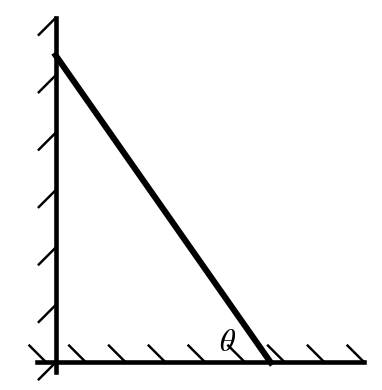
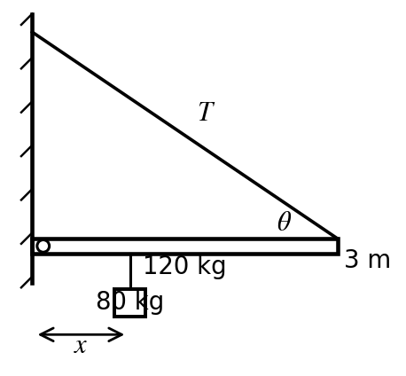
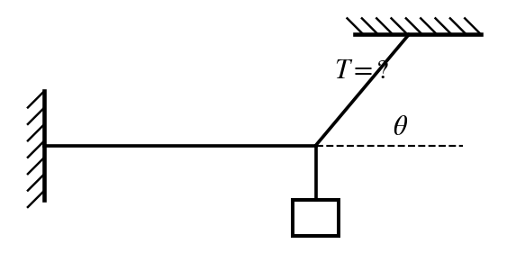
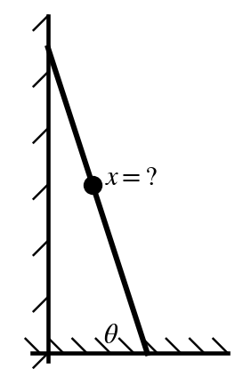
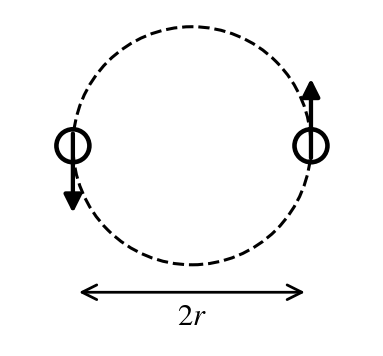

$G = 6.67\times10^{-11}\ \tfrac{\text{N m}^2}{\text{kg}^2}$ $\qquad$ $M_{earth} = 5.98\times10^{24}$ kg $\qquad$ $R_{earth} = 6.37\times10^{6}$ m $\qquad$ $g = 9.8\ \text{m/s}^2$

**Instructions.** Choose the single best answer (a–e). Answers are rounded; pick the nearest choice. For a **maximum** ("how far can he safely…"), pick the largest choice that still works; for a **minimum**, the smallest choice that still works. A calculator and your 3×5 notecard are allowed.

```{=latex}
\needspace{14\baselineskip}
```
::: {layout="[52,48]" layout-valign="top"}
::: {}
**1.** Jim and Sam each hold one end of a uniform 5 m, 60 kg sofa. A 25 kg child is placed on the sofa 1.5 m from Jim. How much force must Jim exert now?

```{=latex}
\begingroup\leftskip=1.5em
```
a)\ 47.5 N\
b)\ 172 N\
c)\ 294 N\
d)\ 368 N\
e)\ 466 N

```{=latex}
\par\endgroup
```

:::


:::

```{=latex}
\medskip
```

```{=latex}
\needspace{14\baselineskip}
```
::: {layout="[52,48]" layout-valign="top"}
::: {}
**2.** A uniform diving board is 6 m long and has a mass of 400 kg. It rests on two supports: support A at the back end (x = 0) and support B 1.2 m from that end. Nothing is standing on the board. What is the magnitude of the force from support A?

```{=latex}
\begingroup\leftskip=1.5em
```
a)\ 3,920 N\
b)\ 5,880 N\
c)\ 9,800 N\
d)\ 13,700 N\
e)\ 15,700 N

```{=latex}
\par\endgroup
```

:::


:::

```{=latex}
\medskip
```

```{=latex}
\needspace{14\baselineskip}
```
::: {layout="[64,36]" layout-valign="top"}
::: {}
**3.** A seesaw 4 m long pivots at its center. A 24 kg kid sits at one end. How far from the center must a 60 kg adult sit on the other side so that the seesaw balances? The seesaw itself has a mass of 30 kg.

```{=latex}
\begingroup\leftskip=1.5em
```
a)\ 0.533 m\
b)\ 0.800 m\
c)\ 1.20 m\
d)\ 1.60 m\
e)\ 2.80 m

```{=latex}
\par\endgroup
```

:::


:::

```{=latex}
\medskip
```

```{=latex}
\needspace{14\baselineskip}
```
::: {layout="[64,36]" layout-valign="top"}
::: {}
**4.** A uniform ladder leans against a frictionless wall. The coefficient of static friction between the ladder and the floor is $\mu_s = 0.35$. What is the minimum angle $\theta$ between the ladder and the floor at which the ladder will not slide?

```{=latex}
\begingroup\leftskip=1.5em
```
a)\ 19.3°\
b)\ 35.0°\
c)\ 55.0°\
d)\ 70.7°\
e)\ 80.3°

```{=latex}
\par\endgroup
```

:::


:::

```{=latex}
\medskip
```

```{=latex}
\needspace{14\baselineskip}
```
::: {layout="[64,36]" layout-valign="top"}
::: {}
**5.** A uniform 3 m, 120 kg beam sticks straight out from a wall on a hinge. A cable runs from the far end of the beam back to the wall above the hinge, making a 35° angle with the beam. The cable can hold at most $T_{max} = 2{,}000$ N. A 80 kg mass hangs from the beam a distance $x$ from the wall. What is the largest $x$ the cable can support?

```{=latex}
\begingroup\leftskip=1.5em
```
a)\ 0.390 m\
b)\ 0.546 m\
c)\ 0.764 m\
d)\ 1.07 m\
e)\ 2.14 m

```{=latex}
\par\endgroup
```

:::


:::

```{=latex}
\medskip
```

```{=latex}
\needspace{14\baselineskip}
```
::: {layout="[64,36]" layout-valign="top"}
::: {}
**6.** A 12 kg light hangs from a knot. One cord runs from the knot to the ceiling, making a 50° angle with the ceiling. A second cord is exactly horizontal and is anchored in the wall. What is the tension in the cord connected to the ceiling?

```{=latex}
\begingroup\leftskip=1.5em
```
a)\ 70.5 N\
b)\ 98.7 N\
c)\ 118 N\
d)\ 154 N\
e)\ 183 N

```{=latex}
\par\endgroup
```

:::


:::

```{=latex}
\medskip
```

```{=latex}
\needspace{10\baselineskip}
```
**7.** A 150 kg load hangs from a circular wire 2 m long with a diameter of 0.001 m and a Young's modulus of $7\times10^{10}$ N/m². By how much does the wire stretch?

```{=latex}
\begingroup\leftskip=1.5em
```
a)\ 0.00546 m\
b)\ 0.0134 m\
c)\ 0.0267 m\
d)\ 0.0420 m\
e)\ 0.0535 m

```{=latex}
\par\endgroup
```

```{=latex}
\medskip
```

```{=latex}
\needspace{14\baselineskip}
```
::: {layout="[64,36]" layout-valign="top"}
::: {}
**8.** A 140 kg man (with the load he carries) climbs a uniform 9 m, 15 kg ladder that leans against a frictionless wall at 72° to the floor. The coefficient of static friction between the ladder and the floor is 0.3. How far up the ladder can he safely climb?

```{=latex}
\begingroup\leftskip=1.5em
```
a)\ 8.5 m\
b)\ 9.0 m\
c)\ 9.5 m\
d)\ 10.0 m\
e)\ 10.5 m

```{=latex}
\par\endgroup
```

:::


:::

```{=latex}
\medskip
```

```{=latex}
\needspace{10\baselineskip}
```
**9.** What is the acceleration due to gravity at a height of 1{,}200 km above the Earth's surface?

```{=latex}
\begingroup\leftskip=1.5em
```
a)\ 6.96 m/s²\
b)\ 8.25 m/s²\
c)\ 9.83 m/s²\
d)\ 277 m/s²\
e)\ 388 m/s²

```{=latex}
\par\endgroup
```

```{=latex}
\medskip
```

```{=latex}
\needspace{10\baselineskip}
```
**10.** A satellite is to circle the Earth once every 12 hours. At what altitude above the Earth's surface must it orbit?

```{=latex}
\begingroup\leftskip=1.5em
```
a)\ 10,400 km\
b)\ 20,200 km\
c)\ 26,600 km\
d)\ 84,300 km\
e)\ $1.37\times10^{5}$ km

```{=latex}
\par\endgroup
```

```{=latex}
\medskip
```

```{=latex}
\needspace{14\baselineskip}
```
::: {layout="[64,36]" layout-valign="top"}
::: {}
**11.** Two stars, each with the mass of the Sun ($2\times10^{30}$ kg), circle their common center of mass. Each star moves on a circle of radius $3\times10^{10}$ m. What is the period?

```{=latex}
\begingroup\leftskip=1.5em
```
a)\ 32.7 days\
b)\ 46.3 days\
c)\ 65.4 days\
d)\ 92.5 days\
e)\ 185 days

```{=latex}
\par\endgroup
```

:::


:::

```{=latex}
\medskip
```

```{=latex}
\needspace{10\baselineskip}
```
**12.** A rocket is launched straight up from the Earth's surface at 2,000 m/s. How high above the surface does it rise? (Ignore air resistance.)

```{=latex}
\begingroup\leftskip=1.5em
```
a)\ 107 km\
b)\ 150 km\
c)\ 210 km\
d)\ 435 km\
e)\ 6,580 km

```{=latex}
\par\endgroup
```

```{=latex}
\medskip
```

```{=latex}
\needspace{10\baselineskip}
```
**13.** A black hole has a mass of $4\times10^{36}$ kg. If its escape speed equals the speed of light ($c = 3\times10^{8}$ m/s), what is the radius of its event horizon?

```{=latex}
\begingroup\leftskip=1.5em
```
a)\ 55,000 m\
b)\ 77,000 m\
c)\ $2.96\times10^{9}$ m\
d)\ $5.93\times10^{9}$ m\
e)\ $1.19\times10^{10}$ m

```{=latex}
\par\endgroup
```

```{=latex}
\medskip
```

```{=latex}
\needspace{10\baselineskip}
```
**14.** An asteroid orbits the Sun at 2.8 AU (1 AU $= 1.5\times10^{11}$ m, $M_{sun} = 2\times10^{30}$ kg). Treating the orbit as a circle, what is its orbital speed?

```{=latex}
\begingroup\leftskip=1.5em
```
a)\ 17.8 km/s\
b)\ 25.2 km/s\
c)\ 29.8 km/s\
d)\ 41.7 km/s\
e)\ 58.4 km/s

```{=latex}
\par\endgroup
```

```{=latex}
\medskip
```

```{=latex}
\needspace{10\baselineskip}
```
**15.** The Earth and the moon (mass $1.2\times10^{23}$ kg) are 500,000 km apart, center to center. How far from the center of the Earth toward the moon, as a percentage of the Earth–moon distance, is the point where the gravitational pull toward the Earth equals the pull toward the moon?

```{=latex}
\begingroup\leftskip=1.5em
```
a)\ 12.4%\
b)\ 50.0%\
c)\ 78.6%\
d)\ 87.6%\
e)\ 98.0%

```{=latex}
\par\endgroup
```

```{=latex}
\medskip
```
