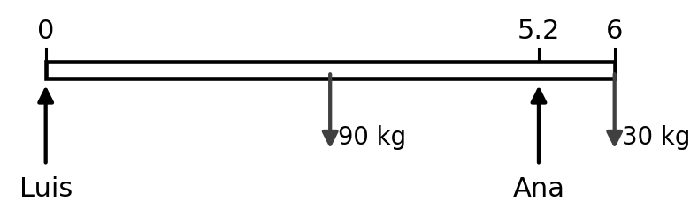
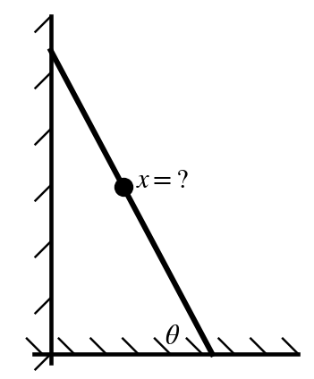
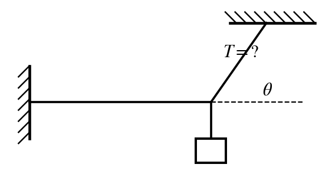
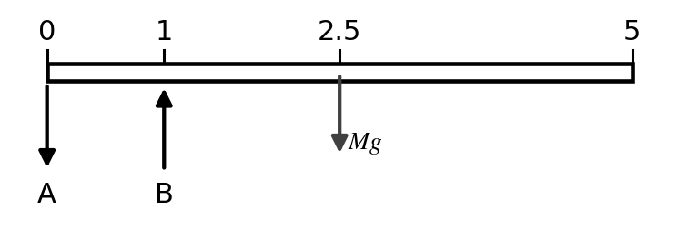
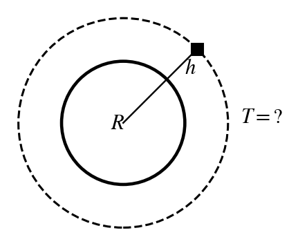
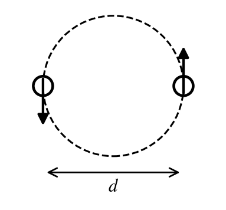

Every numeric answer was computed and checked in `_scripts/build_practice-exam_3_3.py`. Constants are the ones printed on the 2015 Exam 3: $G = 6.67\times10^{-11}$, $M_{earth} = 5.98\times10^{24}$ kg, $R_{earth} = 6.37\times10^{6}$ m, and $g = 9.8$ m/s².

**Sources.** "Ch 12 notes p. 6/10" means page 6 of the professor's *Chapter 12 Statics* notes (he numbers his pages "6/10"). "2015 Exam 3 #2" is question 2 of the previous exam in `Professors-Notes/exam 3-4.pdf`.

Practice Exam 3-3 mixes the 2015 Exam 3 types (sofa with a load on the end, the climbing man, two cords, the wire, the jello block, $g$ at an altitude, satellite period, launch speed, binary stars, the equal-pull point) with notes examples: the angle needed to reach the top of the ladder, the diving board, the seesaw, the rocket height, and escape speed. Question 2 is a **maximum**: pick the largest choice that still works. Every question is a procedure worked in the notes or on the 2015 exam.

| Q | Ans | Answer | Type | Topic (source) | Notecard |
|:-:|:-:|:--|:--|:--|:--|
| 1 | **e** | 848 N | Calc | Two people carry a sofa (Ch 12 p. 4–5; 2015 #1) | Sofa / beam |
| 2 | **a** | 5.5 m | Max | Man climbing a ladder, $x_{max}$ (Ch 12 p. 8; 2015 #2) | Ladder |
| 3 | **e** | 61.2° | Calc | Ladder angle to reach the top (Ch 12 p. 9) | Ladder |
| 4 | **d** | 299 N | Calc | Light hung by two cords (2015 #3; Ch 12 p. 1) | Two cords |
| 5 | **d** | 13.0 mm | Calc | Young's modulus, wire stretch (Ch 12 p. 10; 2015 #5) | Moduli |
| 6 | **b** | 2.35 mm | Calc | Young's modulus, compressed block (2015 #4; Ch 12 p. 10) | Moduli |
| 7 | **c** | 7,350 N | Calc | Diving board, support B (Ch 12 p. 3) | Diving board |
| 8 | **b** | 0.450 m | Calc | Seesaw balance (Ch 12 p. 4) | Seesaw |
| 9 | **a** | 8.97 m/s² | Calc | $g$ at an altitude (Ch 13 p. 1–2; 2015 #12) | Gravity |
| 10 | **e** | 101 min | Calc | Satellite period (Ch 13 p. 2; 2015 #10) | Orbit |
| 11 | **a** | 493 km | Calc | Height reached from the launch speed (Ch 13 p. 7–8) | Rocket |
| 12 | **b** | 5.47 km/s | Calc | Launch speed to reach a height (Ch 13 p. 7–8; 2015 #9) | Rocket |
| 13 | **c** | 5.01 km/s | Calc | Escape speed (Ch 13 p. 9) | Escape |
| 14 | **d** | 89.9% | Calc | Equal-pull point (2015 #13; Ch 13 p. 1) | Equal pull |
| 15 | **c** | 87.2 hours | Calc | Binary stars, period (Ch 13 p. 4; 2015 #11) | Binary stars |

```{=latex}
\needspace{8\baselineskip}
```
# 1. Two people carry a sofa — **e) 848 N**

**Source:** Ch 12 notes p. 4/10 (two men carry a sofa: $\sum\tau_{Jim}$, $\sum\tau_{Sam}$) and p. 5/10 (20 kg kid set on the sofa 1 m from Jim).  
**Previous-exam match:** 2015 Exam 3 #1 (sofa + box of books on Sarah's end), new numbers  
**Notecard:** Sofa / beam  
**What it tests:** torque balance about one carrier to find the other carrier's force.

{width=3.2in fig-align="center"}

**Step 1: pick the pivot at Luis's hands.** A force applied at the pivot has $r = 0$, so its torque is zero and it drops out of the equation. The notes do this on p. 3/10 ("A is eliminated").

**Step 2: torque balance about Luis.** Every force here is vertical and the sofa is horizontal, so each torque is $\tau = rF$, with $r$ measured from Luis. The sofa's weight acts at its center, $L/2$. Ana's upward push is counterclockwise; the weights are clockwise.

$$
\sum\tau_{Luis} = 0:\quad x_{Ana}\,F_{Ana} = \tfrac{L}{2}\,Mg + x_{1}\,m_{1}g
$$

**Step 3: plug in** ($x_{Ana} = 5.2$ m):

$$
5.2\ \text{m}\times F_{Ana} = \underbrace{3\ \text{m}}_{\text{sofa center}}\,\underbrace{(90)(9.8)}_{\text{sofa weight}} + \underbrace{6\ \text{m}}_{\text{crate position}}\,\underbrace{(30)(9.8)}_{\text{crate weight}}
$$

$$
F_{Ana} = \frac{4{,}410\ \text{N m}}{5.2\ \text{m}} = 848.1\ \text{N}
$$

Why the other choices are wrong:

* a) 328 N: is the force on Luis, the other person.
* b) 509 N: leaves out the added load.
* c) 588 N: splits the total weight evenly; that is only true with nothing extra and both at the ends.
* d) 735 N: uses 6 m (the full length) as Ana's lever arm instead of 5.2 m.

```{=latex}
\needspace{8\baselineskip}
```
# 2. Man climbing a ladder, $x_{max}$ — **a) 5.5 m**

**Source:** Ch 12 notes p. 8/10 (leaning ladder with a man climbing it, $x = \tfrac{L}{M}(\mu_s(M+m)\tan\theta - \tfrac{m}{2})$ = 8.8 m).  
**Previous-exam match:** 2015 Exam 3 #2 (150 kg man, 20 kg ladder, 71°, $\mu = 0.25$, 5 m), new numbers  
**Notecard:** Ladder  
**What it tests:** ladder torque balance with a climber, then the maximum-answer rule.

{width=1.5in fig-align="center"}

**Step 1: forces** (notes p. 8/10). $\sum F_y$: $N = (M + m)g$. $\sum F_x$: $N_w = F_f$, and at the limit $F_f = \mu_s N = \mu_s(M+m)g$.

**Step 2: torque about the base.** Ladder weight at $L/2$ (arm $\tfrac{L}{2}\cos\theta$), man at $x$ (arm $x\cos\theta$), wall force at the top (arm $L\sin\theta$):

$$
\tfrac{L}{2}\cos\theta\,mg + x\cos\theta\,Mg - L\sin\theta\,\mu_s(M+m)g = 0
$$

Cancel $g$, divide by $\cos\theta$:

$$
x = \frac{L}{M}\Big(\mu_s(M+m)\tan\theta - \frac{m}{2}\Big)
$$

**Step 3: plug in** ($\tan 62^\circ = 1.881$):

$$
x = \frac{\overbrace{8}^{L}}{\underbrace{110}_{M}}\Big(\underbrace{(0.35)}_{\mu_s}\underbrace{(140)}_{M+m}(1.881) - \underbrace{\tfrac{30}{2}}_{m/2}\Big) = 5.61\ \text{m}
$$

**Step 4: it's a maximum.** He can go up to 5.61 m; any farther and the ladder slips. The largest choice that still works is **5.5 m**. (On the 2015 exam, $x = 3.78$ m and the answer was b) 3.5 m.)

Why the other choices are wrong:

* b) 6.0 m: is more than the maximum, so it fails.
* c) 6.5 m: is more than the maximum, so it fails.
* d) 7.0 m: is more than the maximum, so it fails.
* e) 7.5 m: is more than the maximum, so it fails.

```{=latex}
\needspace{8\baselineskip}
```
# 3. Ladder angle to reach the top — **e) 61.2°**

**Source:** Ch 12 notes p. 9/10 ("He can climb to $x = L$, what $\theta$ is minimum?" $\theta_{min} = \tan^{-1}\tfrac{M + m/2}{(M+m)\mu_s} = 67.6^\circ$).  
**Previous-exam match:** none (lecture-notes example)  
**Notecard:** Ladder  
**What it tests:** the notes p. 9 procedure: solve for $\theta$ with $x = L$.

**Step 1: start from the climbing result** (notes p. 8/10), $xM = \mu_s L(M+m)\tan\theta - \tfrac{mL}{2}$, and set $x = L$ (notes p. 9/10, "He can climb to $x = L$, what $\theta$ is minimum?"):

$$
LM + L\frac{m}{2} = \mu_s L(M+m)\tan\theta \;\Rightarrow\; \tan\theta = \frac{M + m/2}{(M+m)\mu_s}
$$

$L$ cancels, so the ladder's length doesn't matter.

**Step 2: plug in:**

$$
\theta_{min} = \tan^{-1}\frac{\overbrace{90 + 10}^{M + m/2}}{\underbrace{(110)}_{M+m}\underbrace{(0.5)}_{\mu_s}} = \tan^{-1}(1.818) = 61.2^\circ
$$

Notes numbers ($M = 150$, $m = 10$, $\mu_s = 0.4$): $\tan^{-1}(155/64) = 67.6^\circ$.

Why the other choices are wrong:

* a) 14.7°: No standard mistake gives this value; it is a spacing choice.
* b) 20.6°: No standard mistake gives this value; it is a spacing choice.
* c) 28.8°: is the angle from the wall, not from the floor.
* d) 45.0°: is $\theta_{min}$ for the empty ladder (p. 7/10); it ignores the man.

```{=latex}
\needspace{8\baselineskip}
```
# 4. Light hung by two cords — **d) 299 N**

**Source:** 2015 Exam 3 #3, solved with $\sum F_x = \sum F_y = 0$ from Ch 12 notes p. 1/10 ("Static means not moving").  
**Previous-exam match:** 2015 Exam 3 #3 (20 kg light, 40° with the ceiling: 305 N $\rightarrow$ b) 300 N), new numbers  
**Notecard:** Two cords  
**What it tests:** $\sum F_y = 0$ on the knot: $T\sin\theta = mg$.

{width=2.3in fig-align="center"}

**Step 1: forces on the knot** (static, so $\sum F_x = \sum F_y = 0$, notes p. 1/10). Ceiling cord $T$ at $\theta$ above the horizontal; horizontal cord $T_h$; the light's weight $mg$ hangs straight down.

**Step 2: $\sum F_y = 0$.** Only the ceiling cord has a vertical part, $T\sin\theta$:

$$
T\sin\theta = mg \;\Rightarrow\; T = \frac{mg}{\sin\theta} = \frac{\underbrace{(25)(9.8)}_{mg = 245.0\ \text{N}}}{\sin 55^\circ} = 299.1\ \text{N}
$$

Why the other choices are wrong:

* a) 172 N: is the tension in the horizontal cord.
* b) 201 N: multiplies by $\sin\theta$ instead of dividing.
* c) 245 N: is just the light's weight.
* e) 427 N: uses $\cos\theta$: that would be the angle from the vertical.

```{=latex}
\needspace{8\baselineskip}
```
# 5. Young's modulus, wire stretch — **d) 13.0 mm**

**Source:** Ch 12 notes p. 10/10 (Young's modulus $Y = \frac{F/A}{\Delta\ell/\ell}$).  
**Previous-exam match:** 2015 Exam 3 #5 (500 kg, 4.00 m, 0.001 m diameter, $8\times10^{10}$: 0.312 m $\rightarrow$ e) 0.3 m), new numbers  
**Notecard:** Moduli  
**What it tests:** tensile stress/strain with a circular cross-section ($r = d/2$).

**Step 1: the formula** (Ch 12 notes p. 10/10):

$$
Y = \frac{\text{tensile stress}}{\text{tensile strain}} = \frac{F/A}{\Delta\ell/\ell}
$$

**Step 2: the pieces.** The force is the load's weight, and the area is the wire's circular cross-section (radius = half the diameter):

$$
F = mg = (200)(9.8) = 1{,}960\ \text{N}
$$

$$
A = \pi r^2 = \pi\Big(\underbrace{\tfrac{0.002}{2}}_{r}\Big)^2 = 3.142\times10^{-6}\ \text{m}^2
$$

**Step 3: solve for the stretch:**

$$
\Delta\ell = \frac{F\,\ell}{A\,Y} = \frac{\underbrace{(1{,}960)}_{F}\underbrace{(2.5)}_{\ell}}{\underbrace{(3.142\times10^{-6})}_{A}\underbrace{(1.2\times10^{11})}_{Y}} = 0.0130\ \text{m}
$$

Why the other choices are wrong:

* a) 1.33 mm: forgets $g$ (uses the mass instead of the weight).
* b) 3.25 mm: uses the diameter as the radius in $A = \pi r^2$.
* c) 10.2 mm: uses $A = d^2$ (no $\pi$, no half).
* e) 52.0 mm: uses $r = d/4$ (halves the radius twice).

```{=latex}
\needspace{8\baselineskip}
```
# 6. Young's modulus, compressed block — **b) 2.35 mm**

**Source:** 2015 Exam 3 #4, solved with Young's modulus from Ch 12 notes p. 10/10.  
**Previous-exam match:** 2015 Exam 3 #4 (jello 3 m × 4 m × 0.1 m, 500 kg: 1.36 mm $\rightarrow$ e) 1.3 mm), new numbers  
**Notecard:** Moduli  
**What it tests:** compressive stress on the top face, strain = $\Delta h/h$.

**Step 1: the formula** (Ch 12 notes p. 10/10), with compression instead of stretch:

$$
Y = \frac{F/A}{\Delta h/h} \;\Rightarrow\; \Delta h = \frac{F\,h}{A\,Y}
$$

**Step 2: the pieces.** The mass pushes down on the **top** face, so $A$ = width × length. $h$ is the original height.

$$
F = (150)(9.8) = 1{,}470\ \text{N}
$$

$$
A = (0.5)(0.5) = 0.2500\ \text{m}^2
$$

**Step 3: plug in:**

$$
\Delta h = \frac{\underbrace{(1{,}470)}_{F}\underbrace{(0.2)}_{h}}{\underbrace{(0.2500)}_{\text{top area}}\underbrace{(5\times10^{5})}_{Y}} = 0.00235\ \text{m} = 2.35\ \text{mm}
$$

Why the other choices are wrong:

* a) 0.240 mm: forgets $g$.
* c) 5.88 mm: uses a side face ($w \times h$) as the area.
* d) 11.8 mm: finds the strain and stops (forgets to multiply by the height).
* e) 16.5 mm: No standard mistake gives this value; it is a spacing choice.

```{=latex}
\needspace{8\baselineskip}
```
# 7. Diving board, support B — **c) 7,350 N**

**Source:** Ch 12 notes p. 3/10 (diving board, $L = 10$ m, $M = 1000$ kg: $B = 5Mg$, $A = 4Mg$).  
**Previous-exam match:** none (lecture-notes example)  
**Notecard:** Diving board  
**What it tests:** choosing the pivot to eliminate one support, then $\sum F_y = 0$ (A pulls down).

{width=3.2in fig-align="center"}

**Step 1: draw the forces** (notes p. 3/10). The board's weight $Mg$ acts at its center, $L/2 = 2.5$ m. B pushes **up**. A must pull **down**, or the board would tip off B.

**Step 2: torque about A** removes A ($r = 0$):

$$
\sum\tau_A = 0:\quad a\,B - \tfrac{L}{2}\,Mg = 0
$$

$$
B = \frac{L/2}{a}\,Mg = \frac{\overbrace{2.5\ \text{m}}^{L/2}}{\underbrace{1\ \text{m}}_{\text{A to B}}}\,\underbrace{(300)(9.8)}_{Mg = 2{,}940\ \text{N}} = 7{,}350\ \text{N}
$$

**Step 3: $\sum F_y = 0$** with B up and A, $Mg$ down:

$$
B - A - Mg = 0 \;\Rightarrow\; A = B - Mg = 7{,}350 - 2{,}940 = 4{,}410\ \text{N}
$$

In the notes ($L = 10$ m, $a = 1$ m) this gives $B = 5Mg$ and $A = 4Mg$.

Why the other choices are wrong:

* a) 2,940 N: is just the board's weight $Mg$.
* b) 4,410 N: is the force from support A, not B.
* d) 10,300 N: adds $Mg$ instead of subtracting it.
* e) 14,700 N: puts the board's weight at the far end ($L$) instead of its center ($L/2$).

```{=latex}
\needspace{8\baselineskip}
```
# 8. Seesaw balance — **b) 0.450 m**

**Source:** Ch 12 notes p. 4/10 (seesaw, $m_k = 20$ kg, $M = 100$ kg, $x = L/10$).  
**Previous-exam match:** none (lecture-notes example)  
**Notecard:** Seesaw  
**What it tests:** torque balance about the pivot; the seesaw's own mass drops out.

{width=2.6in fig-align="center"}

**Step 1: torque about the center (pivot).** The seesaw's own weight acts at the center, so its lever arm is zero. That's why the notes say its mass "don't care!" The kid is $L/2$ from the pivot; the adult is $x$ from it.

$$
\sum\tau_{center} = 0:\quad \tfrac{L}{2}\,m_k g - x\,M_T g = 0 \;\Rightarrow\; x = \frac{L\,m_k}{2M_T}
$$

$g$ cancels.

**Step 2: plug in:**

$$
x = \frac{\underbrace{3.6\ \text{m}}_{\text{length}}\,\underbrace{18\ \text{kg}}_{\text{kid}}}{2\,\underbrace{72\ \text{kg}}_{\text{adult}}} = 0.450\ \text{m}
$$

In the notes, $m_k = 20$ kg and $M_T = 100$ kg give $x = L/10$.

Why the other choices are wrong:

* a) 0.321 m: No standard mistake gives this value; it is a spacing choice.
* c) 0.900 m: forgets that the kid's lever arm is $L/2$, not $L$.
* d) 1.35 m: measures from the end of the seesaw instead of from the center.
* e) 2.25 m: adds the half-length.

```{=latex}
\needspace{8\baselineskip}
```
# 9. $g$ at an altitude — **a) 8.97 m/s²**

**Source:** Ch 13 notes p. 1/10 ($g = GM_E/R_E^2 = 9.81$ m/s²) and p. 2/10 ($r = R + h$).  
**Previous-exam match:** 2015 Exam 3 #12 (750 km: 7.87 m/s² $\rightarrow$ b) 8 m/s²), new numbers  
**Notecard:** Gravity  
**What it tests:** $g = GM/r^2$ with $r$ measured from Earth's center.

**Step 1: the formula** (notes p. 1/10): $mg = \dfrac{GMm}{R^2}$, so $g = \dfrac{GM}{R^2}$ at the surface. Above the surface the distance is measured from Earth's **center**: $r = R + h$ (notes p. 2/10).

$$
g = \frac{GM_{earth}}{(R + h)^2}
$$

**Step 2: distance from the center:**

$$
r = \underbrace{6.37\times10^{6}}_{R_{earth}} + \underbrace{3\times10^{5}}_{h\ \text{in m}} = 6.670\times10^{6}\ \text{m}
$$

**Step 3: plug in:**

$$
g = \frac{\underbrace{(6.67\times10^{-11})}_{G}\underbrace{(5.98\times10^{24})}_{M_{earth}}}{(6.670\times10^{6})^2} = 8.97\ \text{m/s}^2
$$

The person's mass cancels ($mg = GMm/r^2$); it's extra information.

Why the other choices are wrong:

* b) 12.6 m/s²: No standard mistake gives this value; it is a spacing choice.
* c) 17.6 m/s²: No standard mistake gives this value; it is a spacing choice.
* d) 24.6 m/s²: No standard mistake gives this value; it is a spacing choice.
* e) 34.4 m/s²: No standard mistake gives this value; it is a spacing choice.

```{=latex}
\needspace{8\baselineskip}
```
# 10. Satellite period — **e) 101 min**

**Source:** Ch 13 notes p. 2/10 (satellite orbiting a planet, $T^2 = 4\pi^2r^3/GM$, $r = R + h$; $h = 400$ km $\rightarrow$ 92.4 min).  
**Previous-exam match:** 2015 Exam 3 #10 (altitude $10^8$ m: 3.99 days $\rightarrow$ d) 4 days), new numbers  
**Notecard:** Orbit  
**What it tests:** $T^2 = 4\pi^2r^3/GM$ with $r = R + h$.

{width=1.5in fig-align="center"}

**Step 1: gravity supplies the centripetal force** (notes p. 2/10):

$$
\frac{GMm}{r^2} = \frac{mv^2}{r},\qquad v = \frac{2\pi r}{T}\;\Rightarrow\; T^2 = \frac{4\pi^2 r^3}{GM}
$$

The satellite's mass $m$ cancels.

**Step 2: orbit radius from Earth's center:**

$$
r = \underbrace{6.37\times10^{6}}_{R} + \underbrace{8\times10^{5}}_{h} = 7.170\times10^{6}\ \text{m}
$$

**Step 3: plug in:**

$$
T = \sqrt{\frac{4\pi^2(7.170\times10^{6})^3}{\underbrace{(6.67\times10^{-11})(5.98\times10^{24})}_{GM_{earth}}}} = 6{,}040\ \text{s}
$$

**Step 4: convert:** $6{,}040\ \text{s} = 101$ min.

Notes example: $h = 400$ km gives $T = 5546$ s = 92.4 min (low Earth orbit).

Why the other choices are wrong:

* a) 3.75 min: uses $h$ instead of $r = R + h$.
* b) 16.0 min: drops the $4\pi^2$ (forgets the $2\pi$ in $v = 2\pi r/T$).
* c) 50.3 min: uses $\pi$ instead of $2\pi$.
* d) 84.3 min: uses $R_{earth}$ (an orbit skimming the surface).

```{=latex}
\needspace{8\baselineskip}
```
# 11. Height reached from the launch speed — **a) 493 km**

**Source:** Ch 13 notes p. 7/10 and p. 8/10 (rocket launch $v_i = 1000$ m/s, $h = \tfrac{2GMR}{2GM - v_i^2R} - R$).  
**Previous-exam match:** none (lecture-notes example)  
**Notecard:** Rocket  
**What it tests:** energy conservation with $U = -GMm/r$, solved for $h$.

**Step 1: conservation of energy** (notes p. 7/10), launch at $r = R$ with speed $v_i$, top at $r$ with speed 0:

$$
-\frac{GMm}{R} + \frac12mv_i^2 = -\frac{GMm}{r} \;\Rightarrow\; r = \frac{1}{\frac1R - \frac{v_i^2}{2GM}} = \frac{2GMR}{2GM - v_i^2R}
$$

**Step 2: plug in** ($2GM = 2(6.67\times10^{-11})(5.98\times10^{24}) = 7.977\times10^{14}$):

$$
r = \frac{\underbrace{(7.977\times10^{14})}_{2GM}\underbrace{(6.37\times10^{6})}_{R}}{7.977\times10^{14} - \underbrace{(3{,}000)^2}_{v_i^2}(6.37\times10^{6})} = 6.8632\times10^{6}\ \text{m}
$$

**Step 3: height above the surface:**

$$
h = r - R = 6.8632\times10^{6} - 6.37\times10^{6} = 4.93\times10^{5}\ \text{m} = 493\ \text{km}
$$

Keep at least 4 significant figures until the subtraction: $r$ and $R$ are close, so early rounding changes the answer. The notes' $v_i = 1000$ m/s example shows $h = 50.73$ km; carried through without rounding, it is 51.4 km.

Why the other choices are wrong:

* b) 918 km: uses $v^2/g$.
* c) 1,070 km: forgets the $\tfrac12$ in $\tfrac12mv^2$.
* d) 6,860 km: gives $r$, the distance from Earth's center; forgets to subtract $R$.
* e) 9,600 km: No standard mistake gives this value; it is a spacing choice.

```{=latex}
\needspace{8\baselineskip}
```
# 12. Launch speed to reach a height — **b) 5.47 km/s**

**Source:** Ch 13 notes p. 7/10 ($U = -GMm/r$, energy conservation) and p. 8/10 ("given a target altitude $h = 1000$ km, what $v$ to launch?" 4119 m/s).  
**Previous-exam match:** 2015 Exam 3 #9 (1000 km), new numbers  
**Notecard:** Rocket  
**What it tests:** energy conservation with $U = -GMm/r$, solved for $v$.

**Step 1: conservation of energy** (notes p. 7–8/10). At launch $r = R$, speed $v$; at the top $r = R + h$, speed 0. Gravitational PE is $U = -GMm/r$:

$$
-\frac{GMm}{R} + \frac12mv^2 = -\frac{GMm}{r} \;\Rightarrow\; v = \sqrt{2GM\Big(\frac1R - \frac1r\Big)}
$$

**Step 2: top of the flight:** $r = R + h = 6.37\times10^{6} + 2\times10^{6} = 8.370\times10^{6}$ m.

**Step 3: plug in:**

$$
v = \sqrt{2\,\underbrace{(6.67\times10^{-11})(5.98\times10^{24})}_{GM_{earth}}\Big(\underbrace{\frac{1}{6.37\times10^{6}}}_{1/R} - \underbrace{\frac{1}{8.370\times10^{6}}}_{1/r}\Big)} = 5{,}470\ \text{m/s} = 5.47\ \text{km/s}
$$

Notes example: $h = 1000$ km needs $v = 4119$ m/s.

Why the other choices are wrong:

* a) 3.87 km/s: forgets the 2 from $\tfrac12mv^2$.
* c) 6.26 km/s: uses $mgh$ (constant $g$), which is wrong this far up.
* d) 11.2 km/s: is the escape speed.
* e) 15.7 km/s: No standard mistake gives this value; it is a spacing choice.

```{=latex}
\needspace{8\baselineskip}
```
# 13. Escape speed — **c) 5.01 km/s**

**Source:** Ch 13 notes p. 9/10 ($v_{escape} = \sqrt{2GM/R}$ = 11.2 km/s for Earth).  
**Previous-exam match:** none (lecture-notes example)  
**Notecard:** Escape  
**What it tests:** $v_{esc} = \sqrt{2GM/R}$.

**Step 1: energy conservation** (notes p. 9/10). To escape, the object just reaches $r = \infty$ with $v = 0$, where $U = 0$ and $K = 0$:

$$
-\frac{GMm}{R} + \frac{mv^2}{2} = 0 + 0 \;\Rightarrow\; v_{esc} = \sqrt{\frac{2GM}{R}}
$$

**Step 2: plug in:**

$$
v_{esc} = \sqrt{\frac{2\,\underbrace{(6.67\times10^{-11})}_{G}\underbrace{(6.4\times10^{23})}_{M}}{\underbrace{3.4\times10^{6}}_{R}}} = 5{,}011\ \text{m/s} = 5.01\ \text{km/s}
$$

For Earth the notes get 11,181 m/s, about 11.2 km/s.

Why the other choices are wrong:

* a) 2.53 km/s: No standard mistake gives this value; it is a spacing choice.
* b) 3.54 km/s: forgets the 2 (that is the orbital speed at the surface).
* d) 10.0 km/s: doubles the answer.
* e) 14.0 km/s: No standard mistake gives this value; it is a spacing choice.

```{=latex}
\needspace{8\baselineskip}
```
# 14. Equal-pull point — **d) 89.9%**

**Source:** 2015 Exam 3 #13, solved with $F = GMm/r^2$ from Ch 13 notes p. 1/10.  
**Previous-exam match:** 2015 Exam 3 #13 (moon $7\times10^{22}$ kg, 400,000 km: 90.2% $\rightarrow$ b) 90%), new numbers  
**Notecard:** Equal pull  
**What it tests:** setting two inverse-square pulls equal: $x/d = k/(1+k)$, $k = \sqrt{M_E/M_b}$.

**Step 1: set the two pulls equal** with Newton's law (Ch 13 notes p. 1/10). Let $x$ be the distance from Earth's center, so the distance to the moon is $d - x$. The test mass $m$ cancels:

$$
\frac{GM_Em}{x^2} = \frac{GM_bm}{(d - x)^2} \;\Rightarrow\; \frac{x}{d - x} = \sqrt{\frac{M_E}{M_b}}
$$

**Step 2: the square root:**

$$
k = \sqrt{\frac{\overbrace{5.98\times10^{24}}^{M_E}}{\underbrace{7.475\times10^{22}}_{M_b}}} = 8.944
$$

**Step 3: solve for the fraction:** $x = k(d - x)$, so

$$
\frac{x}{d} = \frac{k}{1 + k} = \frac{8.944}{9.944} = 0.8994 = 89.9\%
$$

The distance doesn't matter for the percentage; only the mass ratio does.

Why the other choices are wrong:

* a) 10.1%: gives the distance from the moon's center.
* b) 50.0%: assumes the halfway point.
* c) 81.2%: uses a cube root.
* e) 98.8%: uses the mass ratio without the square root.

```{=latex}
\needspace{8\baselineskip}
```
# 15. Binary stars, period — **c) 87.2 hours**

**Source:** Ch 13 notes p. 4/10 (two equal-mass stars, $T^2 = 16\pi^2r^3/GM$; "separation btwn the masses is $2r$ (not $r$)").  
**Previous-exam match:** 2015 Exam 3 #11 ($10^{31}$ kg each, $d = 10^8$ m: 2.9 min $\rightarrow$ a) 3 minutes), new numbers  
**Notecard:** Binary stars  
**What it tests:** $T^2 = 16\pi^2r^3/GM$ with $r$ = half the separation.

{width=1.5in fig-align="center"}

**Step 1: the force uses the separation, the circle uses $r$** (notes p. 4/10). Each star moves on a circle of radius $r$ about the center; the distance between the stars is $2r$:

$$
\frac{GM^2}{(2r)^2} = \frac{Mv^2}{r},\qquad v = \frac{2\pi r}{T}\;\Rightarrow\; T^2 = \frac{16\pi^2 r^3}{GM}
$$

**Step 2: the orbit radius:** $r = d/2 = 5\times10^{9}\ \text{m}$.

**Step 3: plug in:**

$$
T = \sqrt{\frac{16\pi^2(5\times10^{9})^3}{\underbrace{(6.67\times10^{-11})}_{G}\underbrace{(3\times10^{30})}_{M}}} = 3.141\times10^{5}\ \text{s} = 87.2\ \text{hours}
$$

Notes example: $M = 2\times10^{30}$ kg, $r = 6\times10^{10}$ m gives 185 days.

Why the other choices are wrong:

* a) 43.6 hours: uses the single-planet $4\pi^2$ formula (forgets that the separation is $2r$ in the force).
* b) 61.7 hours: uses $2M$ for the mass.
* d) 123 hours: uses the single-planet formula with $r = d$.
* e) 247 hours: uses the separation $d$ as the orbit radius (the notes warn: separation is $2r$, not $r$).
