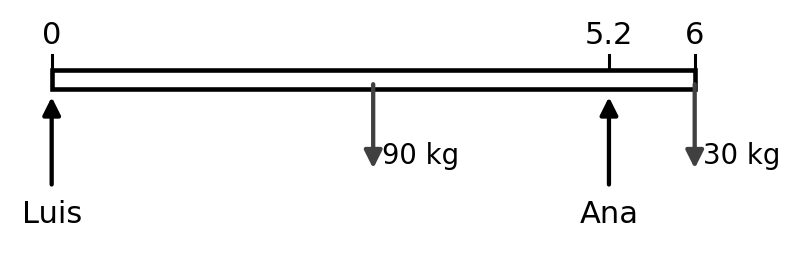
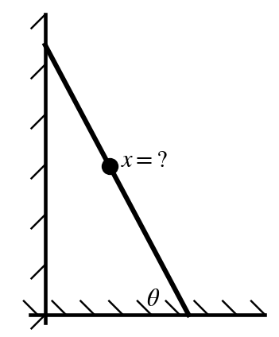
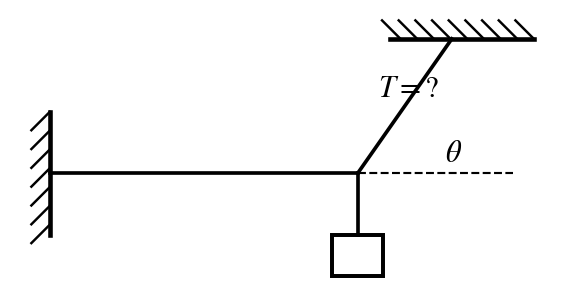
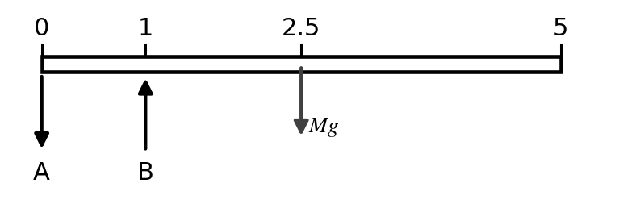
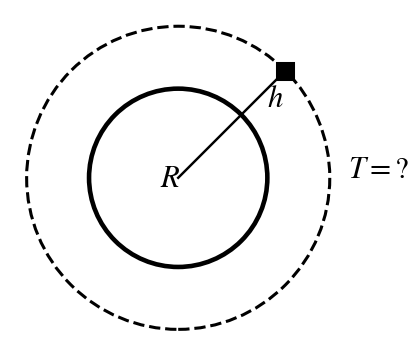
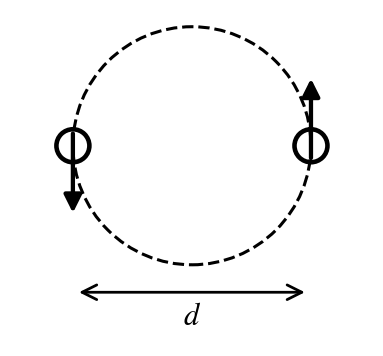

$G = 6.67\times10^{-11}\ \tfrac{\text{N m}^2}{\text{kg}^2}$ $\qquad$ $M_{earth} = 5.98\times10^{24}$ kg $\qquad$ $R_{earth} = 6.37\times10^{6}$ m $\qquad$ $g = 9.8\ \text{m/s}^2$

**Instructions.** Choose the single best answer (a–e). Answers are rounded; pick the nearest choice. For a **maximum** ("how far can he safely…"), pick the largest choice that still works; for a **minimum**, the smallest choice that still works. A calculator and your 3×5 notecard are allowed.

```{=latex}
\needspace{14\baselineskip}
```
::: {layout="[52,48]" layout-valign="top"}
::: {}
**1.** A 90 kg sofa 6 m long is carried by Luis and Ana. Luis has one end; Ana holds the sofa 0.8 m from the other end. A helper sets a 30 kg crate on the very end of the sofa that Ana is holding. How much force must Ana exert now?

```{=latex}
\begingroup\leftskip=1.5em
```
a)\ 328 N\
b)\ 509 N\
c)\ 588 N\
d)\ 735 N\
e)\ 848 N

```{=latex}
\par\endgroup
```

:::


:::

```{=latex}
\medskip
```

```{=latex}
\needspace{14\baselineskip}
```
::: {layout="[64,36]" layout-valign="top"}
::: {}
**2.** A 110 kg man (with the load he carries) climbs a uniform 8 m, 30 kg ladder that leans against a frictionless wall at 62° to the floor. The coefficient of static friction between the ladder and the floor is 0.35. How far up the ladder can he safely climb?

```{=latex}
\begingroup\leftskip=1.5em
```
a)\ 5.5 m\
b)\ 6.0 m\
c)\ 6.5 m\
d)\ 7.0 m\
e)\ 7.5 m

```{=latex}
\par\endgroup
```

:::


:::

```{=latex}
\medskip
```

```{=latex}
\needspace{10\baselineskip}
```
**3.** A 90 kg man (plus load) wants to climb all the way to the top of a uniform 7 m, 20 kg ladder leaning against a frictionless wall. The coefficient of static friction with the floor is 0.5. What is the minimum angle between the ladder and the floor that lets him reach the top without the ladder slipping?

```{=latex}
\begingroup\leftskip=1.5em
```
a)\ 14.7°\
b)\ 20.6°\
c)\ 28.8°\
d)\ 45.0°\
e)\ 61.2°

```{=latex}
\par\endgroup
```

```{=latex}
\medskip
```

```{=latex}
\needspace{14\baselineskip}
```
::: {layout="[64,36]" layout-valign="top"}
::: {}
**4.** A 25 kg light hangs from a knot. One cord runs from the knot to the ceiling, making a 55° angle with the ceiling. A second cord is exactly horizontal and is anchored in the wall. What is the tension in the cord connected to the ceiling?

```{=latex}
\begingroup\leftskip=1.5em
```
a)\ 172 N\
b)\ 201 N\
c)\ 245 N\
d)\ 299 N\
e)\ 427 N

```{=latex}
\par\endgroup
```

:::


:::

```{=latex}
\medskip
```

```{=latex}
\needspace{10\baselineskip}
```
**5.** A 200 kg load hangs from a circular wire 2.5 m long with a diameter of 0.002 m and a Young's modulus of $1.2\times10^{11}$ N/m². By how much does the wire stretch?

```{=latex}
\begingroup\leftskip=1.5em
```
a)\ 1.33 mm\
b)\ 3.25 mm\
c)\ 10.2 mm\
d)\ 13.0 mm\
e)\ 52.0 mm

```{=latex}
\par\endgroup
```

```{=latex}
\medskip
```

```{=latex}
\needspace{10\baselineskip}
```
**6.** A block of rubber with $Y = 5\times10^{5}$ N/m² is 0.5 m wide, 0.5 m long and 0.2 m high. A 150 kg mass resting on top compresses it. By how much does the height shrink?

```{=latex}
\begingroup\leftskip=1.5em
```
a)\ 0.240 mm\
b)\ 2.35 mm\
c)\ 5.88 mm\
d)\ 11.8 mm\
e)\ 16.5 mm

```{=latex}
\par\endgroup
```

```{=latex}
\medskip
```

```{=latex}
\needspace{14\baselineskip}
```
::: {layout="[52,48]" layout-valign="top"}
::: {}
**7.** A uniform diving board is 5 m long and has a mass of 300 kg. It rests on two supports: support A at the back end (x = 0) and support B 1 m from that end. Nothing is standing on the board. What is the magnitude of the force from support B?

```{=latex}
\begingroup\leftskip=1.5em
```
a)\ 2,940 N\
b)\ 4,410 N\
c)\ 7,350 N\
d)\ 10,300 N\
e)\ 14,700 N

```{=latex}
\par\endgroup
```

:::


:::

```{=latex}
\medskip
```

```{=latex}
\needspace{14\baselineskip}
```
::: {layout="[64,36]" layout-valign="top"}
::: {}
**8.** A seesaw 3.6 m long pivots at its center. A 18 kg kid sits at one end. How far from the center must a 72 kg adult sit on the other side so that the seesaw balances?

```{=latex}
\begingroup\leftskip=1.5em
```
a)\ 0.321 m\
b)\ 0.450 m\
c)\ 0.900 m\
d)\ 1.35 m\
e)\ 2.25 m

```{=latex}
\par\endgroup
```

:::


:::

```{=latex}
\medskip
```

```{=latex}
\needspace{10\baselineskip}
```
**9.** What is the acceleration due to gravity on a 75 kg astronaut at a height of 300 km above the Earth's surface?

```{=latex}
\begingroup\leftskip=1.5em
```
a)\ 8.97 m/s²\
b)\ 12.6 m/s²\
c)\ 17.6 m/s²\
d)\ 24.6 m/s²\
e)\ 34.4 m/s²

```{=latex}
\par\endgroup
```

```{=latex}
\medskip
```

```{=latex}
\needspace{14\baselineskip}
```
::: {layout="[64,36]" layout-valign="top"}
::: {}
**10.** What is the period of a satellite (mass 500 kg) in a circular orbit around the Earth at an altitude of 800 km above the Earth's surface?

```{=latex}
\begingroup\leftskip=1.5em
```
a)\ 3.75 min\
b)\ 16.0 min\
c)\ 50.3 min\
d)\ 84.3 min\
e)\ 101 min

```{=latex}
\par\endgroup
```

:::


:::

```{=latex}
\medskip
```

```{=latex}
\needspace{10\baselineskip}
```
**11.** A rocket is launched straight up from the Earth's surface at 3,000 m/s. How high above the surface does it rise? (Ignore air resistance.)

```{=latex}
\begingroup\leftskip=1.5em
```
a)\ 493 km\
b)\ 918 km\
c)\ 1,070 km\
d)\ 6,860 km\
e)\ 9,600 km

```{=latex}
\par\endgroup
```

```{=latex}
\medskip
```

```{=latex}
\needspace{10\baselineskip}
```
**12.** A rocket fired straight up from the Earth's surface rises to a maximum height of 2,000 km. At what speed was it launched? (Ignore air resistance.)

```{=latex}
\begingroup\leftskip=1.5em
```
a)\ 3.87 km/s\
b)\ 5.47 km/s\
c)\ 6.26 km/s\
d)\ 11.2 km/s\
e)\ 15.7 km/s

```{=latex}
\par\endgroup
```

```{=latex}
\medskip
```

```{=latex}
\needspace{10\baselineskip}
```
**13.** What is the escape speed from the surface of a small planet (mass $6.4\times10^{23}$ kg, radius $3.4\times10^{6}$ m)?

```{=latex}
\begingroup\leftskip=1.5em
```
a)\ 2.53 km/s\
b)\ 3.54 km/s\
c)\ 5.01 km/s\
d)\ 10.0 km/s\
e)\ 14.0 km/s

```{=latex}
\par\endgroup
```

```{=latex}
\medskip
```

```{=latex}
\needspace{10\baselineskip}
```
**14.** The Earth and the moon (mass $7.475\times10^{22}$ kg) are 400,000 km apart, center to center. How far from the center of the Earth toward the moon, as a percentage of the Earth–moon distance, is the point where the gravitational pull toward the Earth equals the pull toward the moon?

```{=latex}
\begingroup\leftskip=1.5em
```
a)\ 10.1%\
b)\ 50.0%\
c)\ 81.2%\
d)\ 89.9%\
e)\ 98.8%

```{=latex}
\par\endgroup
```

```{=latex}
\medskip
```

```{=latex}
\needspace{14\baselineskip}
```
::: {layout="[64,36]" layout-valign="top"}
::: {}
**15.** Two equal-mass stars ($3\times10^{30}$ kg each) orbit their common center of mass, halfway between them. Their separation is $d = 1\times10^{10}$ m. What is the period of their orbit?

```{=latex}
\begingroup\leftskip=1.5em
```
a)\ 43.6 hours\
b)\ 61.7 hours\
c)\ 87.2 hours\
d)\ 123 hours\
e)\ 247 hours

```{=latex}
\par\endgroup
```

:::


:::

```{=latex}
\medskip
```
